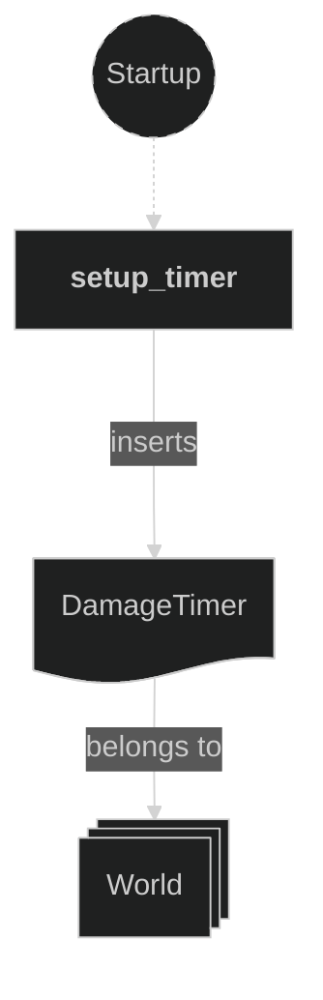
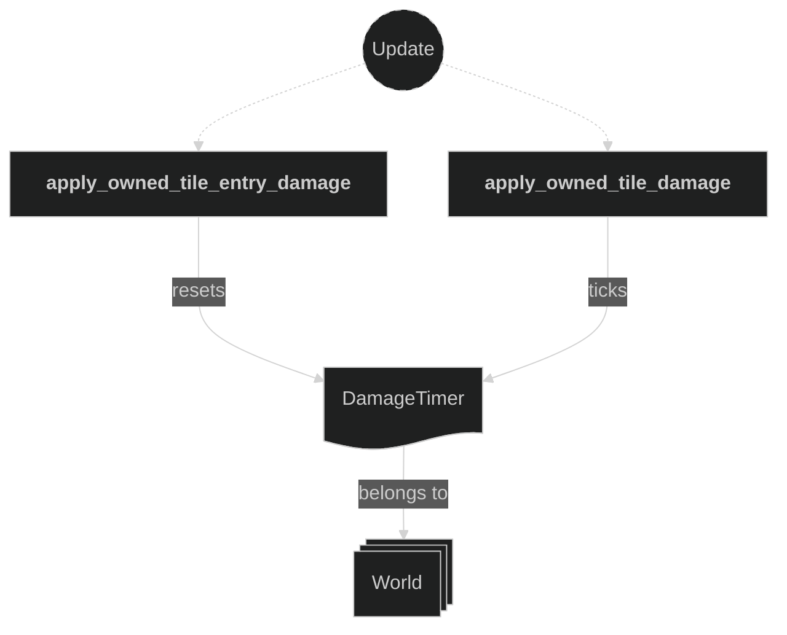
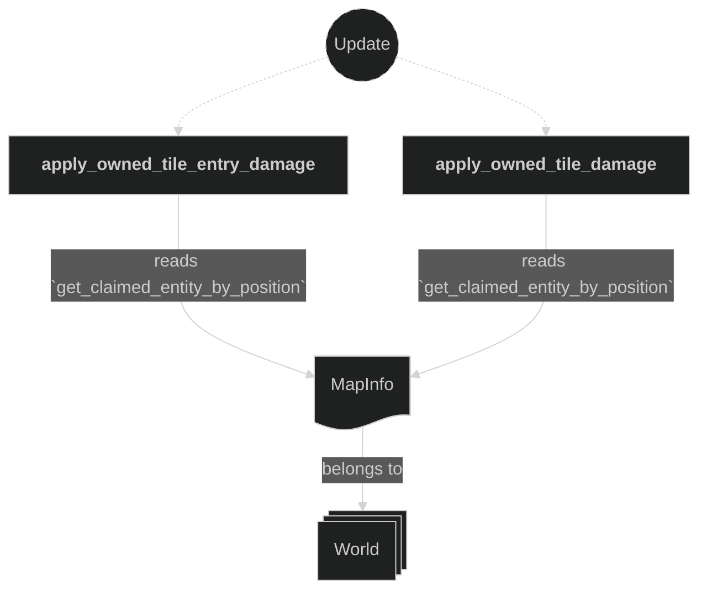
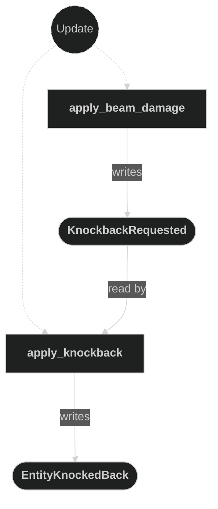
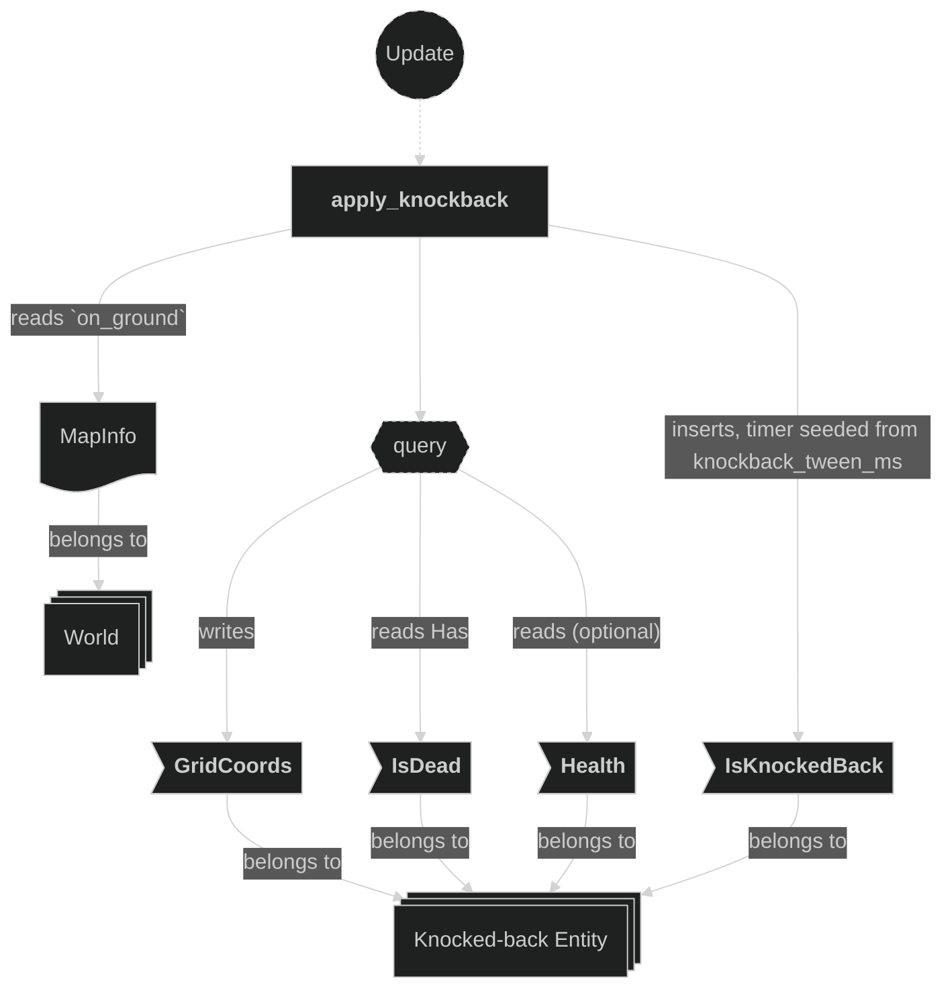
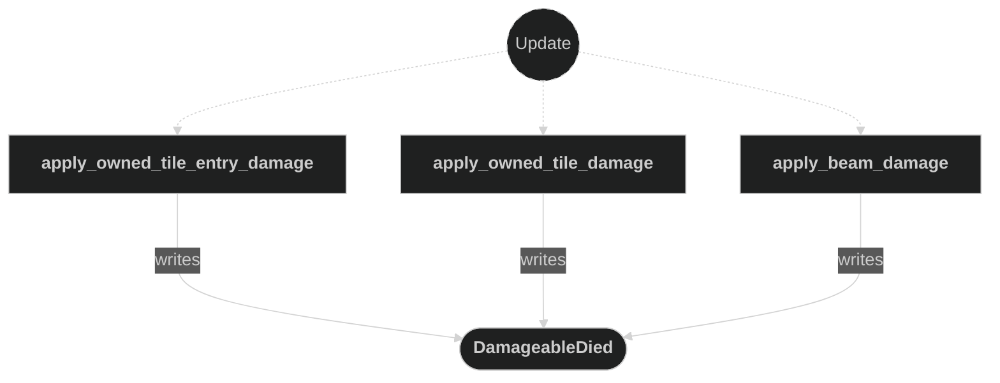

# Damage Plugin

Contains systems responsible for dealing damage to entities and emitting `DamageableDied` messages when an entity's HP reaches zero. The plugin also owns knockback: it moves knocked-back entities and holds the `IsKnockedBack` input lock. Three sources of damage are handled: on-enter tile damage the moment a character moves onto an opponent-owned tile *from a non-hostile tile*, periodic tile damage while a character stays on such a tile, and per-step beam damage for any entity sharing a grid position with a moving beam. A private `deal_damage` helper centralises the decrement-and-emit logic used by every source, and a private `is_hostile_tile` helper centralises the "is this coord an opponent-owned claimed tile" check shared by both tile systems.

The on-enter spike fires only on a *fresh incursion* — a step whose destination is hostile but whose origin was not. It reads the origin from a `PreviousGridCoords` component that the entry system updates on every observed move, so crossing a contiguous run of enemy tiles costs a single spike plus the ongoing standing tick, not a spike per tile.

The two tile systems are complementary and chained (entry before poll): on-enter (`Changed<GridCoords>`) cannot phase-miss a tile the way the timer poll can when a character crosses faster than the 500 ms sample, while the poll covers the case on-enter cannot — a tile becoming hostile *beneath* a stationary character, whose `GridCoords` never changes. Damage amounts come from the `GameConfig` resource: `config.damage.on_enter` (default 5.0) per hostile tile entered and `config.damage.standing` (default 1.0) per 500 ms poll tick.

## Plugin workflow

- Startup phase
    - `setup_timer` inserts the `DamageTimer` resource (500 ms repeating).
- Update phase
    - Apply Owned Tile Entry Damage (chained before the poll):
        - Triggers when a `Character`'s `GridCoords` changes (moved onto, or knocked onto, a tile)
            - Reads:
                - `GridCoords`, `PreviousGridCoords`, and `Health` on `Character` entities (filtered by `Changed<GridCoords>`)
                - `ClaimedTile` component on ground tile entities (to identify the owner)
                - `MapInfo` resource (to resolve a `GridCoords` → claimed tile entity)
            - Writes:
                - Updates `PreviousGridCoords` to the current `GridCoords` on every observed move
                - Decrements `Health::current` by `config.damage.on_enter` on a character that moved onto an opponent-owned tile *from a non-hostile tile*
                - Resets `DamageTimer` so the poll below cannot double-hit the same frame
                - Writes a `DamageableDied` message if `Health::current` drops to zero
    - Apply Owned Tile Damage:
        - Runs every `DamageTimer` tick (500 ms)
            - Reads:
                - `DamageTimer` resource (for tick gating)
                - `GridCoords` and `Health` on `Character` entities
                - `ClaimedTile` component on ground tile entities (to identify the owner)
                - `MapInfo` resource (to resolve a `GridCoords` → claimed tile entity)
            - Writes:
                - Decrements `Health::current` by `config.damage.standing` on characters standing on an opponent-owned tile
                - Writes a `DamageableDied` message if `Health::current` drops to zero
    - Apply Beam Damage:
        - Triggers when any `Beam` entity's `GridCoords` changes (i.e. each beam step)
            - Reads:
                - `Beam.owner`, `Beam.direction`, and `GridCoords` on beam entities (filtered by `Changed<GridCoords>`)
                - `Entity`, `GridCoords`, and `Health` on all damageable entities
            - Writes:
                - Decrements `Health::current` on any entity whose `GridCoords` matches the beam head, excluding the beam's owner
                - Writes a `DamageableDied` message if `Health::current` drops to zero
                - Writes a `KnockbackRequested` message (direction = the beam direction) for the hit entity; `apply_knockback` handles it in `GameplaySet::Displacement` the same frame, so `apply_owned_tile_entry_damage` sees the resulting `GridCoords` change one frame later
    - Apply Knockback (`GameplaySet::Displacement`, `in_state(RoundPhase::Playing)`):
        - Reads:
            - All `KnockbackRequested` messages (from the controller and from `apply_beam_damage`); only the last one per entity is used
            - `GridCoords`, `Has<IsDead>`, and `Option<&Health>` on the target entity
            - `MapInfo` resource (`on_ground`) and `config.effects.knockback_tween_ms`
        - Writes:
            - Skips the entity if it is dead, has `Health::current <= 0`, or the target tile is not ground
            - Otherwise sets `GridCoords` to the target tile
            - Inserts a fresh `IsKnockedBack(Timer)` on the entity
            - Writes an `EntityKnockedBack` message
    - Tick Knockback Lock (every frame, no state gate):
        - Ticks each `IsKnockedBack` timer and removes the component when it finishes

## Plugin Systems

### Setup Timer

Runs once at startup. Inserts the `DamageTimer` resource — a repeating `Timer` whose period is `config.damage.tick_secs` (default 0.5 s) — that gates how frequently tile damage is applied.

### Apply Owned Tile Entry Damage

Triggered by Bevy's `Changed<GridCoords>` filter on `Character` entities — runs only for characters whose position changed this frame (moved by the controller, or knocked back by `apply_knockback`). For each live character it first records the current `GridCoords` into `PreviousGridCoords` (on every move, hostile or not), then applies the spike only on a *fresh incursion*: the destination is hostile (via `is_hostile_tile`) **and** the tile it came from — read from the pre-update `PreviousGridCoords` — was not. On such an entry it calls `deal_damage` with `config.damage.on_enter` and resets `DamageTimer` so the poll system chained after it cannot apply standing damage the same frame. Gating on the origin tile means a character walking through a contiguous enemy region is charged once, not per tile, while the standing poll keeps ticking as it traverses. Reading and updating `PreviousGridCoords` in the same system keeps it order-independent of the controller plugin and of knockback. This is also the fix for a character crossing a claimed tile faster than the 500 ms poll samples — change detection cannot phase-miss the entered tile. Runs *before* `apply_owned_tile_damage` in a `chain()`.

### Apply Owned Tile Damage

Runs every `DamageTimer` tick. Iterates over all `Character` entities with `Health` and checks (via `is_hostile_tile`) whether their current `GridCoords` maps to a `ClaimedTile` owned by a different entity. If so, calls `deal_damage` to decrement `Health::current` by `config.damage.standing` and emit `DamageableDied` if the entity is now dead. Entities with `Health::current <= 0` are skipped up front so already-dead entities do not generate duplicate death messages. Besides standing damage-over-time, this covers the case the entry system cannot: a tile becoming hostile beneath a stationary character (no `GridCoords` change, so no entry trigger).

### Apply Beam Damage

Triggered by Bevy's `Changed<GridCoords>` filter — runs only for beam entities whose position changed this frame (i.e. each beam step). For every such beam, iterates all entities with `Health`, skipping dead entities and the beam's own owner, and calls `deal_damage` for any whose `GridCoords` matches the beam head position. On a hit, also writes a `KnockbackRequested` message for the damaged entity (direction = `beam.direction`). `apply_knockback` below turns it into the move.

### Apply Knockback

Runs in `GameplaySet::Displacement`, gated by `in_state(RoundPhase::Playing)`. It is the only place that moves an entity because of a knockback. It reads every `KnockbackRequested` message of the frame, from the controller plugin (walking into a beam, collision bumps) and from `apply_beam_damage`. It keeps only the last request for each entity (latest wins, in write order: controller in `Movement`, then damage in `Damage`). Earlier requests for the same entity are ignored. For each entity it skips the knockback when the entity is dead (`IsDead`), has `Health::current <= 0`, or the target tile is not on ground (`MapInfo::on_ground`). Otherwise it sets `GridCoords` to the target tile, inserts a fresh `IsKnockedBack` timer of `config.effects.knockback_tween_ms`, and writes `EntityKnockedBack`. The effects plugin reads that message to play the slide. `apply_owned_tile_entry_damage` sees the `GridCoords` change on the next frame.

### Tick Knockback Lock

Runs every frame, not gated by `RoundPhase`. Ticks the timer of every `IsKnockedBack` entity and removes the component when the timer finishes. This is the only removal path during normal play.

### deal_damage (helper)

Private helper, not a system. Decrements `Health::current` by the given `amount` and, if the result is ≤ 0, writes a `DamageableDied` message via the provided `MessageWriter`. All three damage systems delegate to this function to avoid duplicating the decrement-and-emit pattern.

### is_hostile_tile (helper)

Private helper, not a system. Given `MapInfo`, the `ClaimedTile` query, a `GridCoords`, and a character `Entity`, returns whether that coord holds a claimed tile owned by a *different* entity. Resolves the coord via `MapInfo::get_claimed_entity_by_position`, looks up the `ClaimedTile`, and checks `owner.is_some_and(|o| o != character)`. Shared by `apply_owned_tile_entry_damage` and `apply_owned_tile_damage`.

## Components, Resources and Messages CRUD

### Insert DamageTimer resource

Used in the following systems:
- **setup_timer**: inserts the `DamageTimer` resource at startup

### Read/Write DamageTimer resource

Used in the following systems:
- **apply_owned_tile_entry_damage**: resets the timer on a hostile-tile entry so the poll cannot double-hit the same frame
- **apply_owned_tile_damage**: ticks the timer and gates damage application to every 500 ms

### Query Character entities (tile damage)

Used in the following systems:
- **apply_owned_tile_entry_damage**: reads `GridCoords` (filtered by `Changed<GridCoords>`) to locate the entered tile and `PreviousGridCoords` for the origin tile, writes `PreviousGridCoords` (to the current position) and `Health::current` to apply on-enter damage
- **apply_owned_tile_damage**: reads `GridCoords` to locate the tile, writes `Health::current` to apply standing damage

### Read MapInfo resource

Used in the following systems:
- **apply_owned_tile_entry_damage**: resolves the entered `GridCoords` to the claimed tile entity via `get_claimed_entity_by_position` (through `is_hostile_tile`)
- **apply_owned_tile_damage**: resolves a `GridCoords` to the claimed tile entity via `get_claimed_entity_by_position` (through `is_hostile_tile`)

### Query ClaimedTile (tile damage)

Used in the following systems:
- **apply_owned_tile_entry_damage**: reads `ClaimedTile::owner` (via `is_hostile_tile`) to determine whether the entered tile belongs to a different entity
- **apply_owned_tile_damage**: reads `ClaimedTile::owner` (via `is_hostile_tile`) to determine whether the standing tile belongs to a different entity

### Query Beam entities (beam damage)

Used in the following systems:
- **apply_beam_damage**: reads `Beam.owner` and `GridCoords` on beam entities whose position changed this frame

### Query damageable entities (beam damage)

Used in the following systems:
- **apply_beam_damage**: reads `GridCoords` to compare with beam head; writes `Health::current` to apply damage

### Knockback messages

Used in the following systems:
- **apply_beam_damage**: writes `KnockbackRequested` for the hit entity (direction = the beam direction)
- **apply_knockback**: reads `KnockbackRequested` (from this plugin and from the controller plugin) and writes `EntityKnockedBack` for each entity that actually moved

### Query knocked-back entities (apply_knockback)

Used in the following systems:
- **apply_knockback**: reads `Has<IsDead>` and `Option<&Health>`; writes `GridCoords`; inserts `IsKnockedBack`. Reads `MapInfo` (`on_ground`) and `GameConfig` (`effects.knockback_tween_ms`)

### IsKnockedBack component lifecycle

`IsKnockedBack(Timer)` (`src/components/effects.rs`) is only the input lock of a knocked-back entity. `handle_characters_input` (Input plugin) reads it.
- **Inserted** by `apply_knockback`, with a fresh `Timer` of `config.effects.knockback_tween_ms`. A new knockback replaces a running lock.
- **Ticked and removed** by `tick_knockback_lock`, every frame, once the timer finishes. This system is not gated by `RoundPhase`.
- **Removed** by `reset_round` (Round plugin).

### Write DamageableDied messages

Used in the following systems:
- **apply_owned_tile_entry_damage**: emits `DamageableDied` when a character's HP reaches zero on entering an opponent-owned tile
- **apply_owned_tile_damage**: emits `DamageableDied` when a character's HP reaches zero on an opponent-owned tile
- **apply_beam_damage**: emits `DamageableDied` when an entity's HP reaches zero after a beam hit

