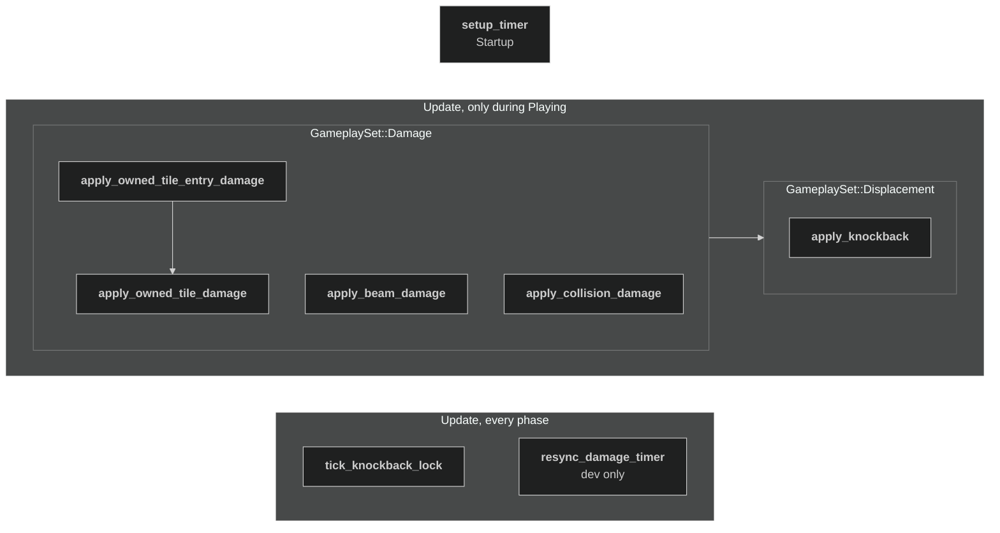
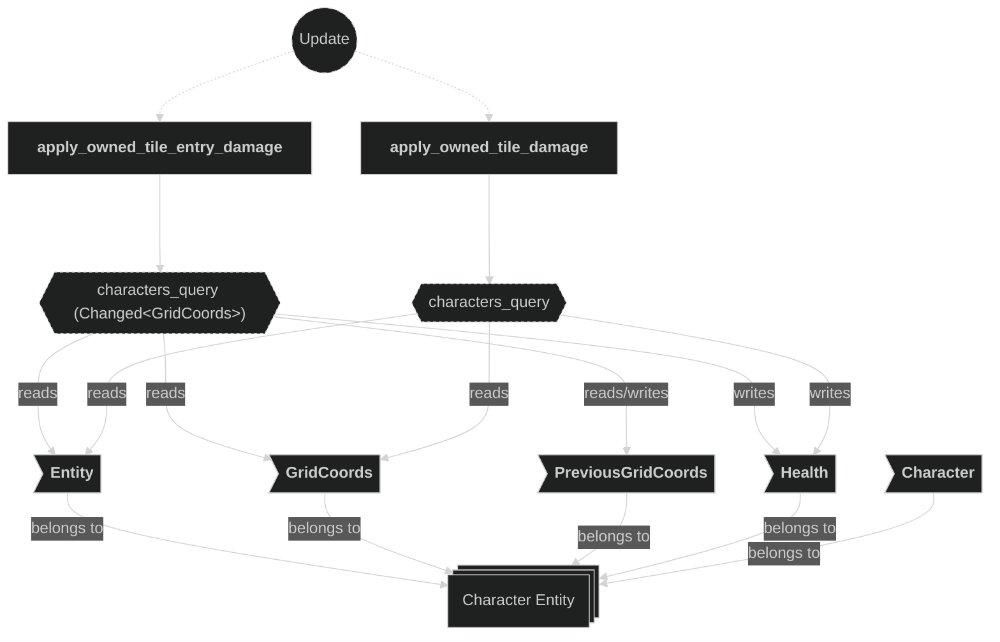
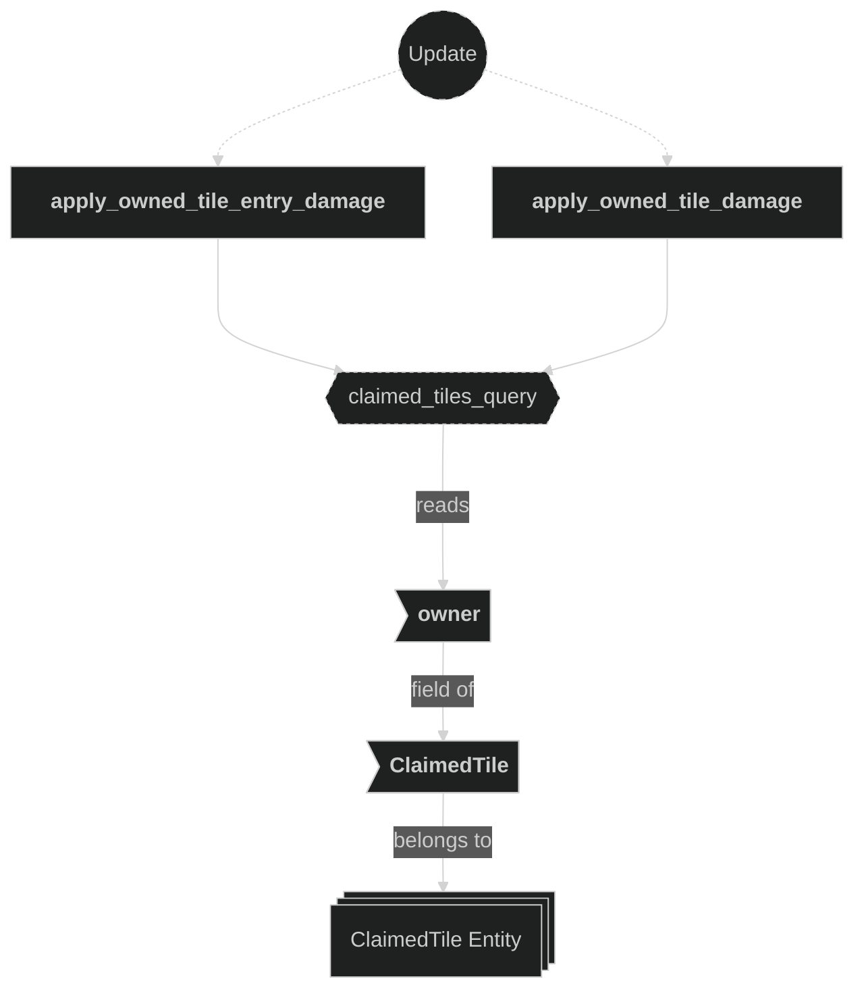
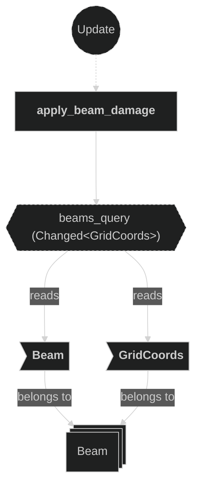
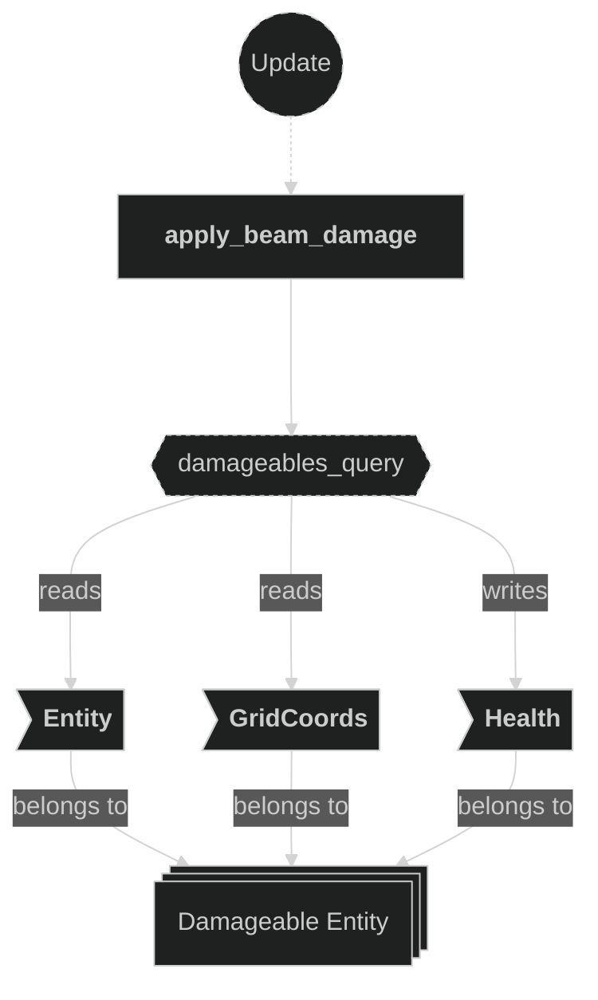
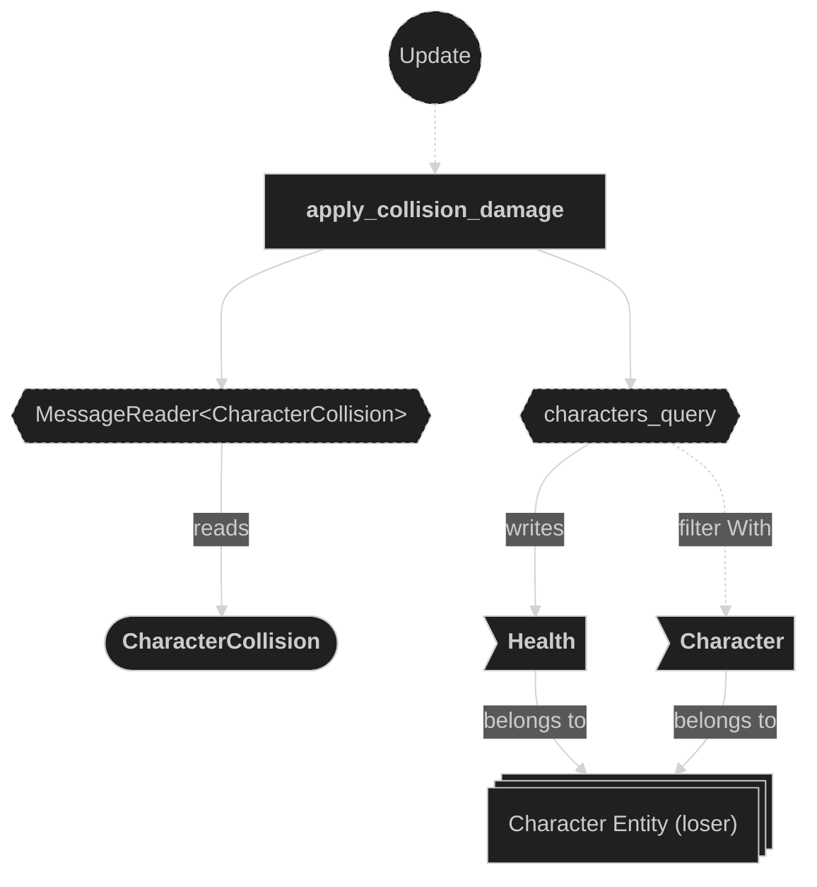
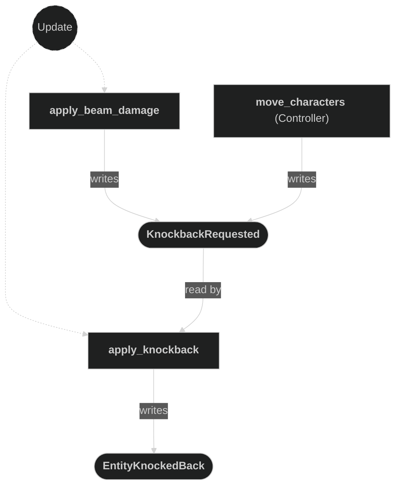
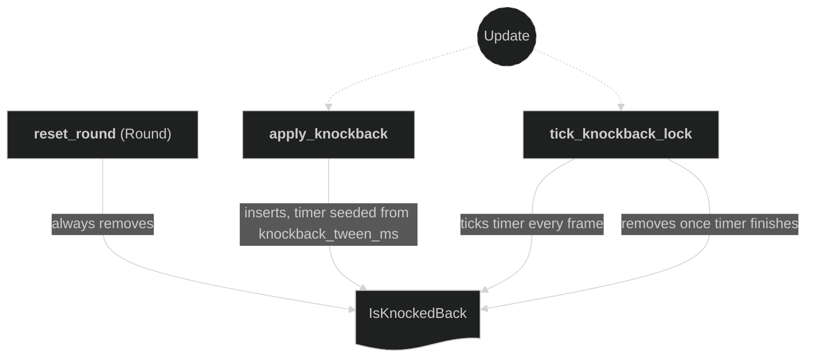
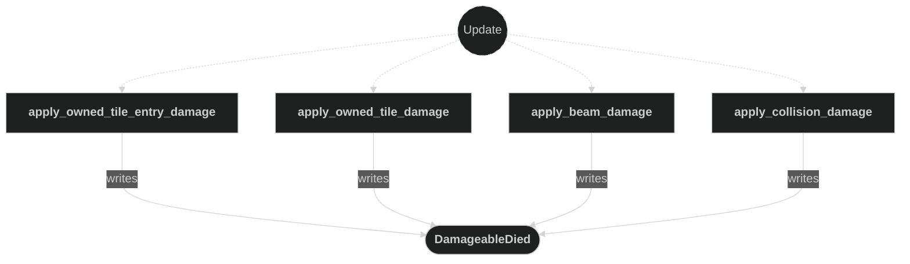
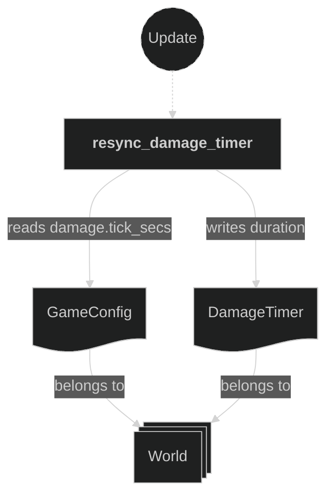

# Damage Plugin

This plugin removes health from players and writes `DamageableDied` when a player reaches zero health. It also moves players that are knocked back.

## Key ideas

- **Hostile tile**: a tile claimed by another player (`is_hostile_tile`). The Bot plugin uses this helper too.
- **Entry damage** (`damage.on_enter`, 5): a player steps onto a hostile tile from a tile that is not hostile.
- **Standing damage** (`damage.standing`, 1): a player is on a hostile tile when `DamageTimer` ends (every `damage.tick_secs`, 0.5 s).
- **Beam damage** (`damage.beam_contact`, 1): a beam steps onto the tile of a player who does not own the beam. The player is also knocked back.
- **Collision damage** (`damage.collision`, 5): the loser of a collision between two players.
- `deal_damage` removes the health and writes `DamageableDied` when the health reaches zero. All four damage systems use it.
- **Knockback**: a push of one tile. Only `apply_knockback` moves a player because of a knockback.

## Ordering

An arrow means "runs before". Systems with no arrow between them have no fixed order.

- `tick_knockback_lock` runs in every phase. So a lock still ends after the phase changes.

## Plugin Systems

### Setup Timer

- Runs at `Startup`. Inserts `DamageTimer`, a repeating timer of `damage.tick_secs`.

### Apply Owned Tile Entry Damage

- Runs for players whose `GridCoords` changed this frame: after a move or a knockback.
- Saves the new position in `PreviousGridCoords`. It does this on every move.
- Deals entry damage only when the new tile is hostile and the old tile was not.
- So a player who crosses many enemy tiles in a row takes entry damage once. The standing damage still applies.
- After entry damage, it resets `DamageTimer`. So the standing damage cannot hit in the same frame.
- It sees every tile that a player enters. The 0.5 s timer alone can miss a tile that the player crosses fast.

### Apply Owned Tile Damage

- Ticks `DamageTimer`. When the timer ends, deals standing damage to each player on a hostile tile.
- It also catches a tile that becomes hostile under a player who does not move. That player's `GridCoords` does not change, so the entry system does not run for them.

### Apply Beam Damage

- Runs for beams that moved this frame. Any player on the beam's tile takes beam damage, except the beam's owner.
- It also writes `KnockbackRequested` in the beam's direction.

### Apply Collision Damage

- Reads `CharacterCollision` from the Controller plugin. The loser takes collision damage.

### Apply Knockback

- Reads all `KnockbackRequested` of the frame, from the Controller plugin and from `apply_beam_damage`.
- For each player, only the last request counts. The Controller writes in `Movement`, and this plugin writes later in `Damage`.
- Skips a dead player, a player with zero health, or a target tile that is not ground.
- Else it moves the player one tile, inserts a new `IsKnockedBack` lock (`effects.knockback_tween_ms`) and writes `EntityKnockedBack`.
- The Effects plugin reads `EntityKnockedBack` and plays the slide. The entry damage sees the move on the next frame.

### Tick Knockback Lock

- Ticks each `IsKnockedBack` timer. Removes the lock when the timer ends.

### Resync Damage Timer (dev only)

- When the config changes, sets the `DamageTimer` duration to the new `damage.tick_secs`.

## Components, Resources and Messages CRUD

### Insert DamageTimer resource

Used in the following systems:
- **setup_timer**: inserts `DamageTimer` at startup.

### Read/Write DamageTimer resource

Used in the following systems:
- **apply_owned_tile_entry_damage**: resets the timer after entry damage.
- **apply_owned_tile_damage**: ticks the timer. Standing damage applies when it ends.

### Query Character entities (tile damage)

Used in the following systems:
- **apply_owned_tile_entry_damage**: reads the new and old tiles, saves the new one in `PreviousGridCoords`, and lowers `Health`.
- **apply_owned_tile_damage**: reads the tile of each player and lowers `Health`.

### Read MapInfo resource

Used in the following systems:
- **apply_owned_tile_entry_damage**: finds the claimed tile at a position (through `is_hostile_tile`).
- **apply_owned_tile_damage**: same.

### Query ClaimedTile (tile damage)

Used in the following systems:
- **apply_owned_tile_entry_damage**: reads the tile owner (through `is_hostile_tile`).
- **apply_owned_tile_damage**: same.

### Query Beam entities (beam damage)

Used in the following systems:
- **apply_beam_damage**: reads the beams that moved this frame.

### Query damageable entities (beam damage)

Used in the following systems:
- **apply_beam_damage**: finds the players on the beam's tile and lowers `Health`.

### Read CharacterCollision messages and query Health (collision damage)

Used in the following systems:
- **apply_collision_damage**: reads `CharacterCollision` and lowers the `Health` of the loser.

### Knockback messages

Used in the following systems:
- **apply_beam_damage**: writes `KnockbackRequested` in the beam's direction.
- **move_characters** (Controller plugin): writes `KnockbackRequested` for walk-ins and collisions.
- **apply_knockback**: reads `KnockbackRequested` and writes `EntityKnockedBack` for each player that moved.

### Query knocked-back entities (apply_knockback)

Used in the following systems:
- **apply_knockback**: checks the player is alive and the target is ground, then moves the player and inserts `IsKnockedBack`.

### IsKnockedBack component lifecycle

- `IsKnockedBack(Timer)` is the input lock of a knocked-back player. The Input plugin reads it.
- **Inserted** by `apply_knockback`. A new knockback replaces a running lock.
- **Removed** by `tick_knockback_lock` when the timer ends, or by `reset_round` (Round plugin).

### Write DamageableDied messages

Used in the following systems:
- **apply_owned_tile_entry_damage**, **apply_owned_tile_damage**, **apply_beam_damage**, **apply_collision_damage**: write `DamageableDied` when the health reaches zero (through `deal_damage`).

### Write DamageTimer duration (dev only)

Used in the following systems:
- **resync_damage_timer**: sets the timer duration when the config changes.

