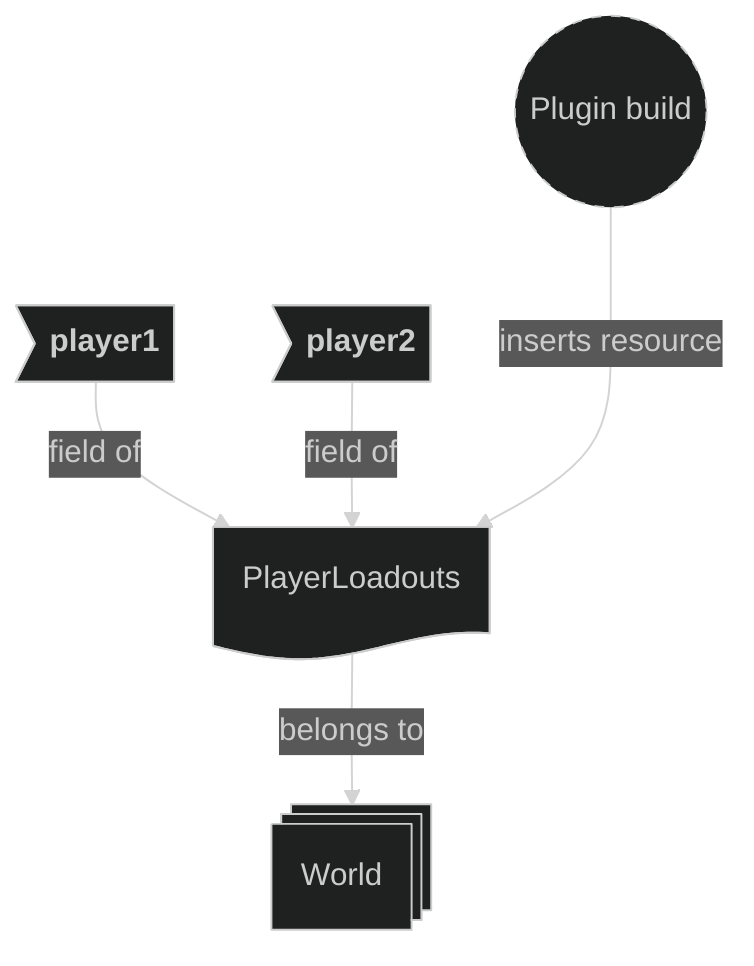
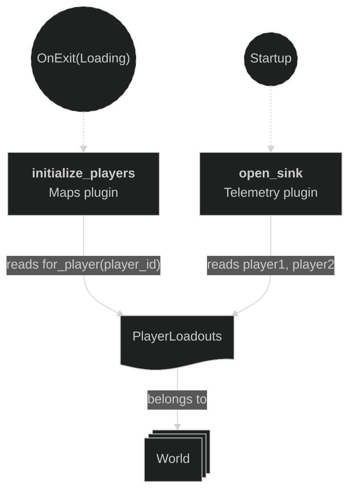
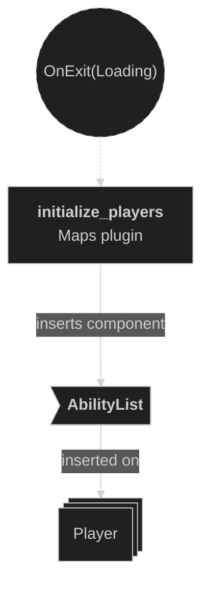
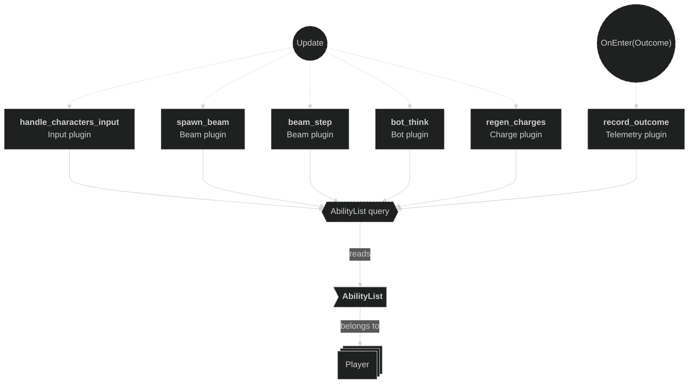

# Abilities Plugin

This plugin gives each player a list of abilities. The abilities change how beams and charges work. Other plugins read the list and apply the effects.

## Key ideas

- `AbilityList` is the list of abilities of one player. The Maps plugin adds it to each player.
- `AbilityDescriptor` is one ability: `Lance`, `BorderGrinder` or `SolarPanels`. It is plain data, so a loadout can later be written in a file.
- Straight Shot is the base beam. Every player has it, so it is not in the list. An empty list means "Straight Shot only".
- `PlayerLoadouts` holds the starting abilities of each player. There is no draft screen yet, so the loadouts are set in code.
- Today, player 1 starts with `SolarPanels` and player 2 starts with `BorderGrinder`.
- This plugin has no systems. Other plugins read `AbilityList` and apply each ability.

## Abilities

- **Lance**: lets a player fire from a claimed tile. The beam then uses `BeamBehavior::Lance`. Without Lance, a player on a claimed tile cannot fire, and no charge is spent.
- **Border Grinder**: when a straight beam reaches an enemy tile, it claims that tile and ends there.
- **Solar Panels**: gives back charges on a timer (`charge.solar_panels_tick_secs`, 5 s). The player gains one charge for every `charge.solar_panels_tiles_per_charge` (10) tiles that they own.

See the [Beam plugin](/documentation/7/006-beam-plugin) for Lance and Border Grinder, and the [Charge plugin](/documentation/23/021-charge-plugin) for Solar Panels.

## Plugin workflow

- At plugin build:
    - Registers `AbilityList` and `AbilityDescriptor`, so the world inspector shows each player's abilities.
    - Inserts `PlayerLoadouts`.

## Plugin Systems

None.

## Components, Resources and Messages CRUD

This plugin has no systems. The sections below show where other plugins use its data.

### Insert PlayerLoadouts resource

Used in the following systems:
- **plugin build**: inserts the starting abilities of both players.

### Read PlayerLoadouts resource

Used in the following systems:
- **initialize_players** (Maps plugin): gets the list of each player with `for_player`.
- **open_sink** (Telemetry plugin): writes both loadouts in the session record.

### Insert AbilityList component

Used in the following systems:
- **initialize_players** (Maps plugin): adds `AbilityList` to each player, from `PlayerLoadouts`.

### Query AbilityList

Used in the following systems:
- **handle_characters_input** (Input plugin), **spawn_beam** (Beam plugin): check `Lance` before a shot.
- **beam_step** (Beam plugin): checks `BorderGrinder` on the caster.
- **bot_think** (Bot plugin): checks `Lance` and `BorderGrinder` to choose a move.
- **regen_charges** (Charge plugin): checks `SolarPanels`.
- **record_outcome** (Telemetry plugin): writes each player's abilities when the round ends.

- `AbilityList`: `Component`, `Reflect`, `Default`, `Clone`.
- `AbilityDescriptor`: `Reflect`, `Clone`, `Debug`, `PartialEq`, `Eq`.
- `PlayerLoadouts`: `Resource`, `Clone`.
