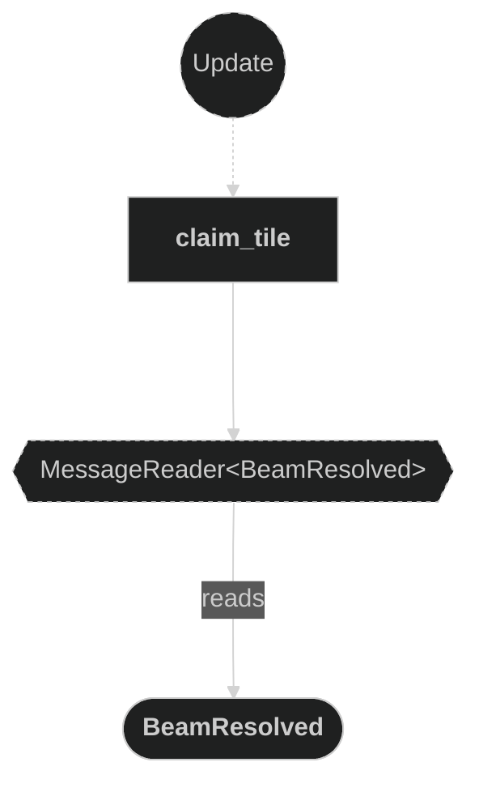
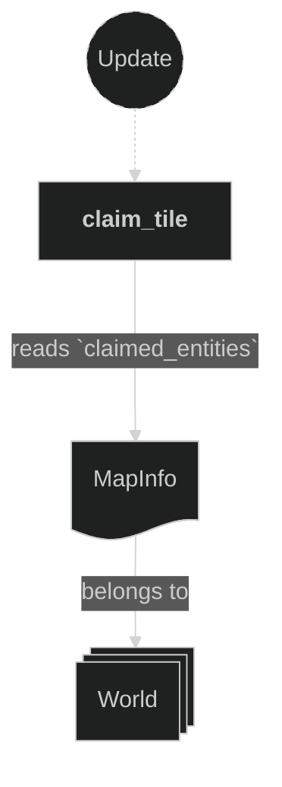
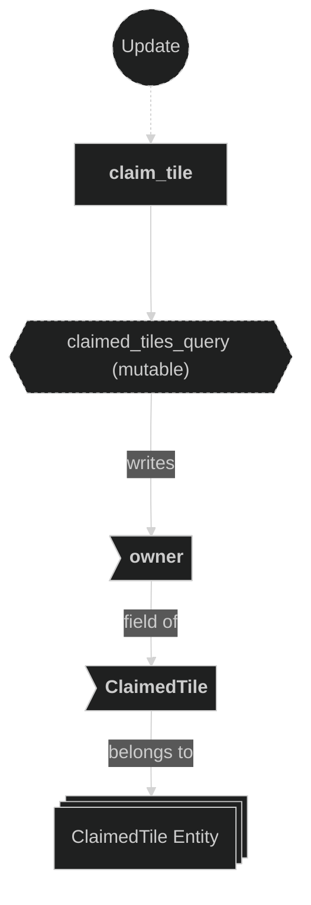
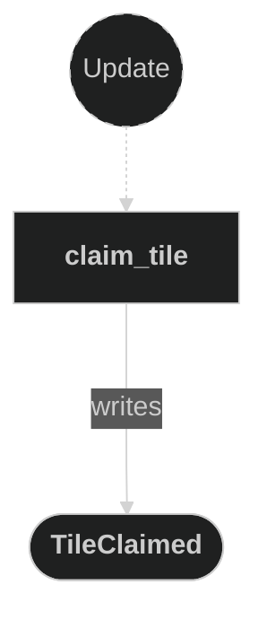
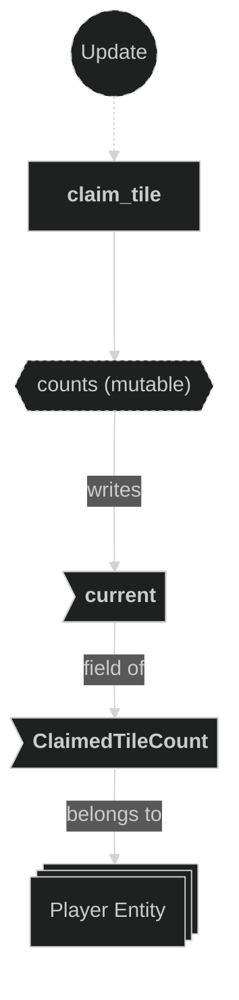

# Claim Plugin

This plugin changes the owner of a tile when a beam ends on it. It is the only place in the code that writes `ClaimedTile::owner`.

## Key ideas

- The Beam plugin writes `BeamResolved` when a beam ends on a tile. This plugin reads it. It never reads `Beam` entities.
- A **flip** is a claim that changes the owner. Claiming a tile that the player already owns is not a flip.
- Each player has a `ClaimedTileCount`: the number of tiles they own. This plugin keeps it correct after each flip.
- `TileClaimed` is written for every claim, flip or not. No system reads it yet. Future abilities will use it.

## Ordering

- `claim_tile` runs in `GameplaySet::Claim`, only during `Playing`.
- `GameplaySet::Claim` runs after `GameplaySet::Beam`. So a beam that ends in a frame claims its tile in the same frame.
- A new system that writes `BeamResolved` must also run only during `Playing`, before `GameplaySet::Claim`. Otherwise its message can be lost.

## Plugin Systems

### Claim Tile

- Reads `BeamResolved`. Finds the tile entity at the message position with `MapInfo::claimed_entities`.
- Sets `ClaimedTile::owner` to the player of the message.
- On a flip, adds 1 to the new owner's `ClaimedTileCount` and removes 1 from the old owner's count, if there was an old owner.
- Writes `TileClaimed` with the position, the old owner and the new owner.
- The Animations plugin sees the changed `ClaimedTile` and plays the tile flip.

## Components, Resources and Messages CRUD

### Read BeamResolved messages

Used in the following systems:
- **claim_tile**: each message is one claim.

### Read MapInfo resource (claim tile)

Used in the following systems:
- **claim_tile**: finds the tile entity at a position.

### Write ClaimedTile (claim tile)

Used in the following systems:
- **claim_tile**: sets the new owner.

### Write TileClaimed messages

Used in the following systems:
- **claim_tile**: writes one message per claim. No system reads it yet.

### Write ClaimedTileCount (claim tile)

Used in the following systems:
- **claim_tile**: on a flip, adds 1 for the new owner and removes 1 for the old owner.

