# Round Plugin

This plugin runs the rounds of a match: the round phases, the countdown, the end of a round and the reset before the next one.

The plugin is a folder, `src/plugins/round/`, with three parts:

- `state`: the phases, the countdown, the round end and the reset. This doc covers this part.
- `intro`: the "3 · 2 · 1 · GO!" banner. See the [Round intro](/documentation/16/014-round-intro) doc.
- `outcome`: the win banner. See the [Round outcome](/documentation/18/016-round-outcome) doc.

`round/mod.rs` also has `spawn_round_label`, a helper that shows a centered text on the overlay camera. The intro and outcome banners use it.

## Key ideas

- `RoundPhase` is the game state. Gameplay systems in other plugins run only during `Playing`, so the other phases freeze the game.

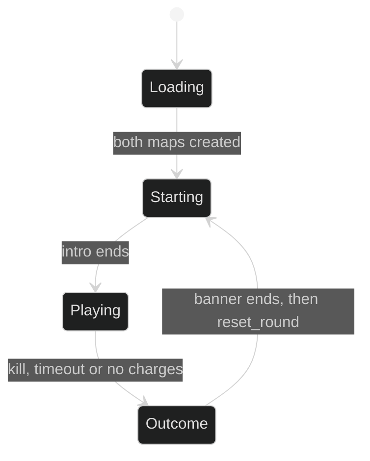

- `Loading` happens once, at boot. Later rounds loop `Starting`, `Playing`, `Outcome`. So the Maps plugin uses `OnExit(Loading)` to build the board once.
- `Countdown` is the round time left, in seconds. It starts at `round.round_duration_secs` (300) and goes down only during `Playing`.
- A round ends in one of three ways:
    - **Kill**: a player's health reaches 0. The other player wins.
    - **Timeout**: the countdown reaches 0.
    - **No charges**: no player has charges or beams in flight. Nobody can act, so the round ends early.
- Tie rule (`winner_by_standing`): more owned tiles, then more health, then player 1. The timeout and the "no charges" end use it. A kill of both players in the same frame uses tiles, then player 1.
- A kill has priority. The other two ends do nothing in a frame where a player died.
- Each end records the winner in `RoundResult`, adds a win to `MatchScore` and enters `Outcome` (`conclude_round`).
- `MatchScore` keeps the wins of each player. The reset does not change it.
- `reset_round` puts the board and the players back to the start, in place. Nothing is despawned or loaded again, except the beams.
- `RoundResetExceptions` lists tiles that keep their owner after the reset. It is empty today. It is ready for future abilities.

## Ordering

An arrow means "runs before". Systems with no arrow between them have no fixed order.

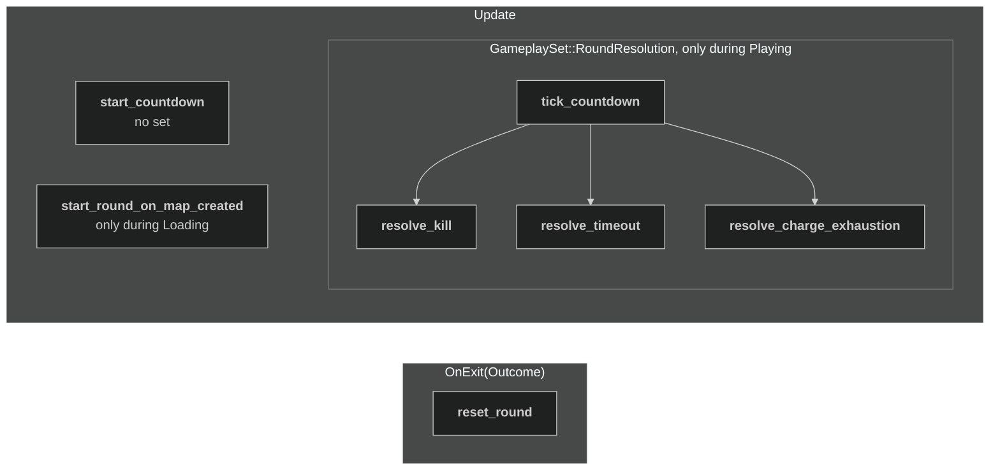

- `RoundResolution` runs after `Damage` and before `HudSync`. So a death or a claim of the same frame counts.
- The three `resolve_*` systems all write `NextState<RoundPhase>`. They are in `RoundPhaseWriter` and are allowed to run in any order. Only one of them sets `Outcome` in a frame.
- `clear_root_effect_drivers` (Effects plugin) also runs on `OnExit(Outcome)`. It needs no order with `reset_round`.

## Plugin Systems

### Start Round on Map Created

- Runs only during `Loading`. Reads `TiledEvent<MapCreated>`.
- Remembers if the level map (`CurrentLevel`) and the HUD map (`HudMap`) were created. They can load in any order.
- When both are created, sets the next phase to `Starting`.
- Bevy then runs `OnExit(Loading)`, where the Maps plugin builds the board.

### Start Countdown

- Reads `TiledEvent<MapCreated>`. Inserts a new `Countdown` at `round.round_duration_secs`.
- So the HUD shows the full time during the intro.

### Tick Countdown

- Runs only during `Playing`. Removes 1 from `Countdown::remaining` each second, and stops at 0.
- Does nothing until `Countdown` exists.

### Resolve Kill

- Reads `DamageableDied`. If one player is still alive, that player wins.
- If both players died in the same frame, the player with more tiles wins, then player 1.

### Resolve Timeout

- When the countdown is 0, finds the winner with `winner_by_standing`.
- Does nothing in a frame where a player died.

### Resolve Charge Exhaustion

- When every player has no charges and no beam in flight (`InFlightBeamCount` is 0), finds the winner with `winner_by_standing`.
- It waits for the beams in flight, because they can still claim tiles.
- Does nothing in a frame where a player died, or when the countdown is 0. The timeout handles that frame, so the win is not counted twice.

### Reset Round

- Runs on exit of `Outcome`, so never before the first round.
- Tiles: sets each `ClaimedTile::owner` to its `RoundResetExceptions` entry, or to none.
- Players: full `Health` and `BeamCharges`, `ClaimedTileCount` from the kept tiles, `InFlightBeamCount` 0, `LookDirection` from `SpawnLookDirection`.
- Players go back to `SpawnPoint` at once, with no slide: `GridCoords`, `PreviousGridCoords`, `Transform` and `RestingTranslation` all get the spawn tile.
- Shows the dead player again (`Visibility::Visible`) and removes `IsDead`, `IsTurning` and `IsKnockedBack`.
- Despawns the beams in flight. Inserts a new `Countdown`, because `MapCreated` does not fire again.
- The tile sprites go back to neutral in the Animations plugin, which sees the changed `ClaimedTile`.

## Components, Resources and Messages CRUD

### Read TiledEvent MapCreated messages

Used in the following systems:
- **start_countdown**: inserts a new `Countdown` for each created map.
- **start_round_on_map_created** (only during `Loading`): waits for the level map and the HUD map.

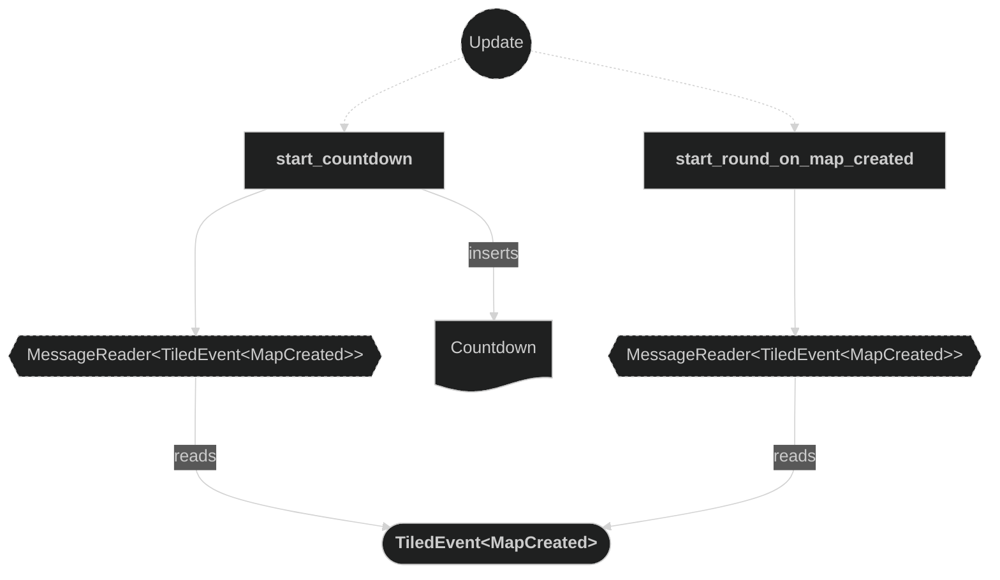

### Countdown resource

Used in the following systems:
- **tick_countdown**: removes 1 from `remaining` each second.
- **animate_countdown** (HUD plugin): shows `remaining` on the countdown digits.

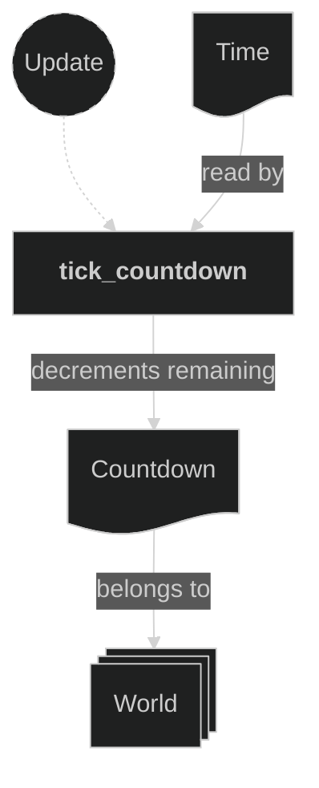

### Read DamageableDied messages

Used in the following systems:
- **resolve_kill**: ends the round when a player dies.
- **resolve_timeout**: does nothing in a frame with a death.
- **resolve_charge_exhaustion**: does nothing in a frame with a death.

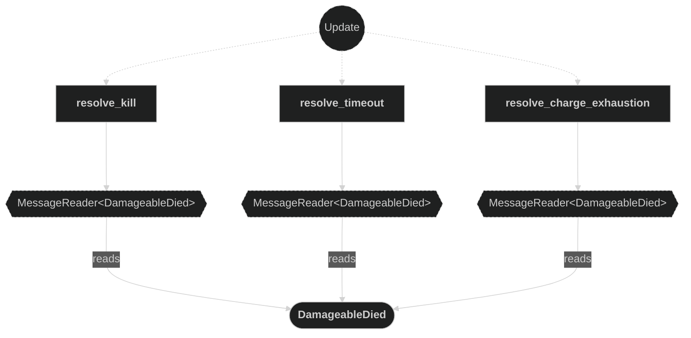

### Query player entities (resolution)

Used in the following systems:
- **resolve_kill**: finds the survivor, or uses the tile count when both died.
- **resolve_timeout**: ranks the players by tiles, then health, then seat.
- **resolve_charge_exhaustion**: checks that no player has charges or beams in flight, then ranks the players like the timeout.

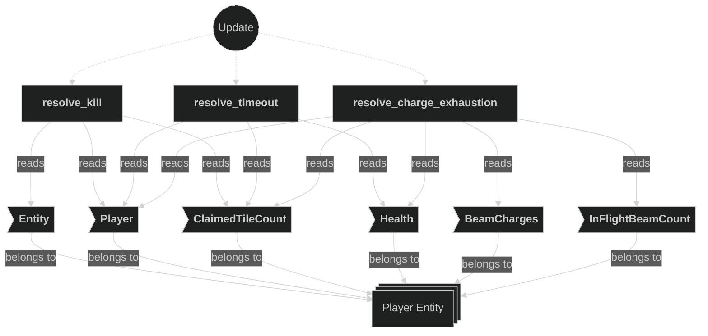

### RoundResult resource

Used in the following systems:
- **resolve_kill**, **resolve_timeout**, **resolve_charge_exhaustion** (through `conclude_round`): write `winner`.
- **show_outcome_banner** (`outcome` part): shows the winner on the banner.
- **record_outcome** (Telemetry plugin): writes the winner in the trace.

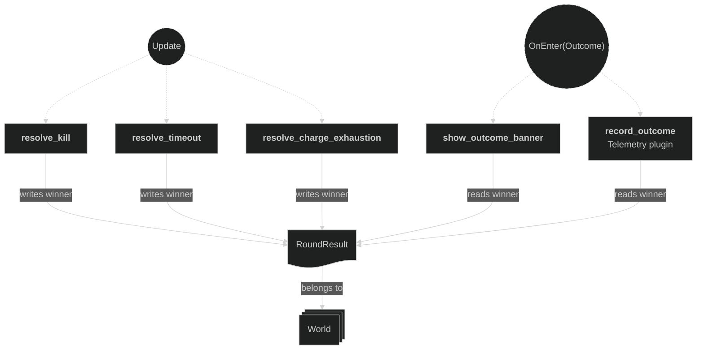

### MatchScore resource

Used in the following systems:
- **resolve_kill**, **resolve_timeout**, **resolve_charge_exhaustion** (through `conclude_round`): add 1 to the winner's `wins`. No system reads it yet.

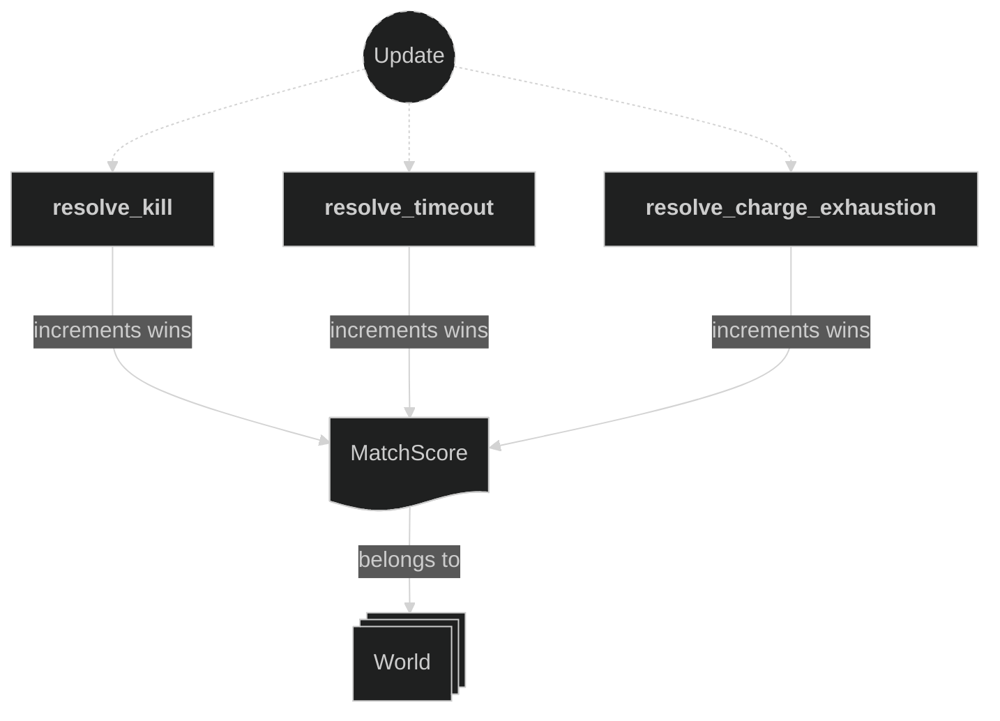

### RoundResetExceptions resource

Used in the following systems:
- **reset_round**: keeps the owner of the listed tiles. The list is empty today.

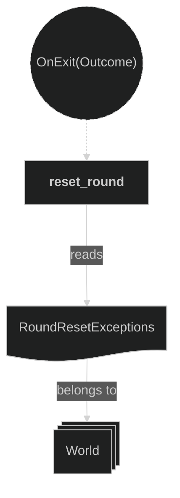

### Set NextState RoundPhase

Used in the following systems:
- **start_round_on_map_created**: sets `Starting` when both maps are created.
- **resolve_kill**, **resolve_timeout**, **resolve_charge_exhaustion** (through `conclude_round`): set `Outcome`.

The `intro` and `outcome` parts set the other phases. See their docs.

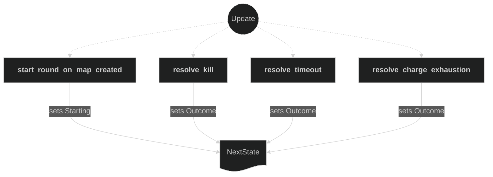

### Reset Round world writes

Used in the following systems:
- **reset_round** (on exit of `Outcome`): resets the board and the players.

```mermaid
---
config:
  theme: dark
---

flowchart TD
classDef system-group stroke-dasharray: 5 5

state_transition(("`OnExit(Outcome)`")):::system-group
reset_round["`**reset_round**`"]

state_transition -.-> reset_round

player_entity@{ shape: st-rect, label: "Player Entity" }
tile_entity@{ shape: st-rect, label: "ClaimedTile Entity" }
beam_entity@{ shape: st-rect, label: "Beam Entity" }

pe_spawn>"`**SpawnPoint**`"] --> |belongs to| player_entity
pe_spawn_look>"`**SpawnLookDirection**`"] --> |belongs to| player_entity
pe_look>"`**LookDirection**`"] --> |belongs to| player_entity
pe_health>"`**Health**`"] --> |belongs to| player_entity
pe_charges>"`**BeamCharges**`"] --> |belongs to| player_entity
pe_count>"`**ClaimedTileCount**`"] --> |belongs to| player_entity
pe_in_flight>"`**InFlightBeamCount**`"] --> |belongs to| player_entity
pe_coords>"`**GridCoords / PreviousGridCoords**`"] --> |inserted on| player_entity
pe_transform>"`**Transform.translation**`"] --> |belongs to| player_entity
pe_resting>"`**RestingTranslation**`"] --> |belongs to| player_entity
pe_vis>"`**Visibility**`"] --> |inserted on| player_entity
pe_dead>"`**IsDead**`"] --> |removed from| player_entity
pe_turning>"`**IsTurning**`"] --> |removed from| player_entity
pe_effect_state>"`**IsKnockedBack**`"] --> |removed from| player_entity
te_owner>"`**ClaimedTile::owner**`"] --> |belongs to| tile_entity

reset_round ---> |reads| pe_spawn
reset_round ---> |reads| pe_spawn_look
reset_round ---> |sets spawn direction| pe_look
reset_round ---> |restores max| pe_health
reset_round ---> |restores max| pe_charges
reset_round ---> |resets to carve-out count| pe_count
reset_round ---> |resets to 0| pe_in_flight
reset_round ---> |inserts spawn coord| pe_coords
reset_round ---> |"teleports to spawn translation"| pe_transform
reset_round ---> |"teleports to spawn translation"| pe_resting
reset_round ---> |makes Visible| pe_vis
reset_round ---> |removes| pe_dead
reset_round ---> |removes| pe_turning
reset_round ---> |removes| pe_effect_state
reset_round ---> |resets owner| te_owner
reset_round ---> |despawns| beam_entity
reset_round ---> |re-inserts Countdown| world_res

world_res@{ shape: doc, label: "Countdown" }
```

Definitions:
- `Countdown`: `Resource`. Inserted by `start_countdown` and `reset_round`, changed by `tick_countdown`, read by `animate_countdown` (HUD plugin).
- `CountdownDigit`: marker `Component` on the countdown digits of the HUD map. Read by `animate_countdown` (HUD plugin).
- `RoundResult`: `Resource` with `winner: Option<u8>`. `None` is a draw, which the tie rules never produce.
- `MatchScore`: `Resource` with `wins: [u32; 2]`. The reset does not change it.
- `RoundResetExceptions`: `Resource` with a `HashMap<GridCoords, Entity>` of tiles and their kept owner.
- `SpawnPoint`: `Component` with the spawn tile of a player. Inserted by `initialize_players` (Maps plugin).
- `SpawnLookDirection`: `Component` with the spawn direction (player 1 down, player 2 up). Inserted by `initialize_players` (Maps plugin).
