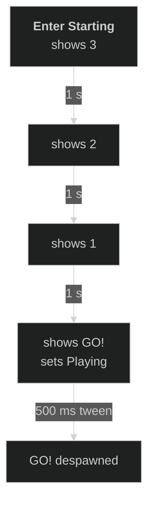
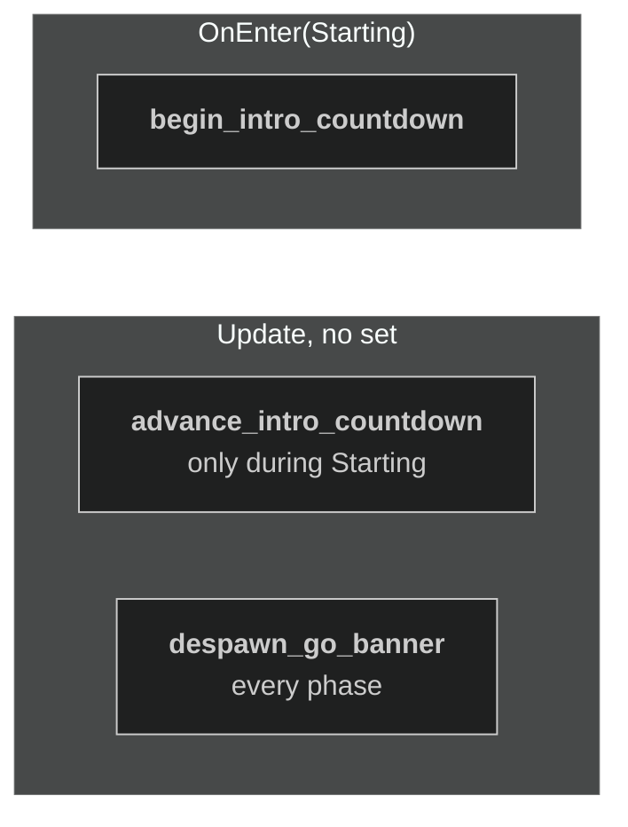
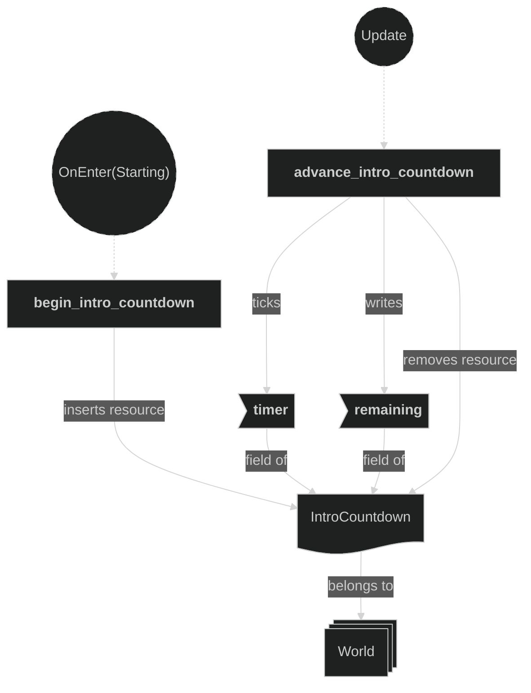
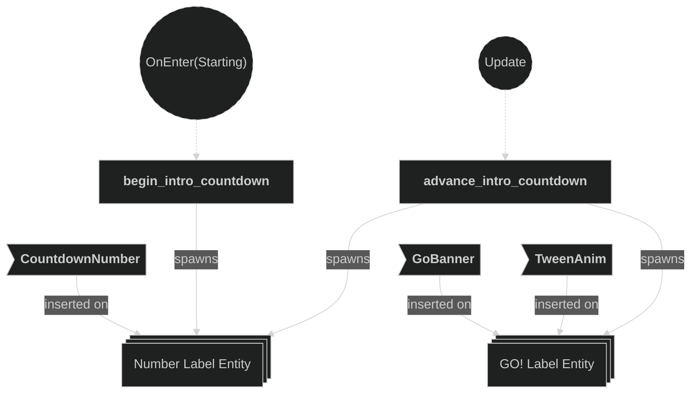
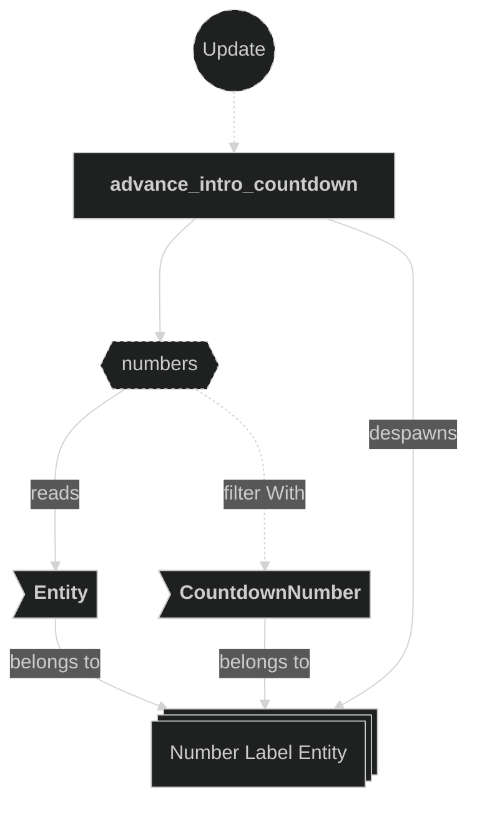
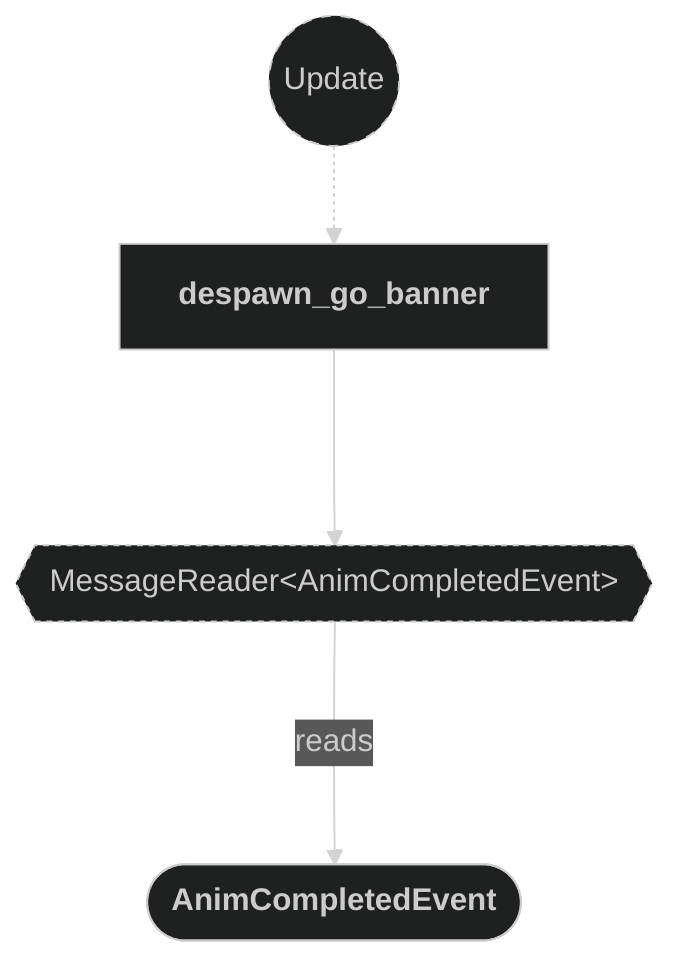
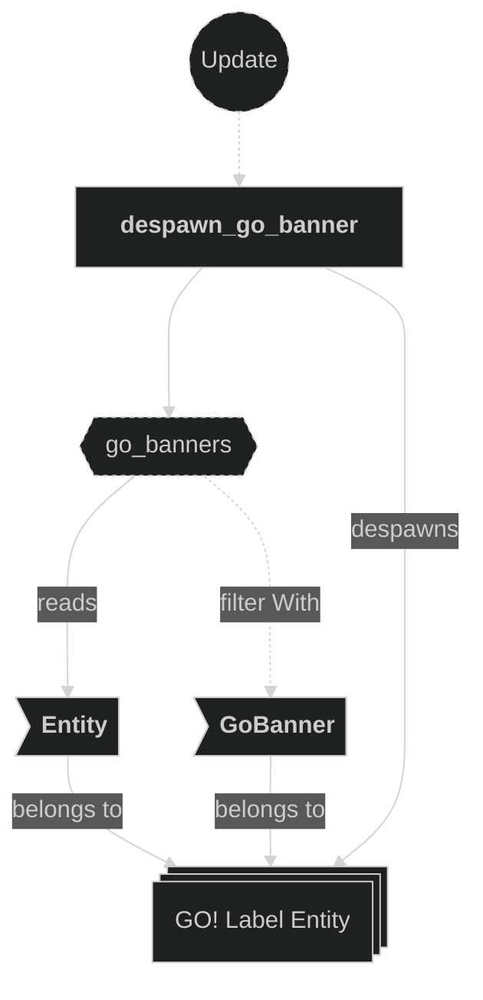
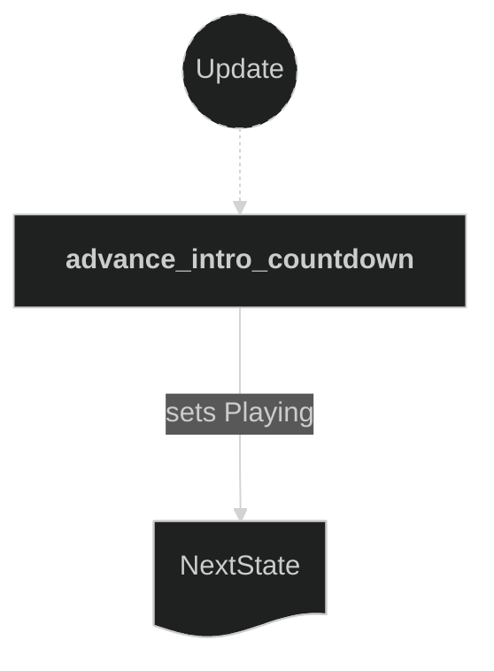

# Round Intro

This part of the [Round plugin](/documentation/15/013-round-plugin) shows the "3 · 2 · 1 · GO!" banner at the start of each round. The code is in `src/plugins/round/intro.rs`.

## Key ideas

- The banner shows during `RoundPhase::Starting`. Gameplay is frozen during this phase.
- The text is drawn with `spawn_round_label`, on the overlay camera (render layer 3). The Text plugin draws the letters and the Camera plugin owns the camera.
- Each number shows for one second. The intro lasts `round.intro_count` seconds (3).
- "GO!" grows fast to `round.go_end_scale` (24) over `round.go_linger_ms` (500 ms), so it looks like it flies past the players. The game is already in `Playing` while it grows.

## Ordering

- `advance_intro_countdown` writes `NextState<RoundPhase>`. It is in `RoundPhaseWriter`, like the other systems that set the phase.
- `despawn_go_banner` runs in every phase. "GO!" ends during `Playing`, so a `Starting` gate would leave it on screen.

## Plugin Systems

### Begin Intro Countdown

- Runs on entering `Starting`.
- Shows the first number (`round.intro_count`) with the `CountdownNumber` marker.
- Inserts `IntroCountdown`: a one-second repeating timer and the current number.

### Advance Intro Countdown

- Runs only during `Starting`. Each second, despawns the current number and removes 1 from the count.
- While the count is above 0, shows the next number.
- At 0, shows "GO!" with `GoBanner` and a scale `TweenAnim` (`ExponentialIn`). Then removes `IntroCountdown` and sets the next phase to `Playing`.

### Despawn Go Banner

- Reads `AnimCompletedEvent`. When the tween of a `GoBanner` ends, despawns it with its letters.

## Components, Resources and Messages CRUD

### Read FontAtlas and GameConfig

Used in the following systems:
- **begin_intro_countdown**: reads the font and `round.intro_count`.
- **advance_intro_countdown**: reads the font, `round.go_linger_ms` and `round.go_end_scale`.

### IntroCountdown resource

Used in the following systems:
- **begin_intro_countdown**: inserts it.
- **advance_intro_countdown**: ticks the timer, changes `remaining`, and removes the resource at the end.

### Spawn banner labels

Used in the following systems:
- **begin_intro_countdown**: spawns the first number with `CountdownNumber`.
- **advance_intro_countdown**: spawns the next numbers with `CountdownNumber`, then "GO!" with `GoBanner` and `TweenAnim`.

### Query CountdownNumber entities

Used in the following systems:
- **advance_intro_countdown**: despawns the number that is on screen.

### Read AnimCompletedEvent messages

Used in the following systems:
- **despawn_go_banner**: finds the end of the "GO!" tween.

### Query GoBanner entities

Used in the following systems:
- **despawn_go_banner**: despawns the "GO!" label whose tween ended.

### Set NextState RoundPhase

Used in the following systems:
- **advance_intro_countdown**: sets `Playing` when "GO!" shows.

Definitions:
- `CountdownNumber`: private marker `Component` on the number label on screen.
- `GoBanner`: private marker `Component` on the "GO!" label.
- `IntroCountdown`: private `Resource` with a one-second `timer` and `remaining`, the number on screen. 0 means "show GO!".
