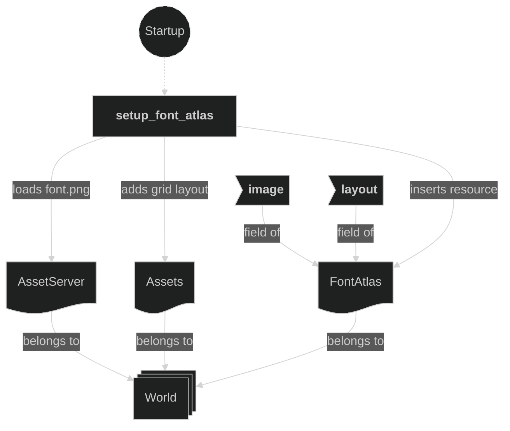
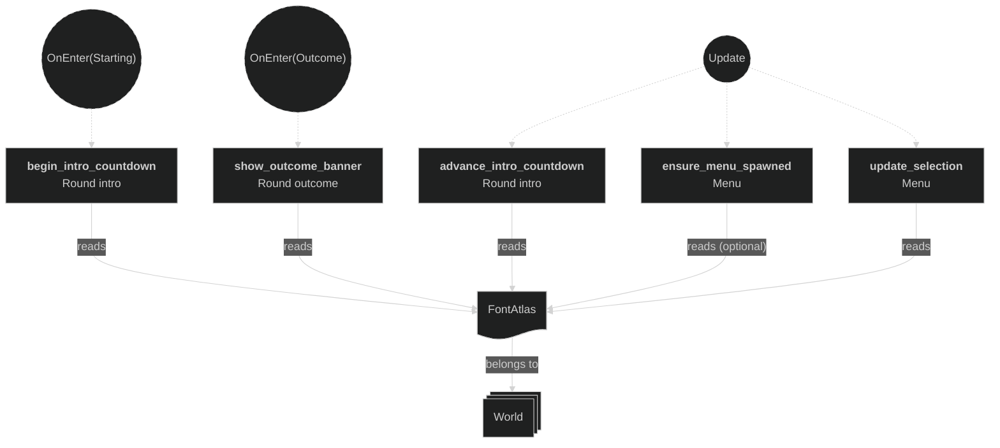
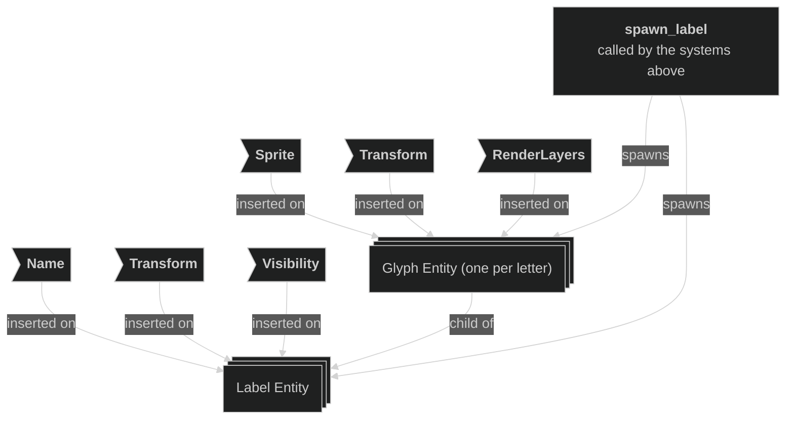

# Text Plugin

This plugin draws text with a bitmap font. It loads the font once, and other plugins call `spawn_label` to show a string. The code is in `src/plugins/text.rs`.

## Key ideas

- `FontAtlas` holds the font image (`assets/font.png`) and its grid layout. It is inserted at `Startup`.
- `spawn_label` turns a string into one parent entity with one sprite child per letter. The letters are centered on the parent's `Transform`.
- The caller chooses the camera: it passes the `RenderLayers`, and `spawn_label` puts them on each letter. Render layers do not pass from parent to child here.
- Despawn the parent to remove the whole label.
- Users today: the [Round intro](/documentation/16/014-round-intro) ("3 · 2 · 1 · GO!"), the [Round outcome](/documentation/18/016-round-outcome) banner and the [Menu](/documentation/22/020-menu-plugin) rows.
- A system that runs on `OnEnter` of a state's default value can run before `Startup`. There, `FontAtlas` may not exist yet, so read it as `Option<Res<FontAtlas>>` (see `ensure_menu_spawned` in the Menu plugin).

## Font atlas

- `assets/font.png` is a grid of 16 px cells. It has uppercase letters, digits and `! ? . : >`.
- `glyph_index` returns the number of the cell that holds a character (for example `'C'` → 2). `spawn_label` uses this number to show that cell. Other characters draw nothing.

## Plugin Systems

### Setup Font Atlas

- Runs once at `Startup`.
- Loads `font.png`, builds the grid layout and inserts `FontAtlas`.

`spawn_label` and `glyph_index` are helper functions. Other plugins call them from their own systems.

## Components, Resources and Messages CRUD

### Insert FontAtlas resource

Used in the following systems:
- **setup_font_atlas**: loads the image, adds the layout and inserts the resource.

### Read FontAtlas resource

Used in the following systems:
- **begin_intro_countdown**, **advance_intro_countdown** (Round intro): draw the numbers and "GO!".
- **show_outcome_banner** (Round outcome): draws the winner banner.
- **ensure_menu_spawned** (Menu): draws the first rows. Reads `Option<Res<FontAtlas>>` and waits until it exists.
- **update_selection** (Menu): draws the rows again when the selection changes.

### Spawn label entities

Used in the following systems (through `spawn_label`):
- **begin_intro_countdown**, **advance_intro_countdown** (Round intro).
- **show_outcome_banner** (Round outcome).
- **ensure_menu_spawned**, **update_selection** (Menu).

Definitions:
- `FontAtlas`: public `Resource` with the font `image` and the grid `layout` handles.
- `FONT_COLS` (16), `FONT_ROWS` (3), `FONT_CELL` (16 x 16 px), `FONT_ADVANCE` (12 px): the atlas grid and the letter spacing.
