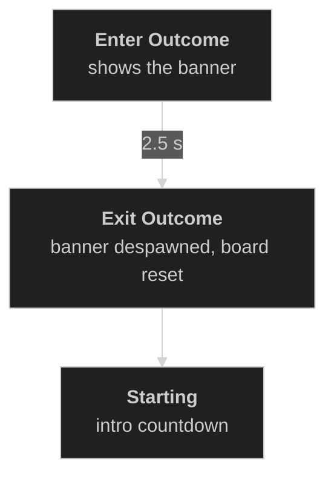
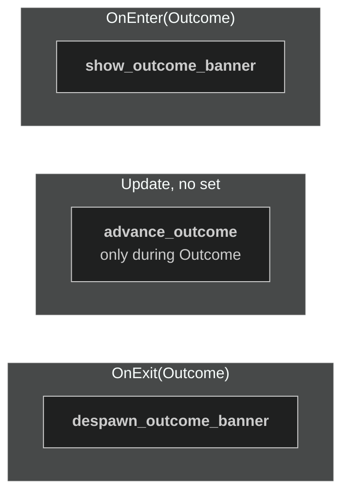
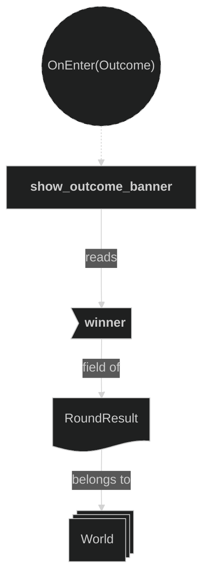
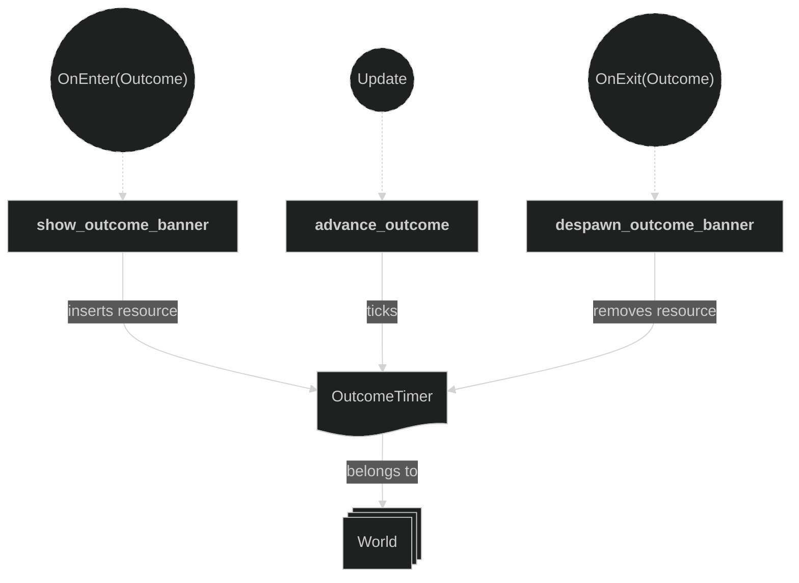
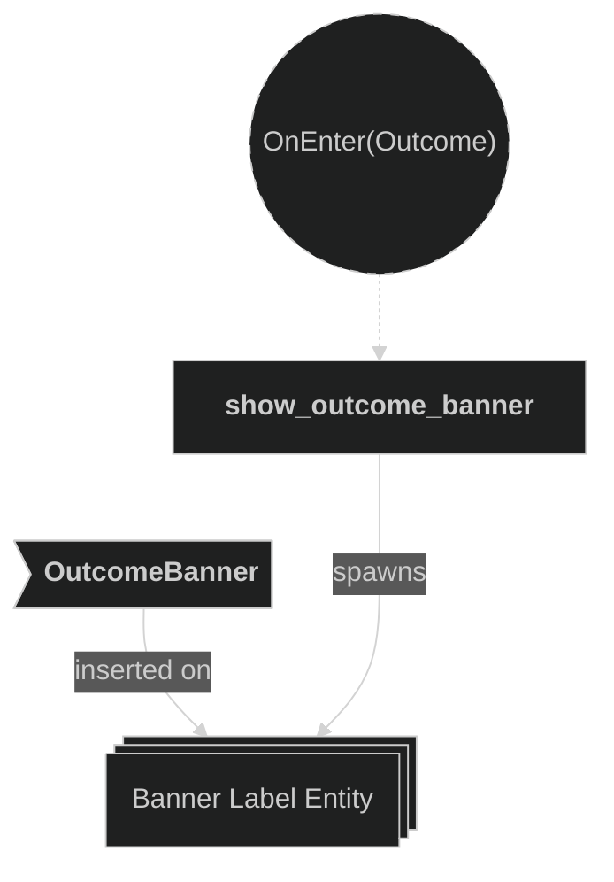
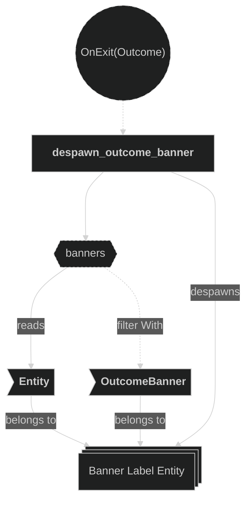
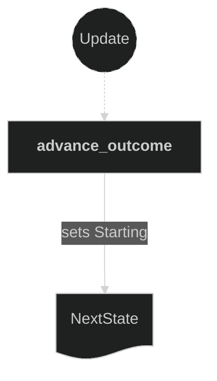

# Round Outcome

This part of the [Round plugin](/documentation/15/013-round-plugin) shows the winner banner at the end of a round, then starts the next round. The code is in `src/plugins/round/outcome.rs`.

## Key ideas

- The banner shows during `RoundPhase::Outcome`. It says "P1 WINS", "P2 WINS" or "DRAW", from `RoundResult::winner`.
- The `state` submodule chooses the winner and enters `Outcome`. This submodule only shows the result.
- The text is drawn with `spawn_round_label`, on the overlay camera, like the [Round intro](/documentation/16/014-round-intro).
- The banner stays for `round.outcome_linger_secs` (2.5 s). This gives the loser's death bounce time to end.
- Then the phase goes back to `Starting`. On the way out, `reset_round` (in `state`) cleans the board, and the intro countdown starts again.

## Ordering

- `advance_outcome` writes `NextState<RoundPhase>`. It is in `RoundPhaseWriter`, like the other systems that set the phase.

## Plugin Systems

### Show Outcome Banner

- Runs on entering `Outcome`.
- Shows the banner text with the `OutcomeBanner` marker.
- Inserts `OutcomeTimer`, a one-shot timer of `round.outcome_linger_secs`.

### Advance Outcome

- Runs only during `Outcome`. Ticks `OutcomeTimer`.
- When the timer ends, sets the next phase to `Starting`.

### Despawn Outcome Banner

- Runs on leaving `Outcome`.
- Despawns the banner with its letters and removes `OutcomeTimer`.

## Components, Resources and Messages CRUD

### Read FontAtlas, GameConfig and Time

Used in the following systems:
- **show_outcome_banner**: reads the font and `round.outcome_linger_secs`.
- **advance_outcome**: reads `Time` to tick the timer.

### Read RoundResult resource

Used in the following systems:
- **show_outcome_banner**: reads `winner` to choose the banner text.

### OutcomeTimer resource

Used in the following systems:
- **show_outcome_banner**: inserts it.
- **advance_outcome**: ticks it.
- **despawn_outcome_banner**: removes it.

### Spawn banner label

Used in the following systems:
- **show_outcome_banner**: spawns the banner with `OutcomeBanner`.

### Query OutcomeBanner entities

Used in the following systems:
- **despawn_outcome_banner**: despawns the banner.

### Set NextState RoundPhase

Used in the following systems:
- **advance_outcome**: sets `Starting` when the timer ends.

Definitions:
- `OutcomeBanner`: private marker `Component` on the banner label.
- `OutcomeTimer`: private `Resource` with a one-shot `Timer`.
