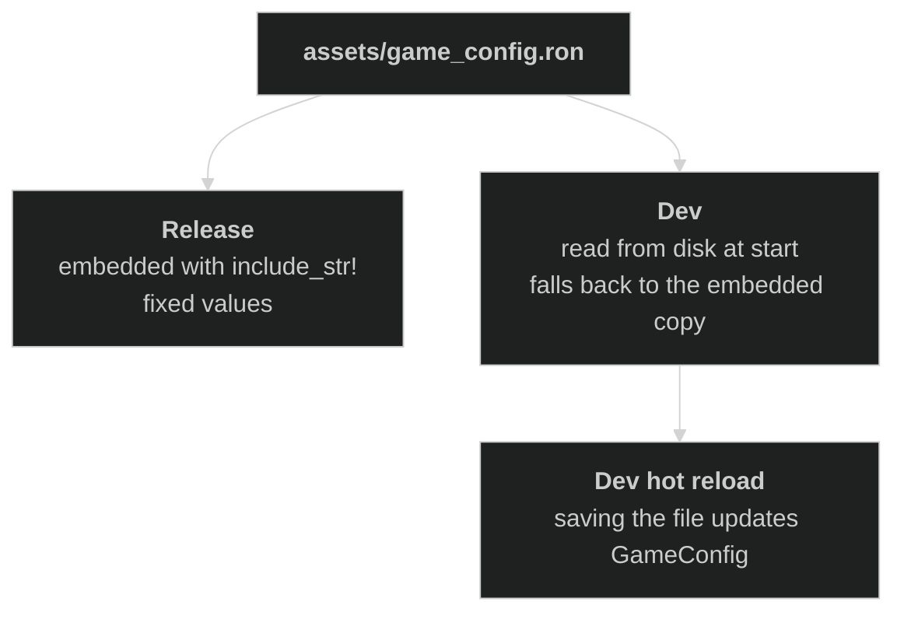
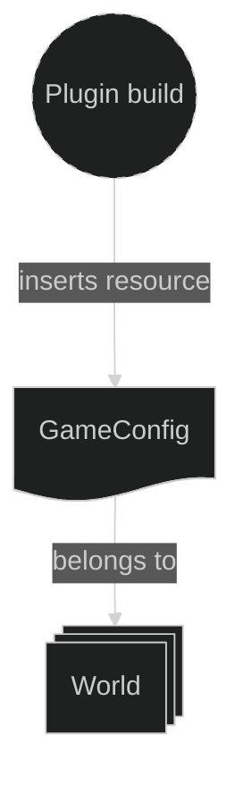
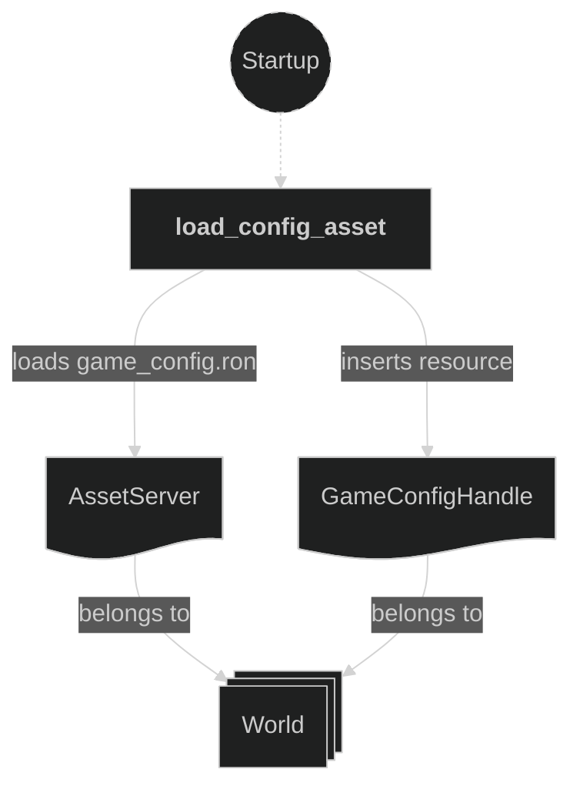
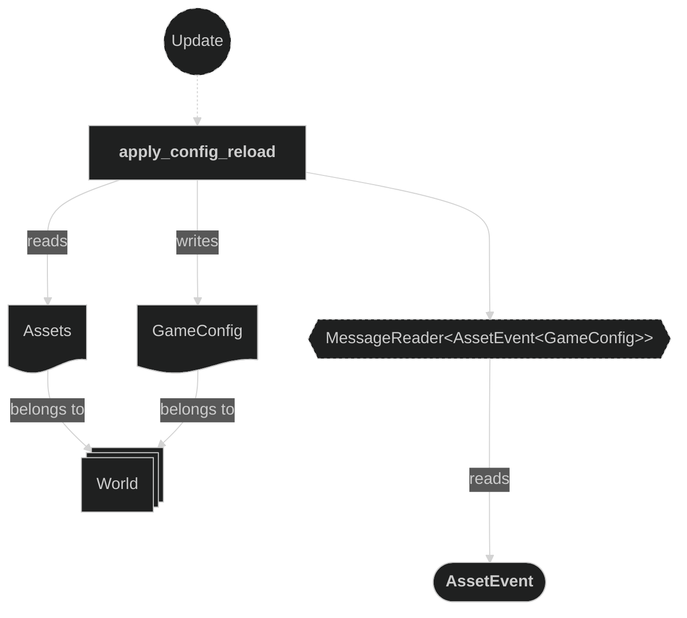

# Config Plugin

This plugin loads the tuning values from `assets/game_config.ron` into the `GameConfig` resource. Other plugins read them with `Res<GameConfig>`. The code is in `src/plugins/config.rs`.

## Key ideas

- To rebalance the game, edit `assets/game_config.ron`. No code change is needed.
- Each `.ron` value has a tag that says when an edit takes effect: `[live]`, `[next-round]`, `[restart]` or `[menu]`. The legend is at the top of the `.ron` file.
- The plugin is registered right after `defaults`. It inserts `GameConfig` at plugin build, so the resource exists before any `Startup` system.
- Fixed layout values stay as consts in their own modules, for example render layers, z-indices and atlas grids.
- The test `embedded_config_parses` checks that the `.ron` file still parses. A broken edit fails the tests, and the game does not start with bad values.

## Dev and release builds

- `[live]` values are read every frame or every step, so they change at once in dev.
- The damage and beam step timers are re-synced by dev-only systems in their own plugins.

## Plugin Systems

### Load Config Asset (dev)

- Runs once at `Startup`.
- Loads `game_config.ron` as an asset and keeps its handle, so the file watcher tracks it.

### Apply Config Reload (dev)

- Runs every frame in `Update`.
- When the asset changes, copies it into the `GameConfig` resource.

## Components, Resources and Messages CRUD

### Read GameConfig

Used in the following systems:
- Almost every plugin reads it. Each plugin doc lists its own readers.

### Insert GameConfig resource

Used in the following systems:
- **plugin build**: parses the embedded copy (release) or the file on disk (dev), and inserts the resource.

### GameConfigHandle resource (dev)

Used in the following systems:
- **load_config_asset**: loads the asset and inserts the handle.

### Read AssetEvent messages and update GameConfig (dev)

Used in the following systems:
- **apply_config_reload**: on `Modified` or `LoadedWithDependencies`, copies the new asset into `GameConfig`.

Definitions:
- `GameConfig`: public `Resource` and `Asset`, with one group of values per domain.
- `GameConfigHandle`: private dev-only `Resource` that keeps the asset handle alive.
- `GameConfigLoader`: dev-only `AssetLoader` that parses the `.ron` file.
