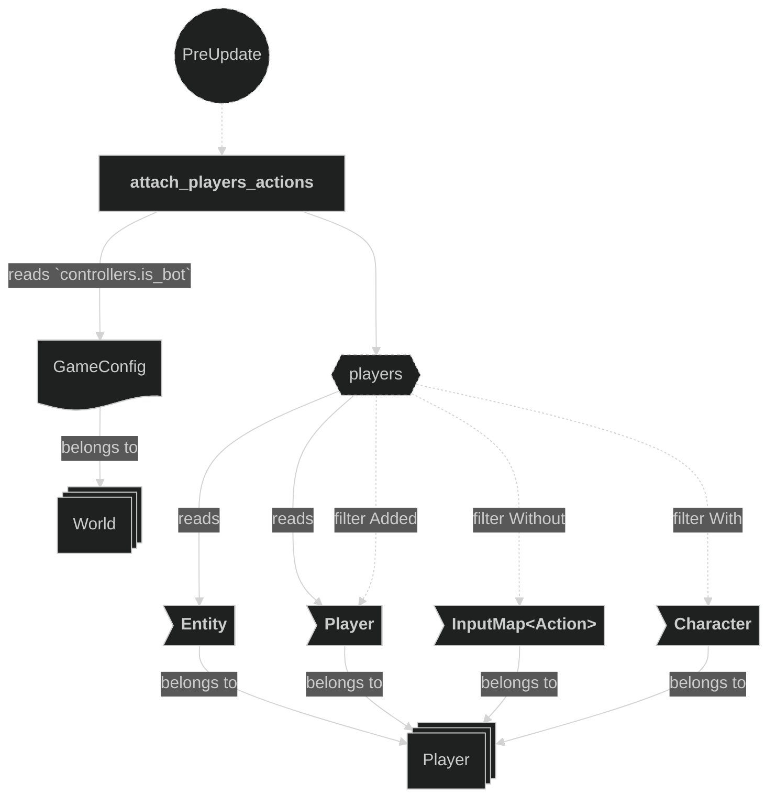
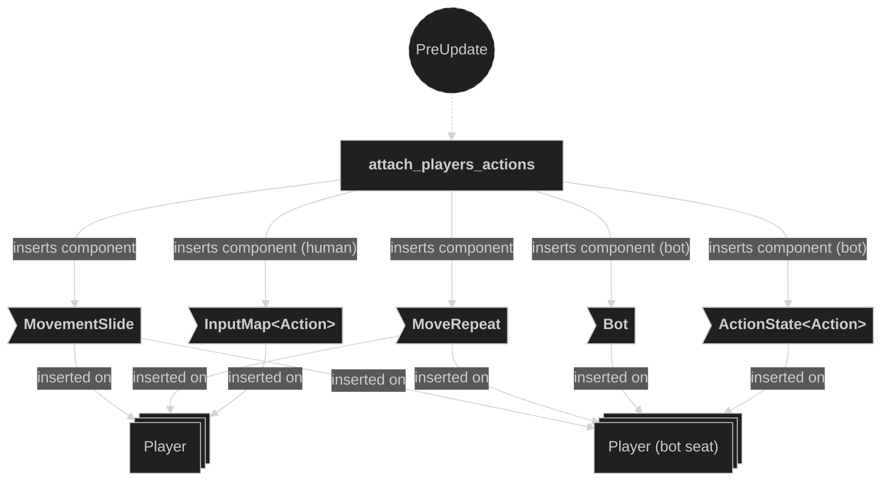
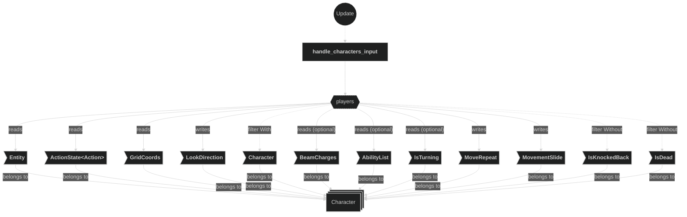
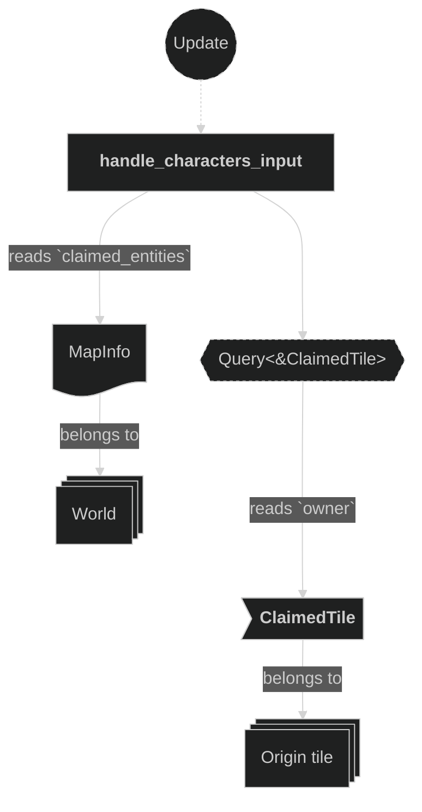
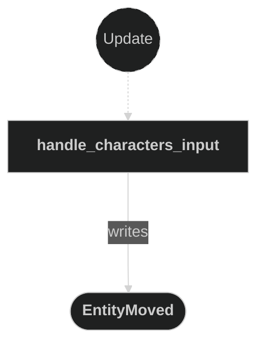
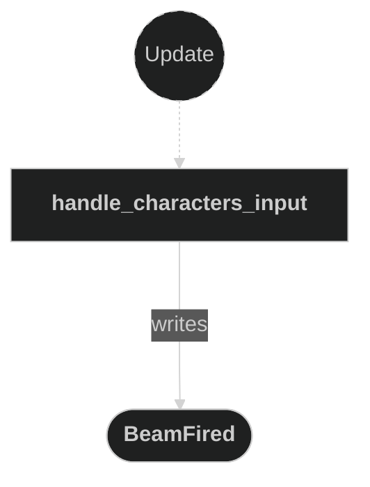
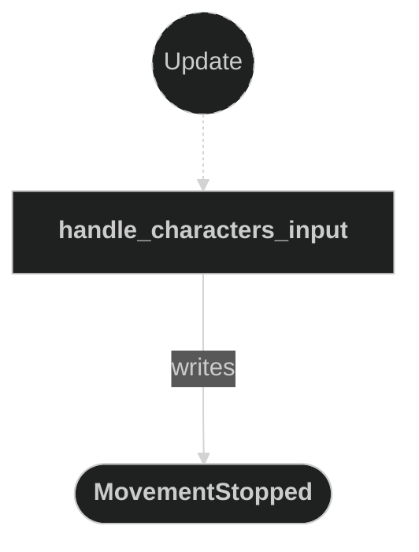
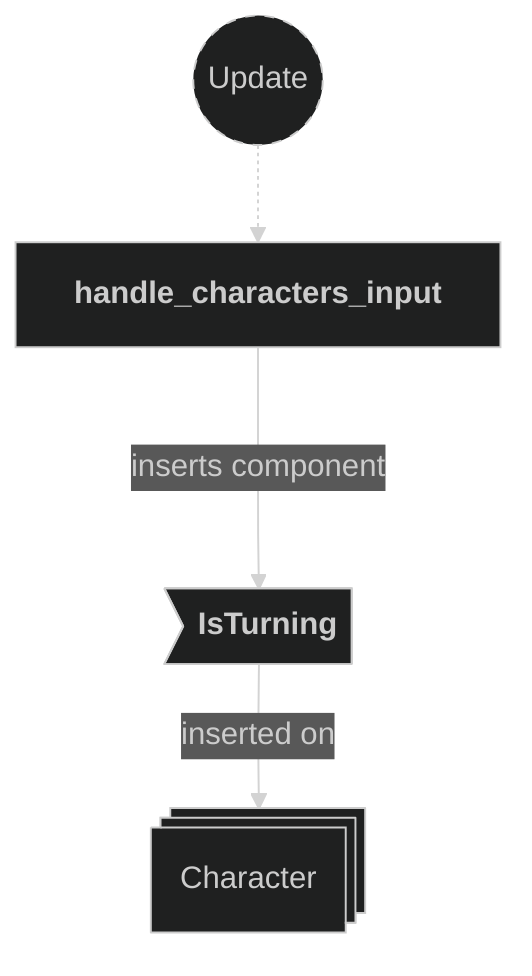
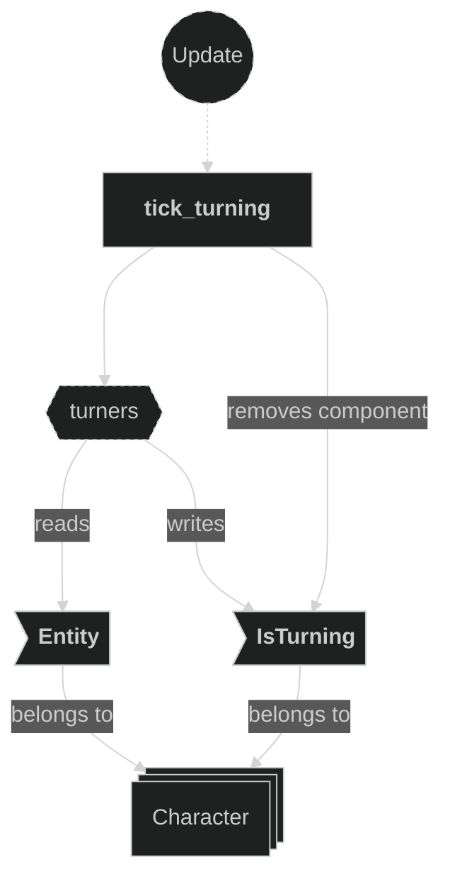

# Input Plugin

This plugin reads the player keys and turns them into move, shoot and stop messages. It also sets up the input on each new player and turns characters in place when they face a new direction. A bot player has no key map: the Bot plugin fills the same action state, earlier in the same frame.

The plugin also registers the `InputManagerPlugin` and the `TweeningPlugin`.

## Plugin Systems

### Attach Players Actions

- Runs in `PreUpdate`, once for each new player.
- A human seat gets an `InputMap`. A bot seat gets a bare `ActionState` and the `Bot` marker instead.
- Both kinds of seat also get `MoveRepeat` and `MovementSlide`.

### Handle Characters Input

- Runs in `Update`, only during `Playing`. Skips knocked-back and dead characters.
- **Lock** switches the direction lock on or off. A locked character never turns.
- **Shoot** fires only if a charge is left. From a claimed tile it also needs `Lance`, else nothing is spent.
- Lock and Shoot also work during a turn.
- **Release** after moving asks for a settle effect and resets the repeat, so the next press steps at once.
- **New facing** (unlocked): the facing changes at once and a turn starts.
- A turn from rest holds the step back, so a quick tap only turns. A turn while running keeps stepping.
- **Step**: the first step is immediate. The next ones wait `move_repeat_delay_ms`, then `move_repeat_rate_ms`.
- Straight (non-diagonal) steps wait `1/√2` less, so they look as fast as diagonal steps.

### Tick Turning

- Runs in `Update`, only during `Playing`. Moves each turn through its steps, then removes `IsTurning`.
- A 90° turn has one step. A 180° turn has two, through a fixed middle direction.
- It never changes the facing, so a shot during a turn goes in the new direction.

## Components, Resources and Messages CRUD

### Query Player entities for action attachment

Used in the following systems:
- **attach_players_actions**: new players with no `InputMap` yet. The config says if the seat is a bot.

### Write commands — attach InputMap or bot ActionState

Used in the following systems:
- **attach_players_actions**: human and bot seats get different components.

### Query Character entities for input handling

Used in the following systems:
- **handle_characters_input**: all characters, except knocked-back or dead ones.

### Read fire-gate inputs (MapInfo + ClaimedTile)

Used in the following systems:
- **handle_characters_input**: checks who owns the tile under the player before a shot.

### Write EntityMoved messages

Used in the following systems:
- **handle_characters_input**: one message for each step. A turn and a step can happen in the same frame.

### Write BeamFired messages

Used in the following systems:
- **handle_characters_input**: one message for each allowed shot.

### Write MovementStopped messages

Used in the following systems:
- **handle_characters_input**: when the move key is released after moving.

### Write commands — insert IsTurning

Used in the following systems:
- **handle_characters_input**: when an unlocked character faces a new direction. A new turn replaces the old one.

### Query turning characters

Used in the following systems:
- **tick_turning**: all characters that are turning.

