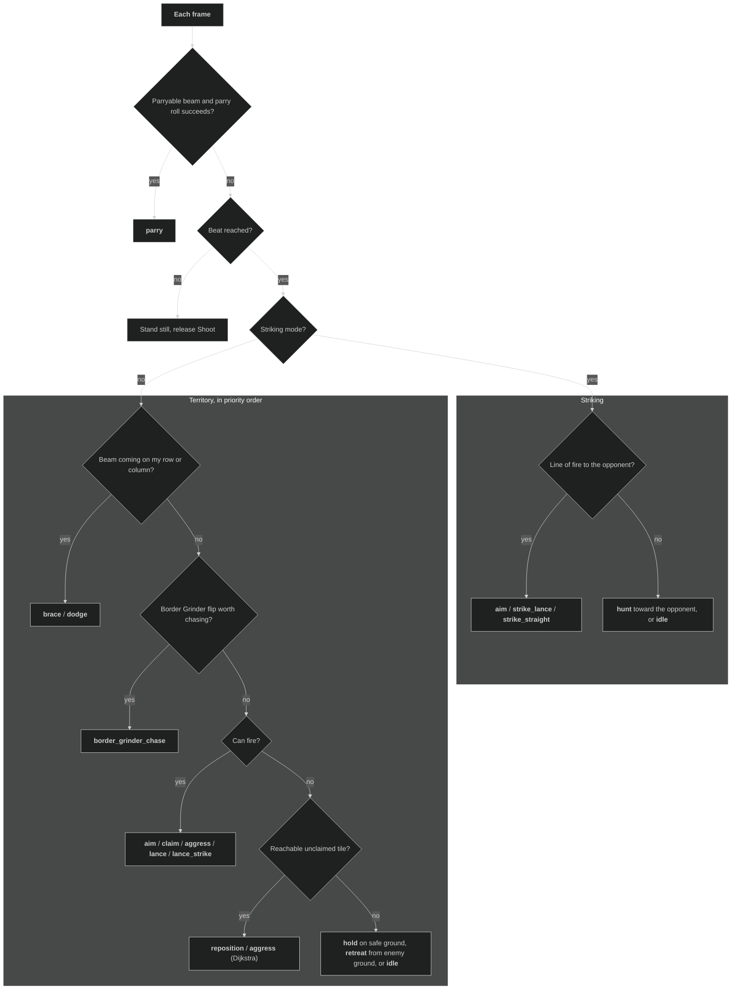
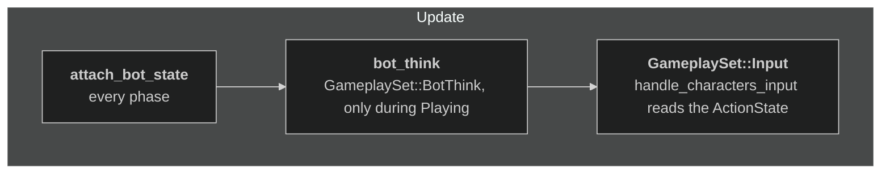
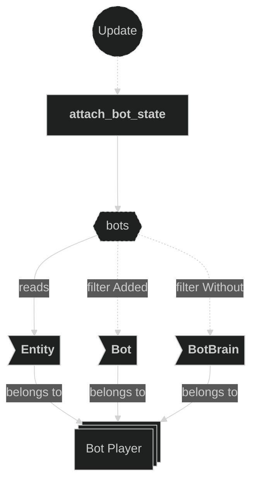
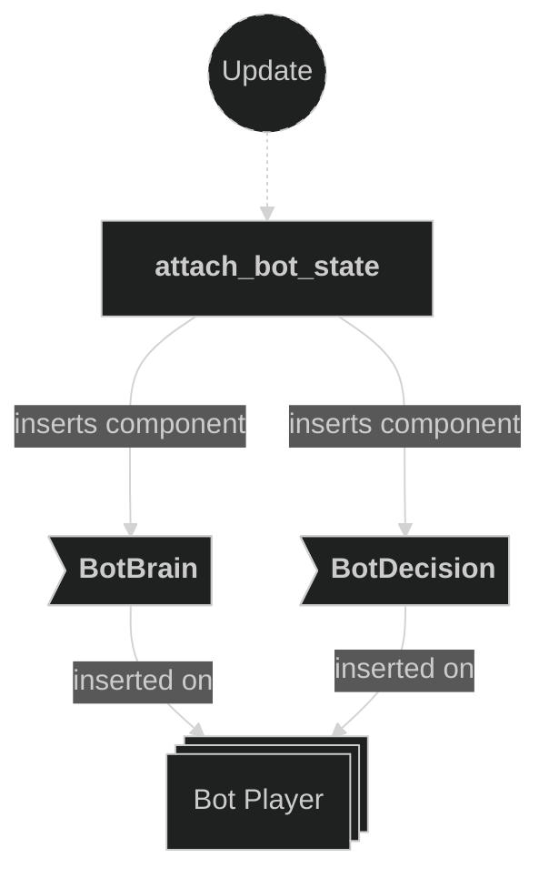
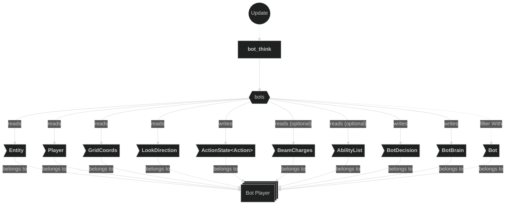
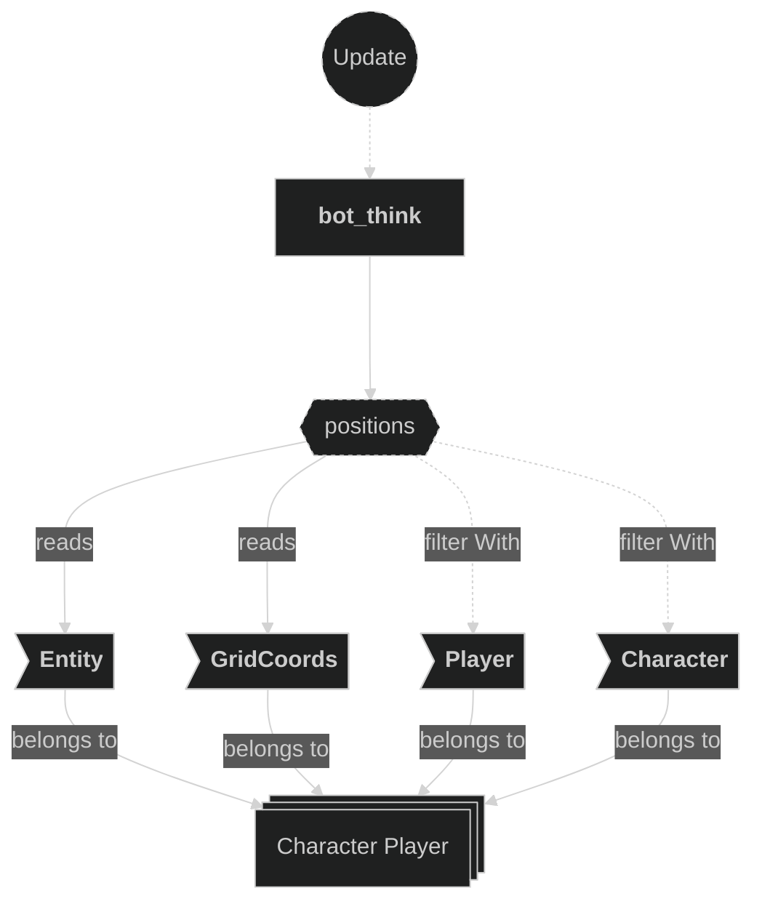
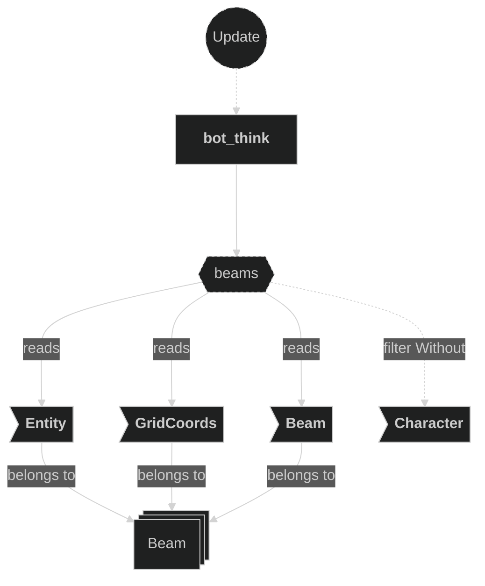
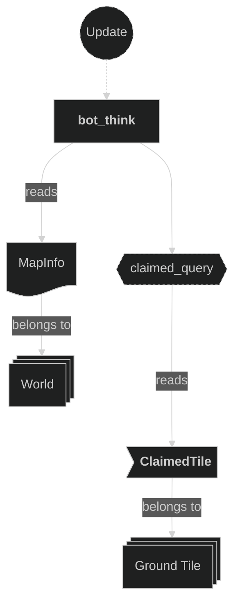
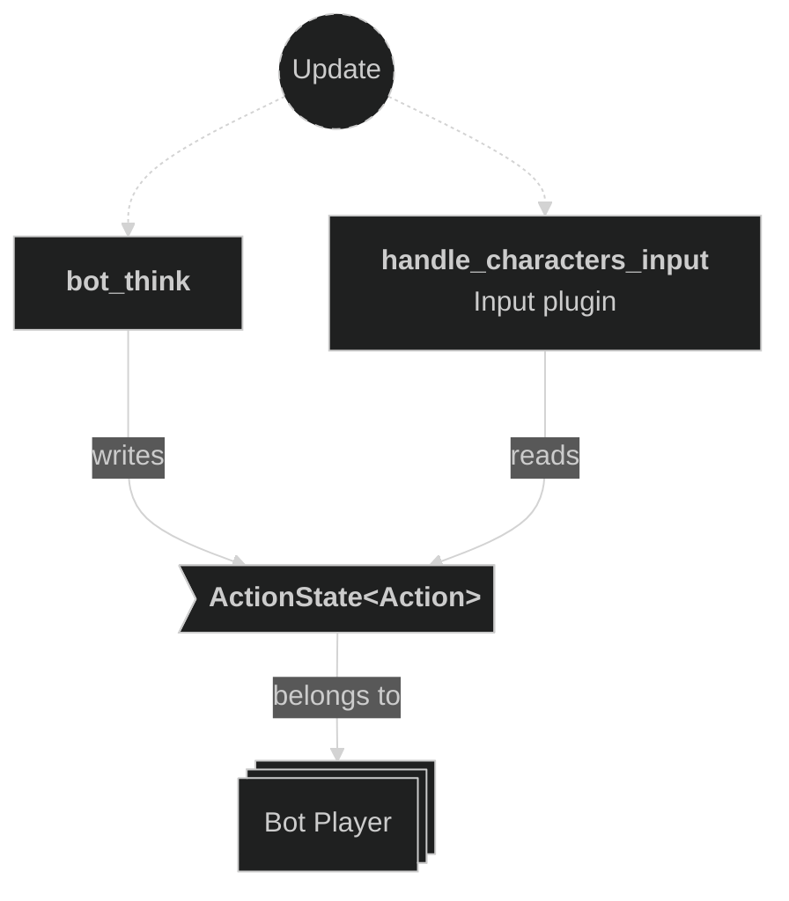
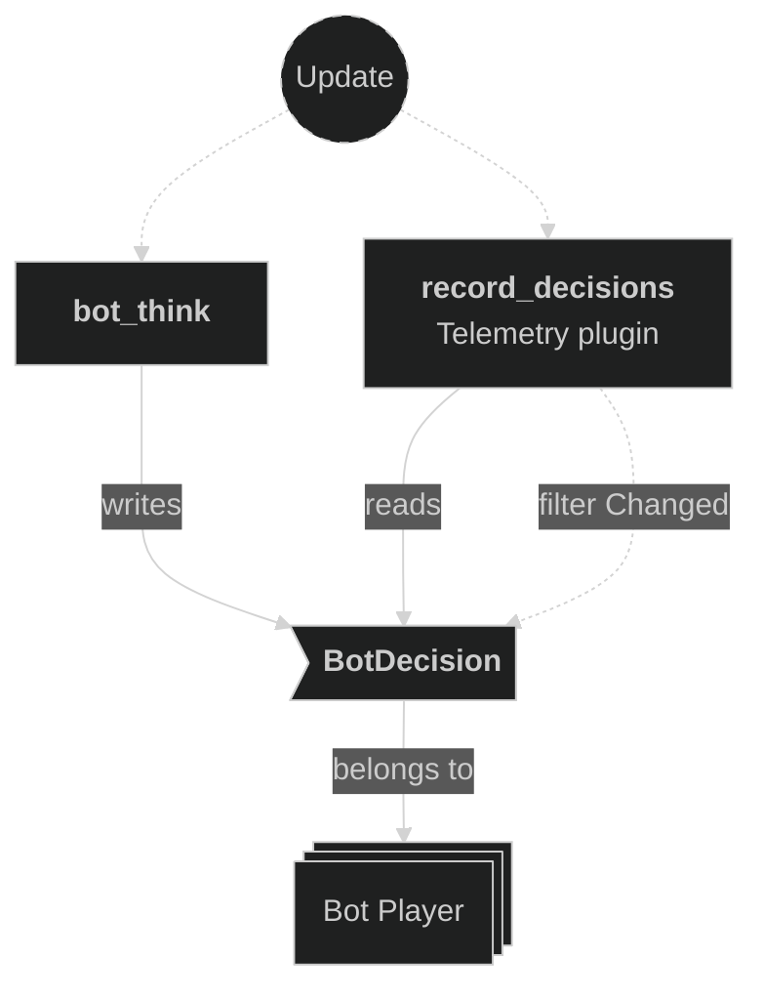

# Bot Plugin

This plugin plays a player for the computer. It writes the bot's `ActionState<Action>`, and the Input plugin reads it like a human's input. The code is in `src/plugins/bot.rs`.

## Key ideas

- The bot has no `InputMap`. It presses the same actions as a human, so it follows the same fire and charge rules.
- `controllers.player1_bot` / `player2_bot` choose which players are bots. The Input plugin reads them and adds the `Bot` marker.
- Each bot plays in one of two modes, chosen by `bot.player1_strike` / `player2_strike`:
    - **Striking**: hunts the opponent and shoots at them. It ignores territory.
    - **Territory** (default): claims tiles, dodges beams, and uses its abilities.
- The **parry reflex** runs every frame, before everything else. A parry window is shorter than the time between two decisions.
- All other decisions happen on a **beat**: every `bot.think_interval_ms`, plus a small random jitter. Between beats, the bot stands still and does not shoot.
- `bot.parry_chance` is rolled once per incoming beam. The result is kept, so the reflex and the brace/dodge choice agree on the same beam.
- Each decision is copied into `BotDecision`. The Telemetry plugin logs it when it changes.

## Decision flow

- With Border Grinder, a shot that flips an enemy tile is chosen before any normal claim.
- The Border Grinder chase is skipped if a flip is possible from the current tile, or if the path costs more than `bot.chase_cost_threshold`.
- A striking bot without Lance never steps onto an enemy tile, because it cannot fire from there.

## Ordering

## Plugin Systems

### Attach Bot State

- Adds `BotBrain` and `BotDecision` to each new `Bot` entity.

### Bot Think

- Runs every frame during `Playing`, for each bot.
- Follows the decision flow above. Writes the move axis and the Shoot button into `ActionState<Action>`.
- Replaces `BotDecision` only when the decision changes.

### Helpers

- `reach`: counts the free tiles in a straight line.
- `border_grinder_target`: true if the next tile belongs to the enemy.
- `lance_landing`, `lance_hits_enemy`: where a Lance shot lands, and whether it hits the opponent.
- `shot_hits_enemy`: whether a Straight or Lance shot hits the opponent.
- `incoming_beam_threat`: finds an enemy beam coming toward the bot, with the facing to parry it and a safe dodge step.
- `dijkstra_first_steps`: cost and first step to every reachable tile. Entering an enemy tile costs `bot.hostile_cost`.
- `astar_first_step`: first step toward one target tile. Used by the striking mode.
- `reposition_score`, `fires_toward_opponent`: scoring for the territory mode, biased toward the opponent when `bot.aggression` ≥ 0.5.

## Components, Resources and Messages CRUD

### Read GameConfig and Time

Used in the following systems:
- **bot_think**: reads the `bot.*` values, `parry.window_fraction` and the elapsed time.

### Query new bots

Used in the following systems:
- **attach_bot_state**: finds `Bot` entities that were just added and have no `BotBrain`.

### Insert BotBrain and BotDecision

Used in the following systems:
- **attach_bot_state**: inserts both with default values.

### Query bots

Used in the following systems:
- **bot_think**: reads the bot's position, facing, charges and abilities. Writes its `ActionState`, `BotDecision` and `BotBrain`.

### Query player positions

Used in the following systems:
- **bot_think**: finds the opponent's tile. `With<Character>` is needed because HUD entities also have `Player` and `GridCoords`.

### Query beams

Used in the following systems:
- **bot_think**: finds parryable beams (`find_parryable_beam`, shared with the Input plugin) and incoming beams (`incoming_beam_threat`).

### Read MapInfo and ClaimedTile

Used in the following systems:
- **bot_think**: checks ground, forbidden tiles and tile owners for firing, pathfinding and threats.

### ActionState of a bot

Used in the following systems:
- **bot_think**: writes the move axis and presses or releases Shoot.
- **handle_characters_input** (Input plugin): reads it, the same way as for a human.

### BotDecision

Used in the following systems:
- **bot_think**: replaces it when the decision changes.
- **record_decisions** (Telemetry plugin): logs it.

Definitions:
- `Bot`: marker `Component` (`src/components/markers.rs`), added by the Input plugin to a bot player.
- `BotDecision`: public `Component` with `behaviour` (a short tag, in bold in the decision flow), `why`, `move_x`, `move_y` and `shoot`.
- `BotBrain`: private `Component` with the fire cooldown state, the next beat time, a sticky `target` tile and the cached `parry_rolls`.
