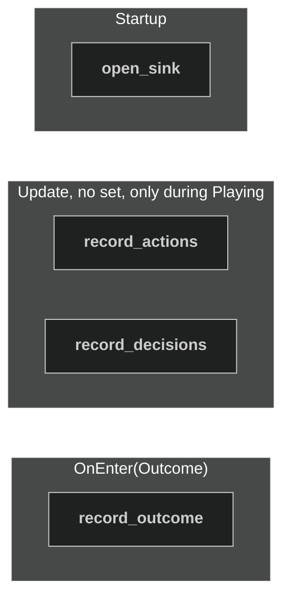
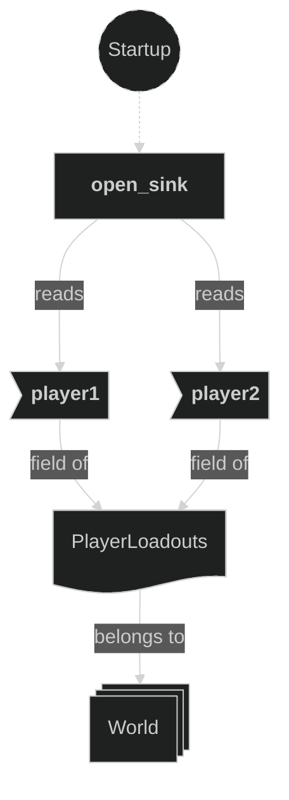
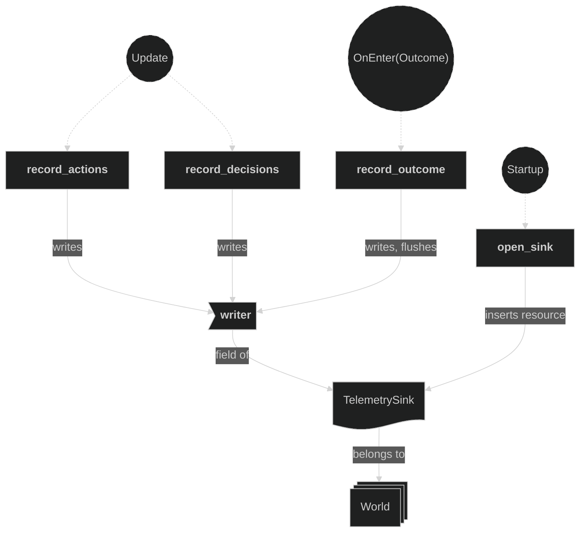
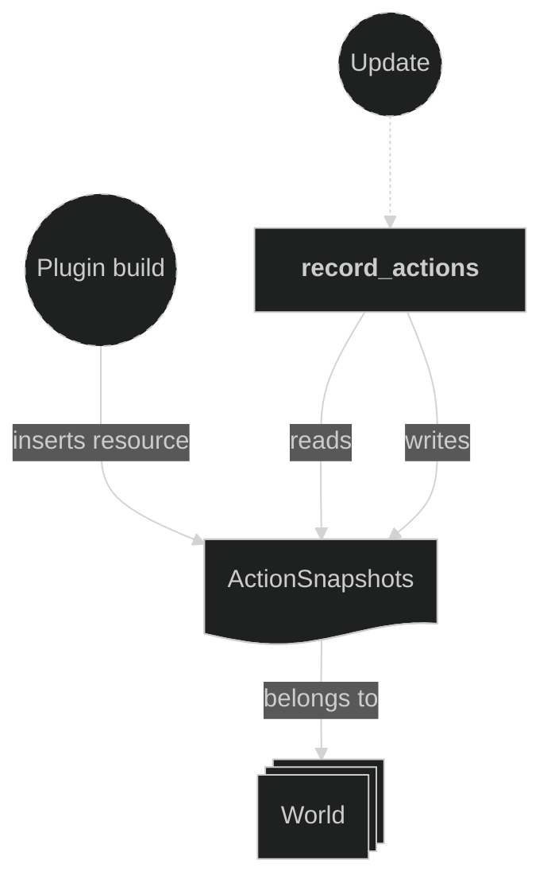
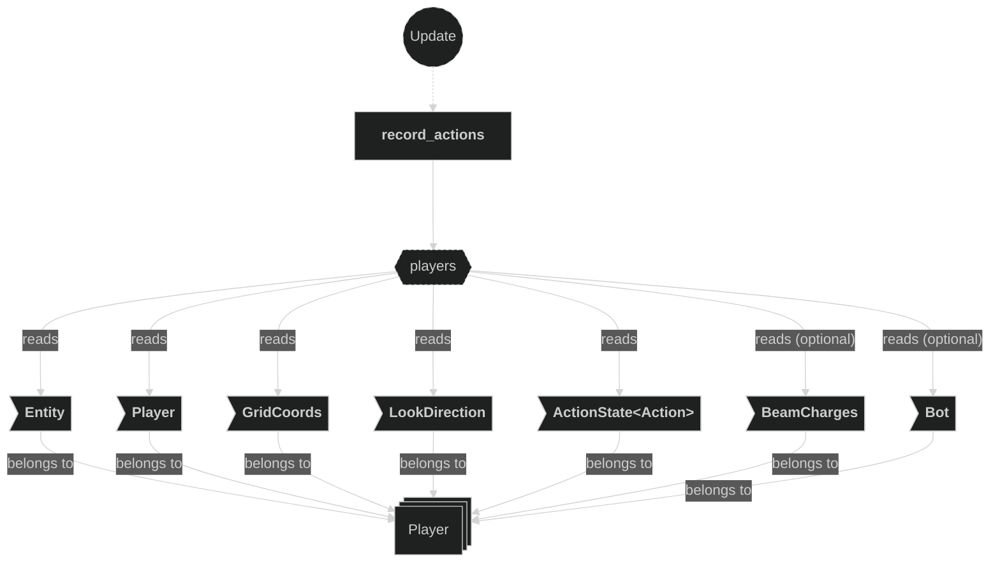
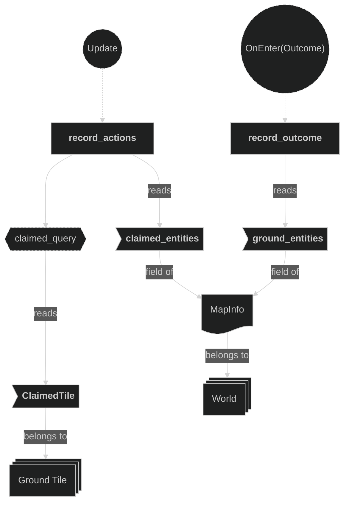
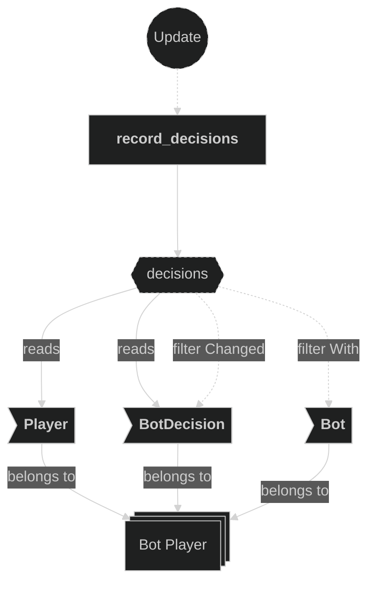
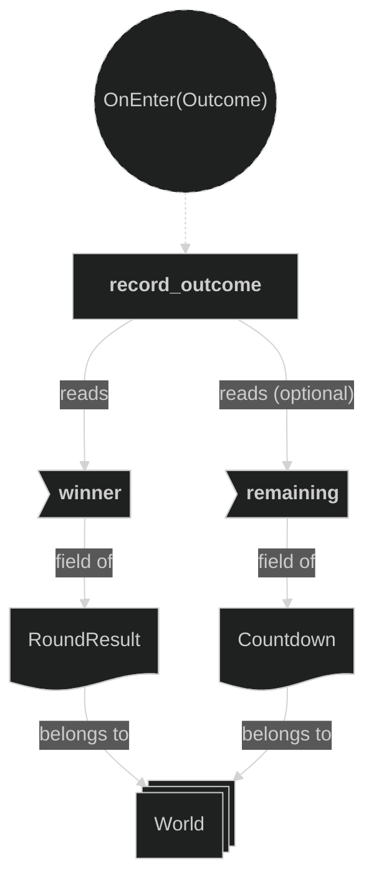
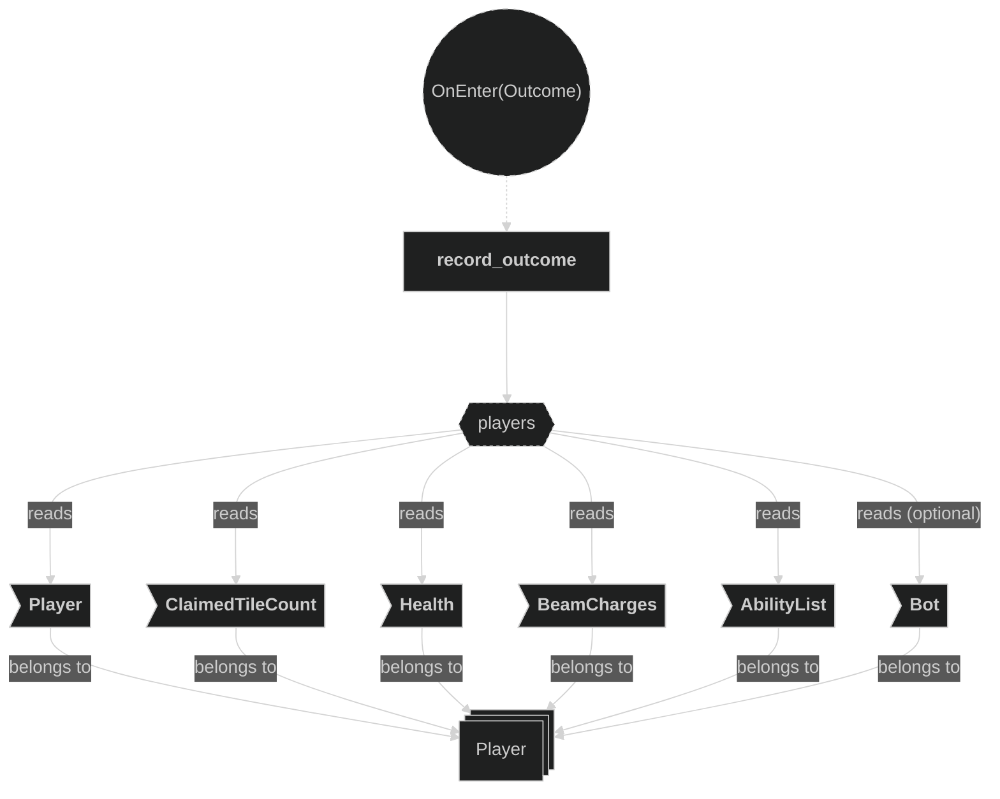

# Telemetry Plugin

This plugin records human and bot play into `play_trace.jsonl`, one JSON object per line, for balance analysis. The code is in `src/plugins/telemetry.rs`.

## Key ideas

- `telemetry.enabled` turns the whole plugin on or off. Every system checks it.
- If the file cannot be opened, there is no `TelemetrySink`, and all systems do nothing.
- At start, the old trace files are rotated: `play_trace.jsonl` becomes `play_trace.1.jsonl`, and so on. `telemetry.history` is the total number of files kept.
- Each record has a `kind`. Player records also have a `controller` tag: `"human"` or `"bot"`.
- Actions and decisions are written only when they change, so the file stays small.

| `kind` | Written | Content |
|---|---|---|
| `session` | once, at start | which players are bots, and the starting loadouts |
| `action` | when a player's state changes | position, facing, shoot, charges, on an enemy tile |
| `decision` | when a bot's `BotDecision` changes | the bot's behaviour, reason and move |
| `outcome` | once per round | winner, reason (`kill`, `timeout`, `charge_exhaustion`), duration, and tiles, HP, charges spent and loadout per player |

## Ordering

- All four systems run only when `telemetry.enabled` is true.

## Plugin Systems

### Open Sink

- Runs once at `Startup`.
- Rotates the old files, opens a new `play_trace.jsonl` and writes the `session` record.
- Inserts `TelemetrySink`. If the file cannot be opened, logs a warning and inserts nothing.

### Record Actions

- Runs every frame during `Playing`.
- Builds a snapshot of each player. If it differs from the last one in `ActionSnapshots`, writes an `action` record.

### Record Decisions

- Runs every frame during `Playing`.
- Writes a `decision` record for each bot whose `BotDecision` changed.

### Record Outcome

- Runs on entering `Outcome`.
- Finds the reason: `kill` if a player has no HP, `timeout` if the countdown is 0, else `charge_exhaustion`.
- Writes the `outcome` record and flushes the file.

## Components, Resources and Messages CRUD

### Read GameConfig and Time

Used in the following systems:
- **open_sink**: reads `telemetry.*` and `controllers.*`.
- **record_actions**, **record_decisions**: read the elapsed time.
- **record_outcome**: reads `round.round_duration_secs`.

### Read PlayerLoadouts resource

Used in the following systems:
- **open_sink**: writes both loadouts in the `session` record.

### TelemetrySink resource

Used in the following systems:
- **open_sink**: inserts it.
- **record_actions**, **record_decisions**, **record_outcome**: write records into it. They do nothing when it is missing.

### ActionSnapshots resource

Used in the following systems:
- **plugin build**: inserts it empty.
- **record_actions**: compares each player with its last snapshot, and stores the new one.

### Query players (actions)

Used in the following systems:
- **record_actions**: reads the state of each player to build its snapshot.

### Read MapInfo and ClaimedTile

Used in the following systems:
- **record_actions**: checks if the player stands on an enemy tile (`is_hostile_tile`).
- **record_outcome**: reads the number of ground tiles, for `tile_pct`.

### Query bot decisions

Used in the following systems:
- **record_decisions**: reads the bots whose `BotDecision` changed.

### Read RoundResult and Countdown

Used in the following systems:
- **record_outcome**: reads the winner, and the time left to find the reason and the duration.

### Query players (outcome)

Used in the following systems:
- **record_outcome**: reads tiles, HP, charges and abilities of each player.

Definitions:
- `TelemetrySink`: private `Resource` with a buffered writer on `play_trace.jsonl`.
- `ActionSnapshots`: private `Resource` with the last written snapshot of each player.
- `SessionRecord`, `ActionRecord`, `DecisionRecord`, `OutcomeRecord`: the four record types, serialized with `serde`.
