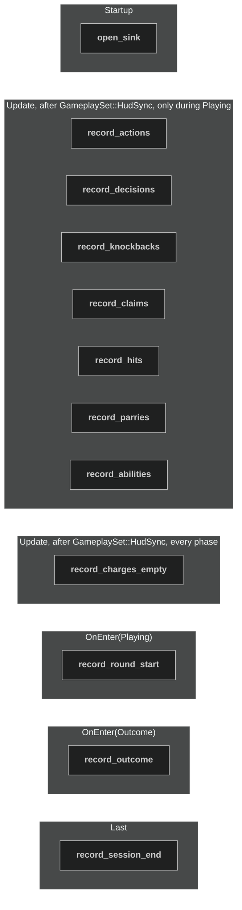
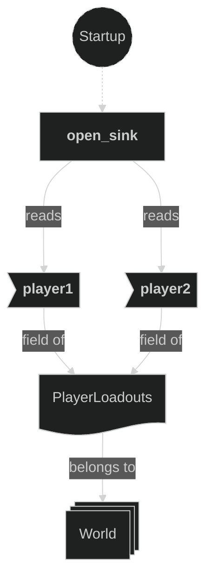
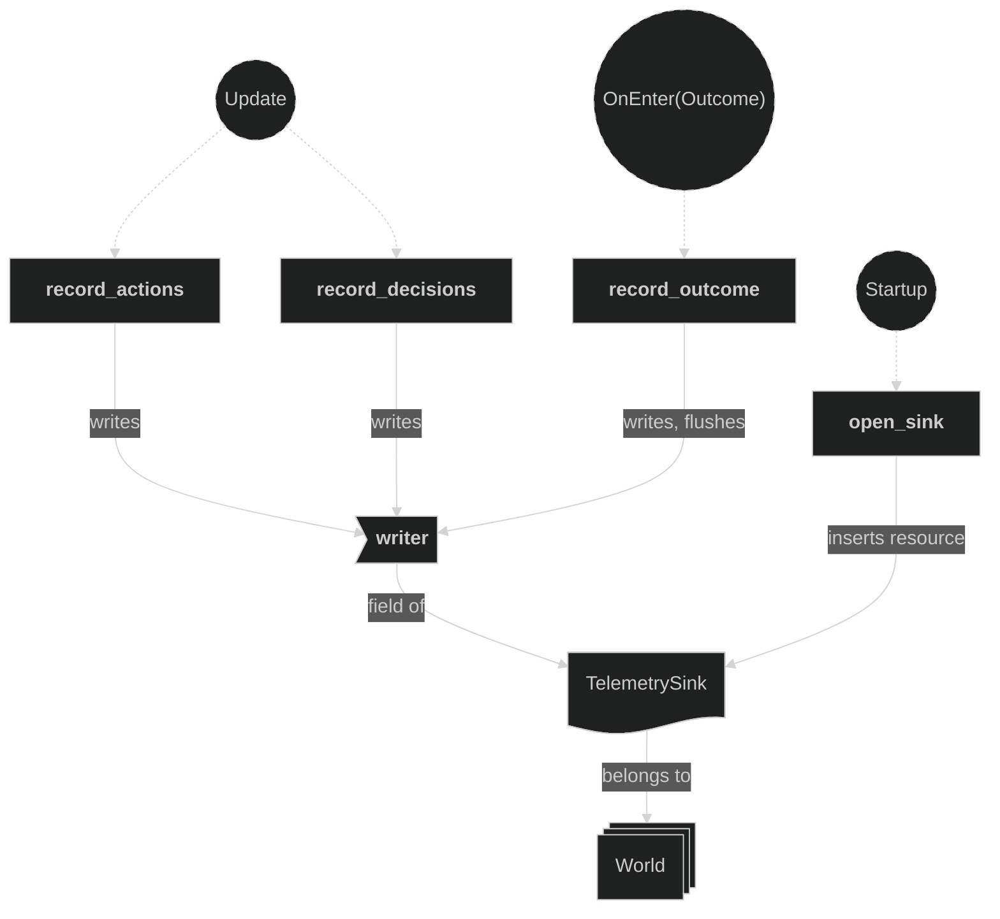
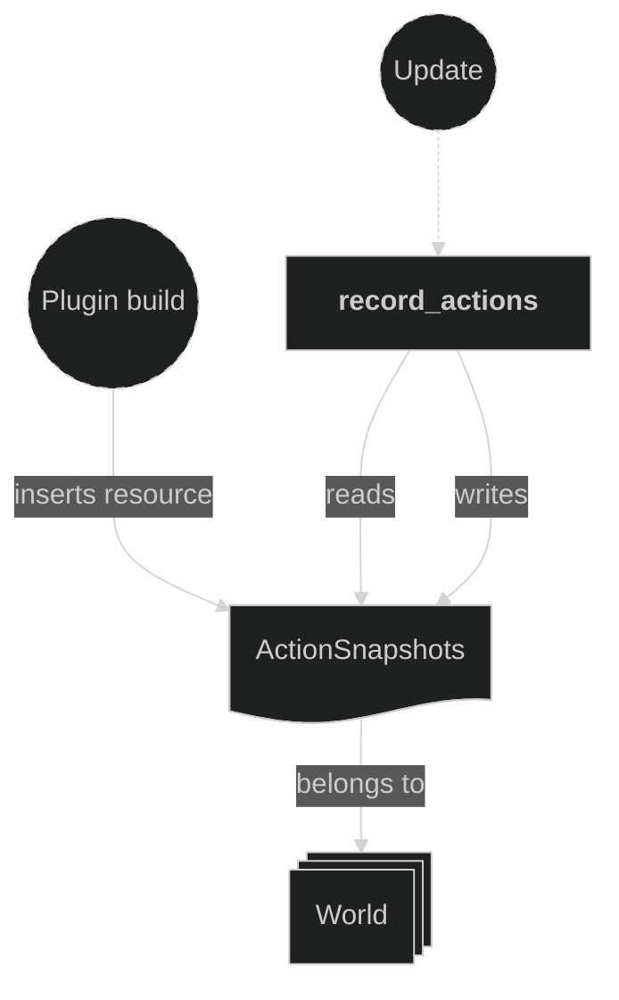
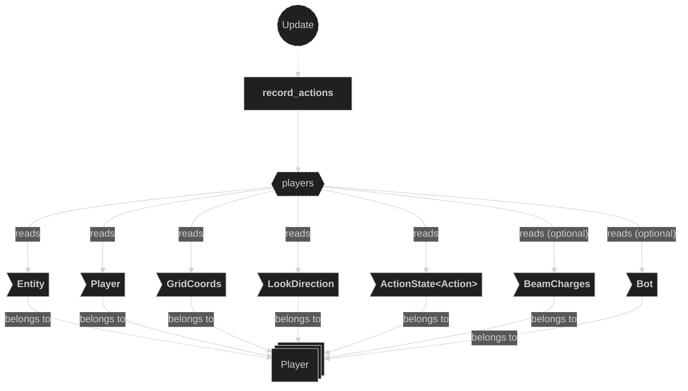
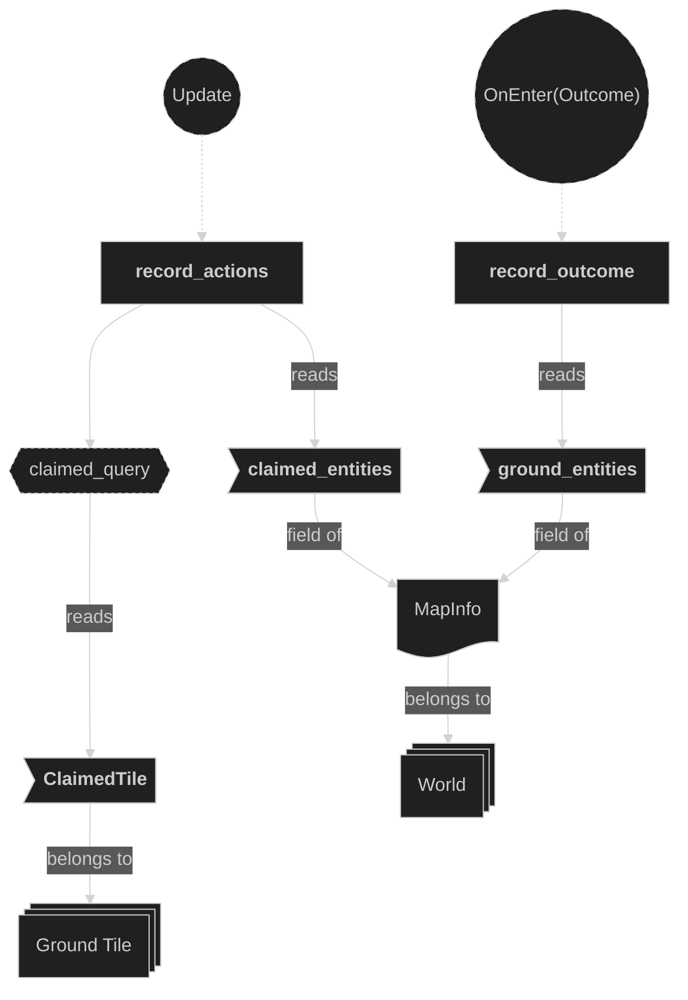
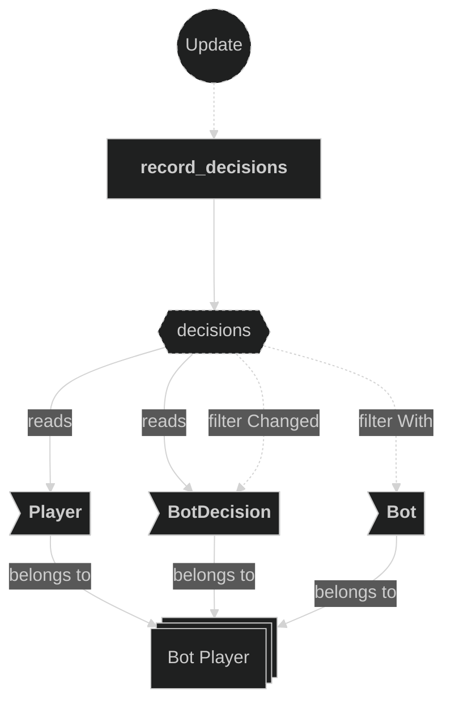
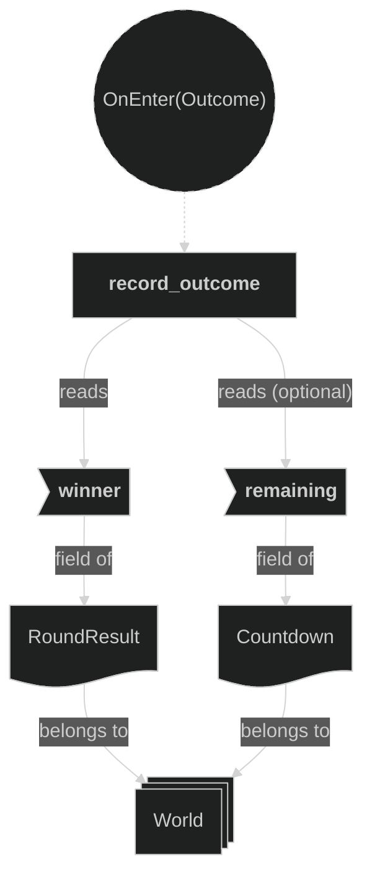
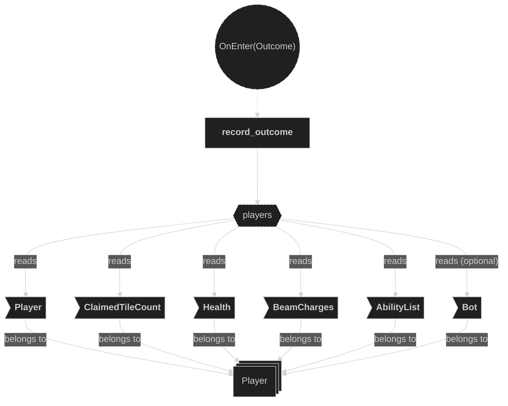

# Telemetry Plugin

This plugin records human and bot play into `play_trace.jsonl`, one JSON object per line, for balance analysis and for cutting clips from a screen recording. The code is in `src/plugins/telemetry.rs`.

## Key ideas

- `telemetry.enabled` turns the whole plugin on or off. Every system checks it.
- If the file cannot be opened, there is no `TelemetrySink`, and all systems do nothing.
- At start, the old trace files are rotated: `play_trace.jsonl` becomes `play_trace.1.jsonl`, and so on. `telemetry.history` is the total number of files kept.
- The first line is the `session` record. It holds `schema_version` (now 2) and the clock anchor.
- Every later record has two clocks, both in seconds since the app launched:
  - `t` is game time (`Time<Virtual>`). It slows down during hitstop, and Bevy limits very long frames. It does not follow the wall clock.
  - `rt` is real time (`Time<Real>`). Use `rt` to place a record on a video timeline.
- Records are `action`, `decision`, `event` and `outcome`. An `event` record has an `event` name and its own fields.
- Actions and decisions are written only when they change, so the file stays small.
- Player ids are 0 (P1) and 1 (P2). Fields named `attacker`, `caster` or `old_owner` are `null` when there is no player.

## Mapping a record to a video

The `session` record gives the time of the line in Unix milliseconds (`unix_ms`) and the real time since launch at that instant (`rt_at_write`). With the Unix time when the recording started:

```
video_seconds = (session.unix_ms - recording_start_unix_ms) / 1000 + record.rt - session.rt_at_write
```

`t_at_write` is the game time at the same instant. It is only useful to relate `t` to `rt`. `rt_at_write` is exact. `t_at_write` is the value of the current frame. `rt` on other records is also the value of their frame.

## Record schema

One example line per `kind`. Existing fields keep their names. `rt` and the `event` records are additions.

| `kind` | Written | Fields |
|---|---|---|
| `session` | once, at start | `schema_version`, `unix_ms`, `t_at_write`, `rt_at_write`, `map`, `telemetry_enabled`, `bot_p1`, `bot_p2`, `loadout_p1`, `loadout_p2`, `rounds`, `after_last_round` |
| `action` | when a player's state changes | `controller`, `player_id`, `t`, `rt`, `x`, `y`, `facing`, `shoot`, `charges_current`, `charges_max`, `on_hostile` |
| `decision` | when a bot's `BotDecision` changes | `controller`, `player_id`, `t`, `rt`, `behaviour`, `why`, `move_x`, `move_y`, `shoot` |
| `event` | see the next table | `event`, `t`, `rt`, and the fields of that event |
| `outcome` | once per round | `t`, `rt`, `round`, `winner`, `reason` (`kill`, `timeout`, `charge_exhaustion`), `round_duration_secs`, and `players` with tiles, HP, charges spent and loadout |

`rounds` and `after_last_round` in the `session` record are the match limit from the `launch` config (0 = endless). `map` is the level asset path.

| `event` | Written | Fields |
|---|---|---|
| `round_start` | on entering `Playing` | `round` (from 1), `players` (`player_id`, `controller`, `loadout`) |
| `claim` | once per player per frame in which tiles changed owner | `player_id`, `tiles_claimed`, `tile_pct_after`, `x`, `y` (the first tile) |
| `hit` | when a player loses health | `attacker`, `victim`, `damage`, `hp_after`, `cause` (`beam`, `hostile_tile` or `collision`) |
| `knockback` | when a player is knocked back | `victim`, `tiles` (always 1), `x`, `y` (new position), `dx`, `dy` |
| `parry` | when a parry lands | `defender`, `caster`, `success` (always `true`), `parries` |
| `ability_used` | when a drafted ability takes effect | `player_id`, `ability` |
| `charges_empty` | when a player's charges reach 0 | `player_id` |
| `session_end` | when the app exits | `round` (the last round started) |

Limits to know:
- `parry` is written only for a parry that lands. A missed parry is a normal shot and has no event, so `success` is always `true`.
- A beam claims one tile, so `tiles_claimed` is 1 until an ability claims many tiles at once.
- `hit` with `cause` `hostile_tile` has no attacker. `collision` has no attacker either.

Example lines (values shortened):

```json
{"kind":"session","schema_version":2,"unix_ms":1795600000000,"t_at_write":0.0,"rt_at_write":0.42,"map":"level2.tmx","telemetry_enabled":true,"bot_p1":true,"bot_p2":true,"loadout_p1":["SolarPanels"],"loadout_p2":["BorderGrinder"],"rounds":3,"after_last_round":"Stay"}
{"kind":"action","controller":"bot","player_id":1,"t":3.37,"rt":3.81,"x":23,"y":14,"facing":"Up","shoot":false,"charges_current":117,"charges_max":117,"on_hostile":false}
{"kind":"decision","controller":"bot","player_id":1,"t":3.37,"rt":3.81,"behaviour":"claim","why":"nearest free tile","move_x":0.0,"move_y":1.0,"shoot":false}
{"kind":"event","event":"round_start","t":3.37,"rt":3.81,"round":1,"players":[{"player_id":0,"controller":"bot","loadout":["SolarPanels"]},{"player_id":1,"controller":"bot","loadout":["BorderGrinder"]}]}
{"kind":"event","event":"claim","t":3.56,"rt":4.0,"player_id":1,"tiles_claimed":1,"tile_pct_after":0.43,"x":23,"y":17}
{"kind":"event","event":"hit","t":11.03,"rt":11.9,"attacker":null,"victim":1,"damage":5.0,"hp_after":95.0,"cause":"hostile_tile"}
{"kind":"event","event":"knockback","t":11.15,"rt":12.0,"victim":1,"tiles":1,"x":8,"y":18,"dx":0,"dy":1}
{"kind":"event","event":"parry","t":22.77,"rt":24.1,"defender":1,"caster":0,"success":true,"parries":1}
{"kind":"event","event":"ability_used","t":6.34,"rt":6.9,"player_id":1,"ability":"BorderGrinder"}
{"kind":"event","event":"charges_empty","t":40.2,"rt":43.0,"player_id":0}
{"kind":"event","event":"session_end","t":120.5,"rt":131.0,"round":3}
{"kind":"outcome","t":51.4,"rt":55.0,"round":1,"winner":0,"reason":"kill","round_duration_secs":48,"players":[{"player_id":0,"controller":"bot","tile_pct":20.1,"tile_count":47,"hp":52.0,"charges_spent":73,"loadout":["SolarPanels"]},{"player_id":1,"controller":"bot","tile_pct":21.4,"tile_count":50,"hp":-1.0,"charges_spent":47,"loadout":["BorderGrinder"]}]}
```

## Ordering



- All eleven systems run only when `telemetry.enabled` is true.
- The `Update` recorders run after every gameplay set, so the last frame of a round is recorded.

## Plugin Systems

### Open Sink

- Runs once at `Startup`.
- Rotates the old files, opens a new `play_trace.jsonl` and writes the `session` record. `unix_ms` is the system clock at that moment. `rt_at_write` is the time since the app start, read at the same moment.
- Inserts `TelemetrySink`. If the file cannot be opened, logs a warning and inserts nothing.

### Record Actions

- Runs every frame during `Playing`.
- Builds a snapshot of each player. If it differs from the last one in `ActionSnapshots`, writes an `action` record.

### Record Decisions

- Runs every frame during `Playing`.
- Writes a `decision` record for each bot whose `BotDecision` changed.

### Record Round Start

- Runs on entering `Playing`.
- Adds 1 to `TelemetryRound`, writes the `round_start` event with each player's controller and loadout, and flushes the file.

### Record Claims

- Runs every frame during `Playing`. Reads `TileClaimed`.
- Skips a message that did not change the owner. Merges the others by player, and writes one `claim` event per player. `tile_pct_after` is the owned share of all ground tiles.

### Record Hits

- Runs every frame during `Playing`. Reads `DamageDealt` and writes a `hit` event. `hp_after` is the health when the system runs. A beam hit has an `attacker`.

### Record Knockbacks

- Runs every frame during `Playing`. Reads `EntityKnockedBack` and writes a `knockback` event with the new position and the push direction.

### Record Parries

- Runs every frame during `Playing`. Reads `BeamParried` and writes a `parry` event.

### Record Abilities

- Runs every frame during `Playing`. Reads `AbilityTriggered` and writes an `ability_used` event.

### Record Charges Empty

- Runs every frame, in every phase. Looks at players whose `BeamCharges` changed.
- Writes a `charges_empty` event the first time the charges are 0. It forgets the player when the charges are above 0 again, for example after a round reset.

### Record Outcome

- Runs on entering `Outcome`.
- Finds the reason: `kill` if a player has no HP, `timeout` if the countdown is 0, else `charge_exhaustion`.
- Writes the `outcome` record with the round index and flushes the file.

### Record Session End

- Runs in `Last`. When an `AppExit` message is present, writes the `session_end` event and flushes the file.

## Components, Resources and Messages CRUD

### Read GameConfig and Time

Used in the following systems:
- **open_sink**: reads `telemetry.*`, `controllers.*` and `launch.*`.
- **every record system**: read the game time and the real time.
- **record_outcome**: reads `round.round_duration_secs`.

### Read PlayerLoadouts resource

Used in the following systems:
- **open_sink**: writes both loadouts in the `session` record.



### TelemetrySink resource

Used in the following systems:
- **open_sink**: inserts it.
- **record_actions**, **record_decisions**, **record_outcome**: write records into it. They do nothing when it is missing.



### ActionSnapshots resource

Used in the following systems:
- **plugin build**: inserts it empty.
- **record_actions**: compares each player with its last snapshot, and stores the new one.



### Query players (actions)

Used in the following systems:
- **record_actions**: reads the state of each player to build its snapshot.



### Read MapInfo and ClaimedTile

Used in the following systems:
- **record_actions**: checks if the player stands on an enemy tile (`is_hostile_tile`).
- **record_outcome**: reads the number of ground tiles, for `tile_pct`.



### Query bot decisions

Used in the following systems:
- **record_decisions**: reads the bots whose `BotDecision` changed.



### Read RoundResult and Countdown

Used in the following systems:
- **record_outcome**: reads the winner, and the time left to find the reason and the duration.



### Query players (outcome)

Used in the following systems:
- **record_outcome**: reads tiles, HP, charges and abilities of each player.



Definitions:
- `TelemetrySink`: private `Resource` with a buffered writer on `play_trace.jsonl`.
- `ActionSnapshots`: private `Resource` with the last written snapshot of each player.
- `SessionRecord`, `ActionRecord`, `DecisionRecord`, `OutcomeRecord`: the four record types, serialized with `serde`.
