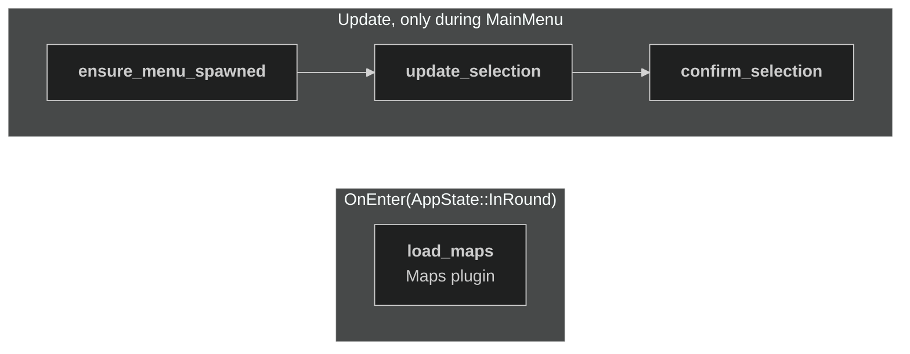
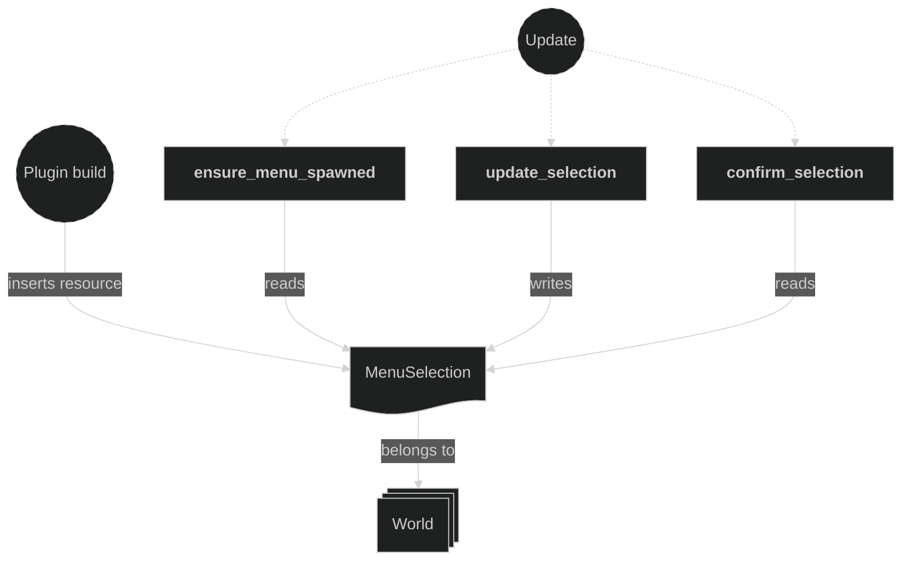
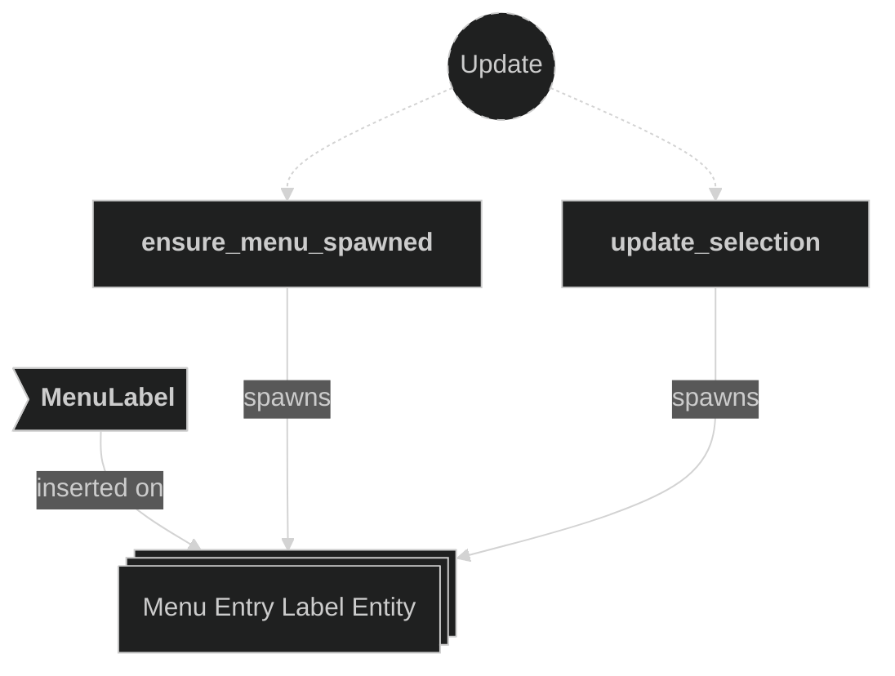
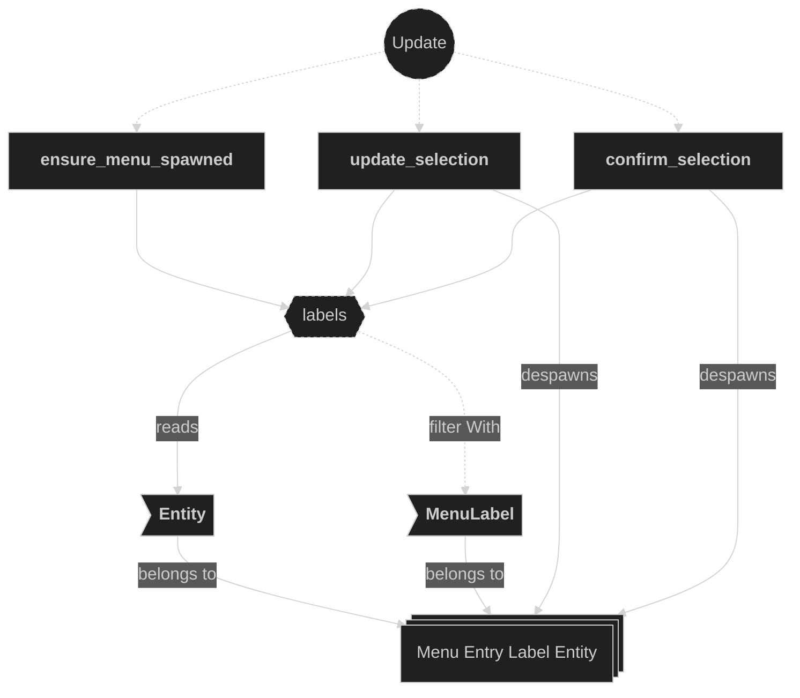
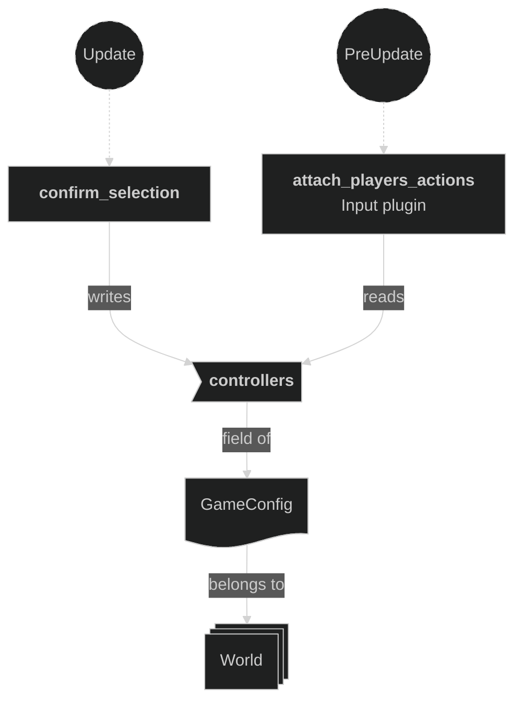
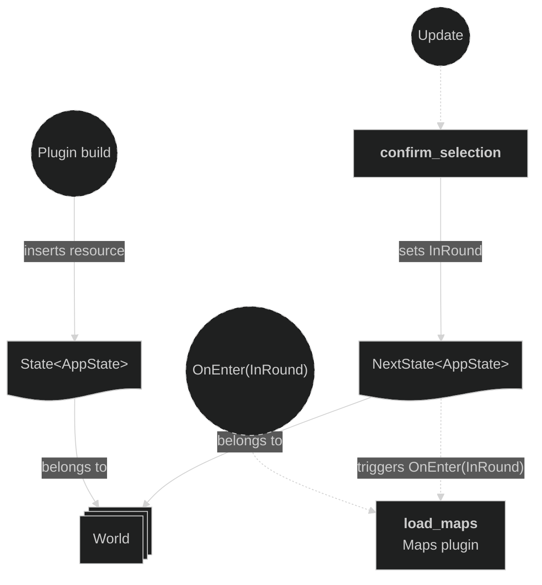

# Menu Plugin

This plugin shows the main menu, where players choose who is a bot. No map loads before a choice is confirmed. The code is in `src/plugins/menu.rs`.

## Key ideas

- `AppState` is the top-level state, above `RoundPhase`. It starts in `MainMenu` and goes to `InRound` once. It never goes back.
- The Maps plugin runs `load_maps` on `OnEnter(AppState::InRound)`. So the maps, the players and the round all wait for the menu.
- The confirmed choice is written into `GameConfig.controllers`. The Input plugin reads it when the players spawn.
- The entries are drawn with the [Text plugin](/documentation/17/015-text-plugin) on the overlay camera. The selected entry starts with `>`.
- Controls: W / S or the arrow keys move the cursor. Q or `/` confirms.

| Entry | Player 1 | Player 2 |
|---|---|---|
| `1P VS 2P` | human | human |
| `1P VS BOT` | human | bot |
| `BOT VS 2P` | bot | human |
| `BOT VS BOT` (dev builds only) | bot | bot |

## Ordering

- `ensure_menu_spawned` runs in `Update`, because `OnEnter` of the default state can run before `Startup`, when `FontAtlas` does not exist yet.

## Plugin Systems

### Ensure Menu Spawned

- Waits for `FontAtlas`, then draws the entries once, if none exist.

### Update Selection

- Moves the cursor up or down. It stops at the first and last entries.
- On a change, despawns the entries and draws them again.

### Confirm Selection

- On Q or `/`, writes the chosen matchup into `GameConfig.controllers`.
- Despawns the entries and sets the next state to `InRound`.

## Components, Resources and Messages CRUD

### Read FontAtlas and ButtonInput

Used in the following systems:
- **ensure_menu_spawned**: reads `FontAtlas` as an `Option`.
- **update_selection**: reads `FontAtlas` and the up and down keys.
- **confirm_selection**: reads the confirm keys.

### MenuSelection resource

Used in the following systems:
- **plugin build**: inserts it with entry 0.
- **ensure_menu_spawned**: reads it to mark the selected entry.
- **update_selection**: changes it.
- **confirm_selection**: reads it to find the chosen matchup.

### Spawn menu entries

Used in the following systems:
- **ensure_menu_spawned**: draws the first entries.
- **update_selection**: draws the entries again after a change.

### Query MenuLabel entities

Used in the following systems:
- **ensure_menu_spawned**: checks if entries already exist.
- **update_selection**, **confirm_selection**: despawn the entries.

### Write GameConfig controllers

Used in the following systems:
- **confirm_selection**: writes `player1_bot` and `player2_bot`.
- **attach_players_actions** (Input plugin): reads them when the players spawn.

### AppState

Used in the following systems:
- **plugin build**: registers the state, starting in `MainMenu`.
- **confirm_selection**: sets `NextState<AppState>` to `InRound`.
- **load_maps** (Maps plugin): runs on `OnEnter(AppState::InRound)`.

Definitions:
- `AppState`: public `States` enum: `MainMenu` (default) and `InRound`.
- `MatchupChoice`: one menu choice. `controllers()` returns `(player1_bot, player2_bot)`.
- `MENU_ENTRIES`: the ordered list of entries and their text.
- `MenuSelection`: public `Resource` with the index of the selected entry.
- `MenuLabel`: public marker `Component` on each entry label.
