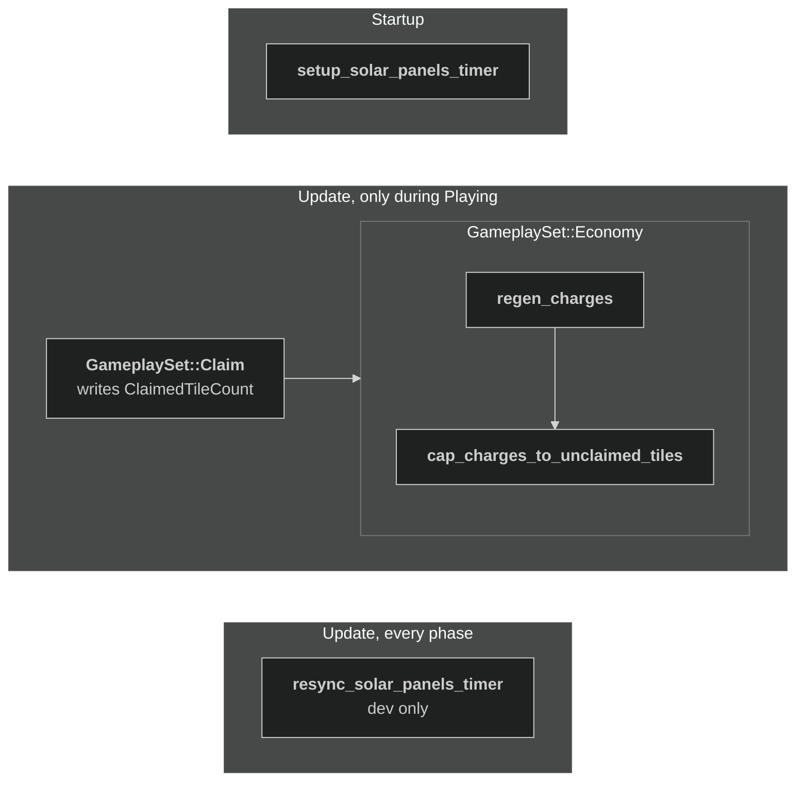
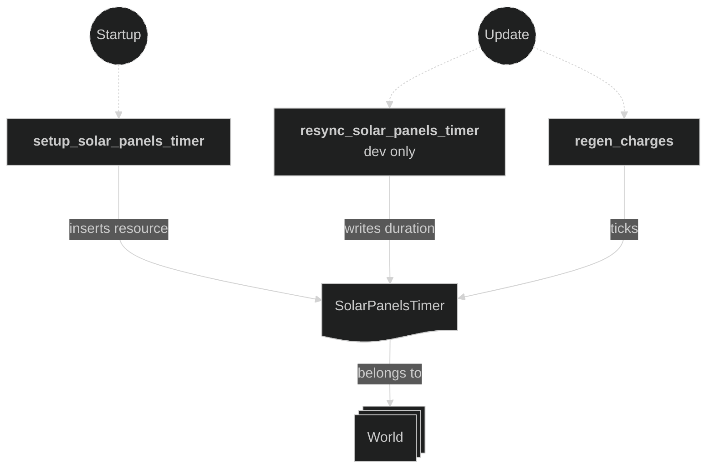
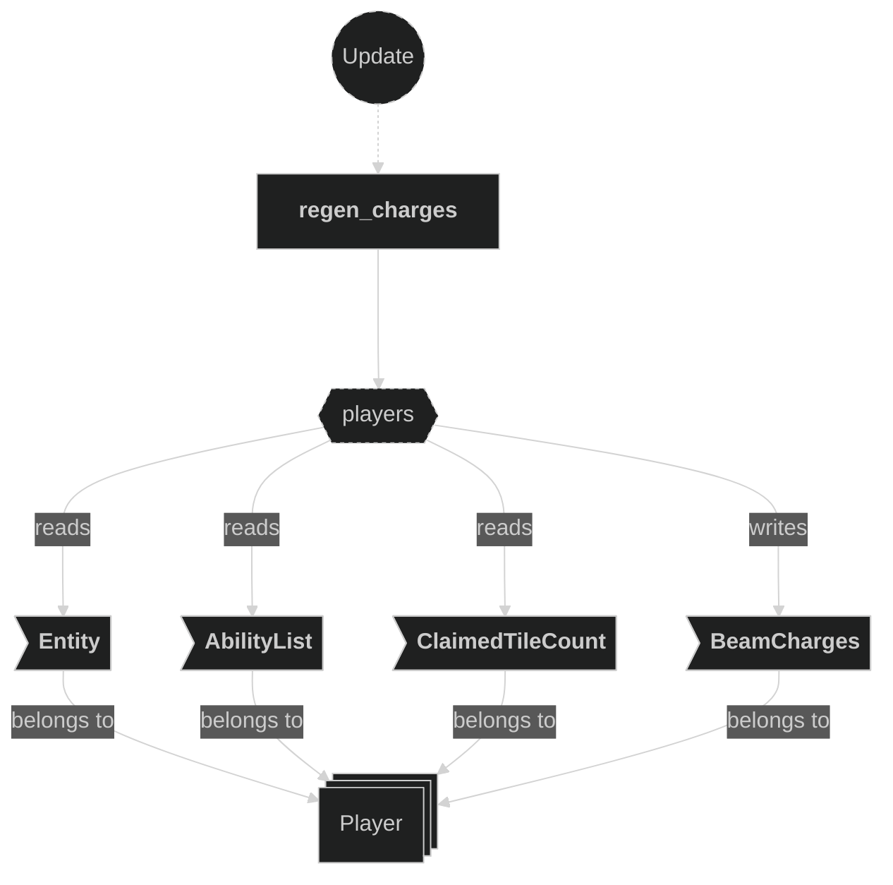
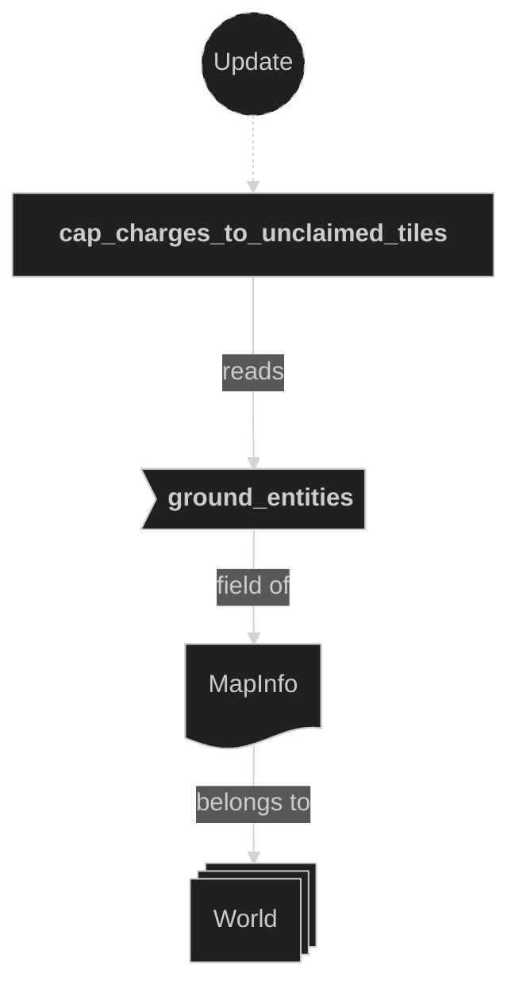
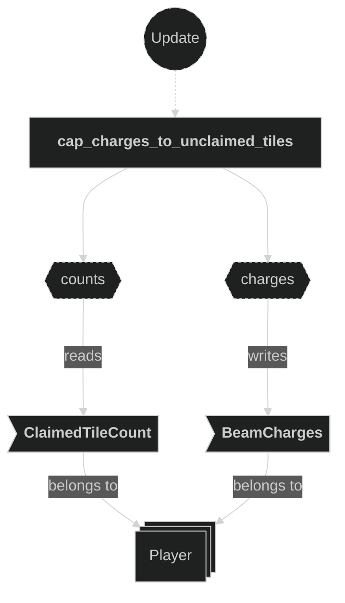
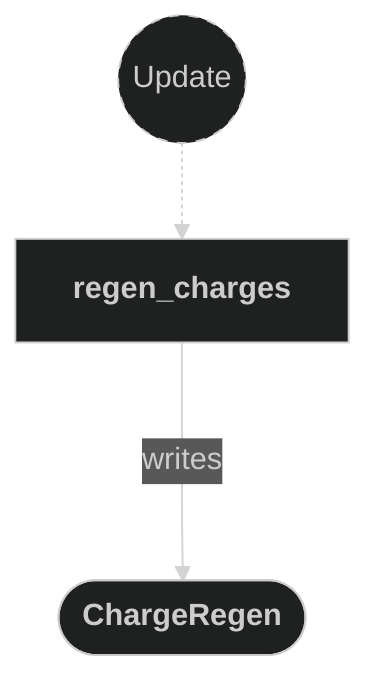

# Charge Plugin

This plugin changes the players' `BeamCharges` outside of firing: it gives charges back and keeps them under a limit. The code is in `src/plugins/charge.rs`.

## Key ideas

- **Solar Panels**: every `charge.solar_panels_tick_secs`, a player with this ability gains one charge per `charge.solar_panels_tiles_per_charge` tiles they own. The gain stops at `BeamCharges::max`.
- **Unclaimed-tile cap**: a charge is only useful to claim a free tile. So every frame, each player's charges are lowered to the number of unclaimed tiles, if they are above it. They are never raised.
- The cap is safe because claimed tiles never become free again during a round.
- A regen writes a `ChargeRegen` message. Nothing reads it yet. The cap writes no message; the HUD already reacts to `Changed<BeamCharges>`.
- This plugin is the place for future abilities that change charges.

## Ordering

- Economy runs after Claim in the same frame, so both systems see the tiles claimed earlier in that frame.
- The cap runs after the regen, so a regen can never leave charges above the cap.

## Plugin Systems

### Setup Solar Panels Timer

- Runs once at `Startup`. Inserts `SolarPanelsTimer`, a repeating timer.

### Resync Solar Panels Timer (dev)

- When `GameConfig` changes, sets the new timer duration. The elapsed time is kept.

### Regen Charges

- Ticks the timer. When it ends, gives charges to each player with Solar Panels.
- Writes `ChargeRegen` with the real gain, when the gain is above 0.

### Cap Charges To Unclaimed Tiles

- Runs every frame, for every player.
- Unclaimed tiles = ground tiles minus the claimed tiles of all players.
- Lowers `BeamCharges::current` to that number when it is higher.

## Components, Resources and Messages CRUD

### Read GameConfig and Time

Used in the following systems:
- **setup_solar_panels_timer**, **resync_solar_panels_timer**: read `charge.solar_panels_tick_secs`.
- **regen_charges**: reads `Time` and `charge.solar_panels_tiles_per_charge`.

### SolarPanelsTimer resource

Used in the following systems:
- **setup_solar_panels_timer**: inserts it.
- **resync_solar_panels_timer** (dev): changes its duration.
- **regen_charges**: ticks it.

### Query players (regen)

Used in the following systems:
- **regen_charges**: checks `SolarPanels`, reads the player's tile count and adds charges.

### Read MapInfo resource

Used in the following systems:
- **cap_charges_to_unclaimed_tiles**: reads the number of ground tiles.

### Query claimed tile counts and charges (cap)

Used in the following systems:
- **cap_charges_to_unclaimed_tiles**: adds up the tile counts of all players, then lowers the charges of every player.

### Write ChargeRegen messages

Used in the following systems:
- **regen_charges**: writes one message per player whose charges went up.

Definitions:
- `SolarPanelsTimer`: public `Resource` with the repeating Solar Panels timer.
- `ChargeRegen`: `Message` with `owner` and `amount`, declared in `messages.rs`.
