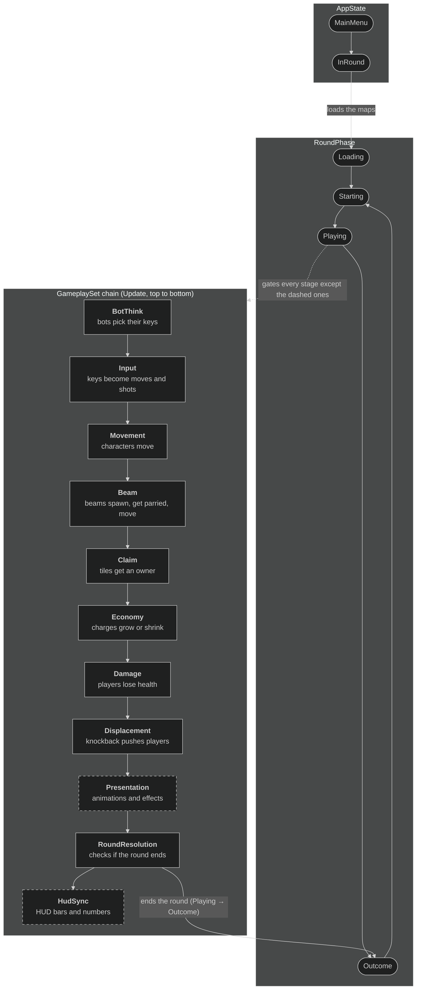
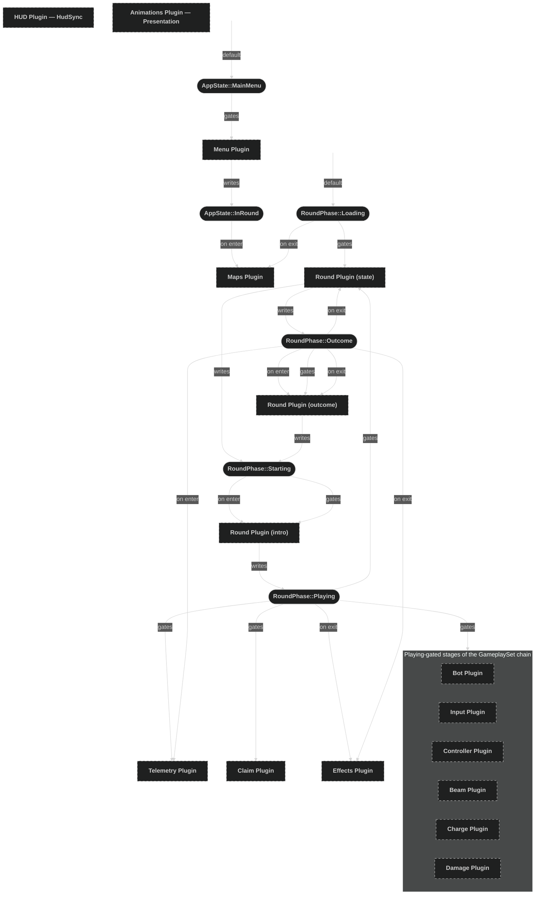

# Plugin State Relationships

Some plugins are also linked through game states. A plugin can run only in one state, run once when a state starts or ends, or move the game to a new state. The diagram below shows each of these links.

For the links through messages, see [doc-9 Plugin message relationships](/documentation/9/000-plugin-message-relationships).

## Link kinds

- **gates**: the systems run only while the game is in that state.
- **on enter / on exit**: the systems run once, when the state starts or ends.
- **writes**: the systems move the game to a new state. Only a few systems do this.
- **default**: the state the machine starts in (the small white circle).

## State machines

- `AppState` (`menu.rs`): `MainMenu` → `InRound`. It never goes back.
- `RoundPhase` (`round/state.rs`): `Loading` → `Starting` → `Playing` → `Outcome` → `Starting` again.

## States and GameplaySet

The two state machines decide *when* systems run. The `GameplaySet` chain (`schedule.rs`) decides *in which order* they run inside one frame.

- `AppState` changes only once: from the menu to the round. `InRound` loads the maps, and that starts `RoundPhase`.
- `RoundPhase` loops for each round: `Starting` (intro) → `Playing` → `Outcome` (result) → `Starting`.
- In Bevy, a set (`SystemSet`) is a named group of systems. You can order a whole group with one rule.
- `GameplaySet` is a list of stages in `Update`, from `BotThink` to `HudSync`. Each plugin puts its systems in a stage.
- All stages run only during `Playing`, except `Presentation` and `HudSync`, which always run.
- `RoundResolution` is the stage that ends a round. It moves the game to `Outcome`.
- The systems that change `RoundPhase` are in `RoundPhaseWriter`. Each runs in a different phase, so their order does not matter.

## Notes

- `Loading` ends only when both maps (level and HUD) have finished loading.
- A round reaches `Outcome` on a kill, at the end of the countdown, or when all players are out of charges.
- Telemetry also needs the `telemetry_enabled` config, so it can be off during `Playing`.
- HUD, animations and effects are not gated, on purpose: their tweens must finish across phase changes.
- The knockback lock timer is not gated, so a lock still ends after the phase changes.
- On exit of `Outcome`, effects remove the drivers that move players, with no fixed order against `reset_round`. An effect driver is a small entity that plays one effect tween (for example a slide or a knockback) for one player.

## Reading the diagram

The game starts in the menu. Picking a matchup loads the maps, and the end of loading starts the round loop. Each round goes from the intro to play, then to the result banner, and back to the intro.

