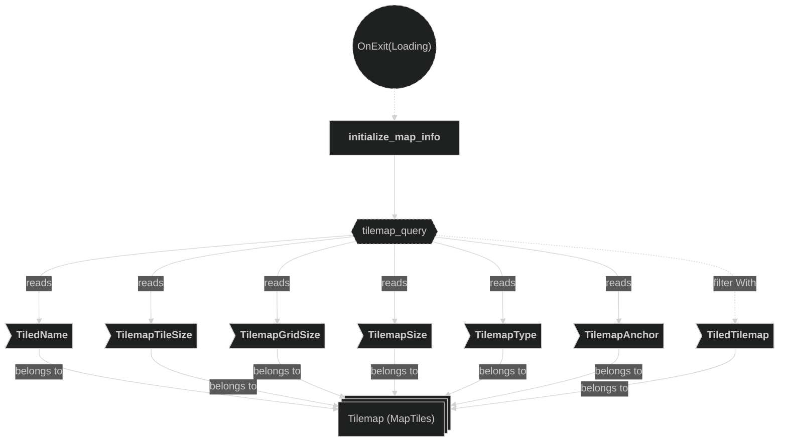
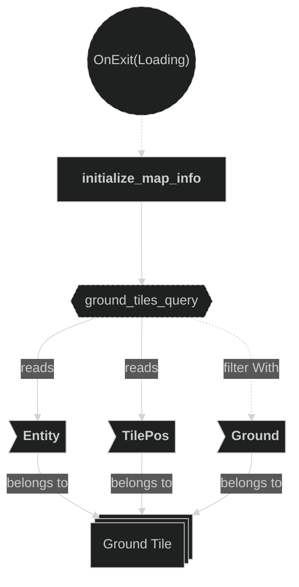
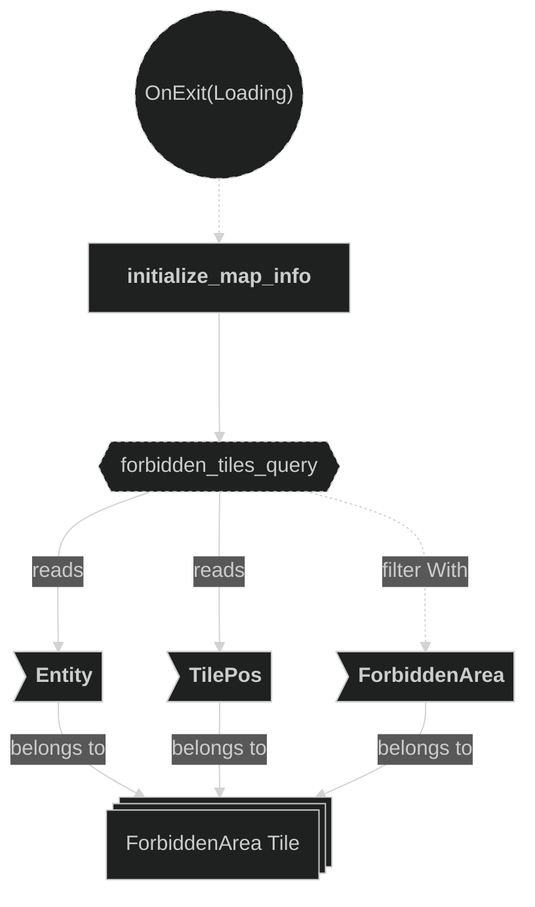
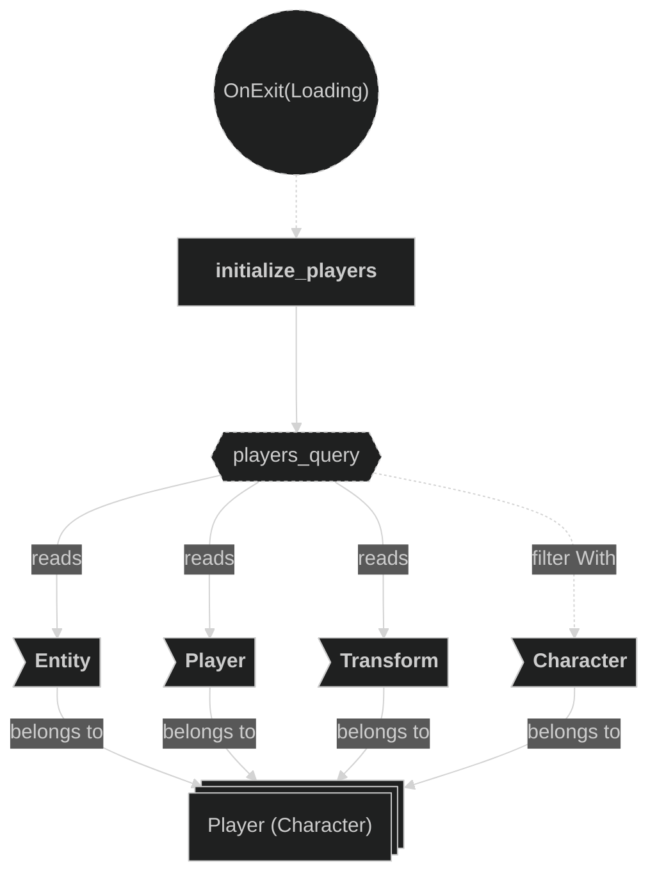
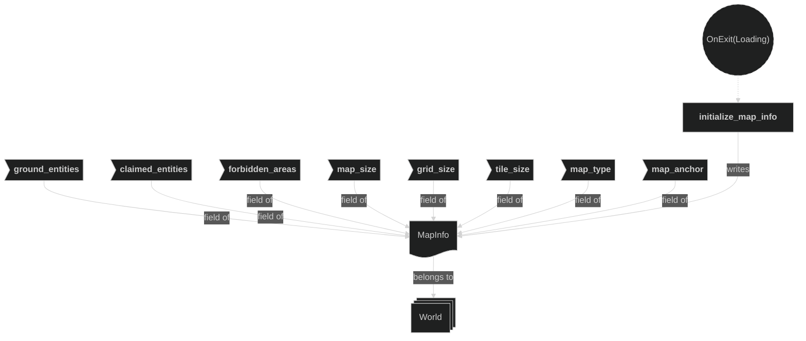
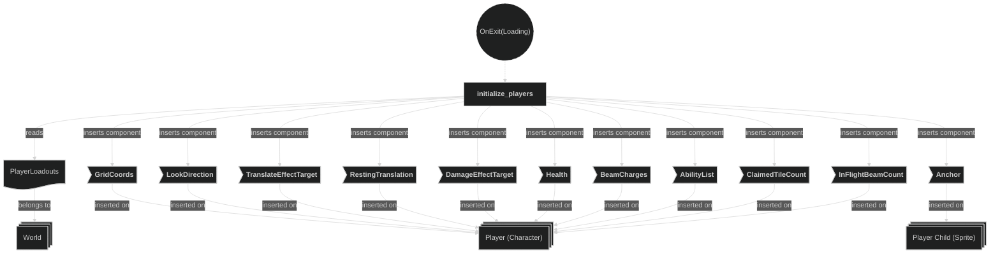
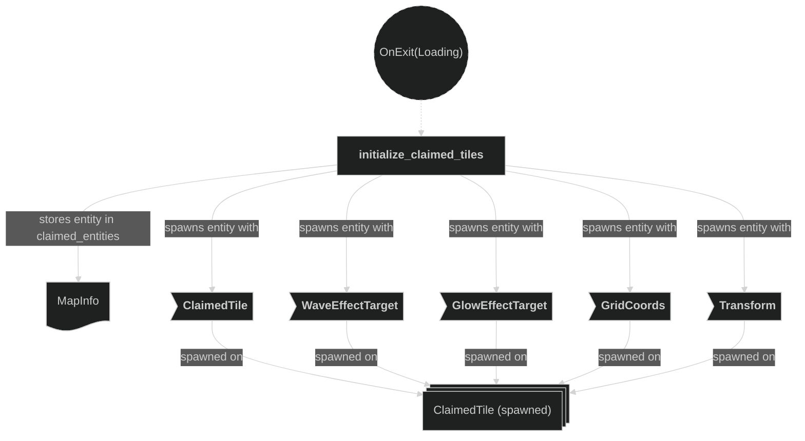
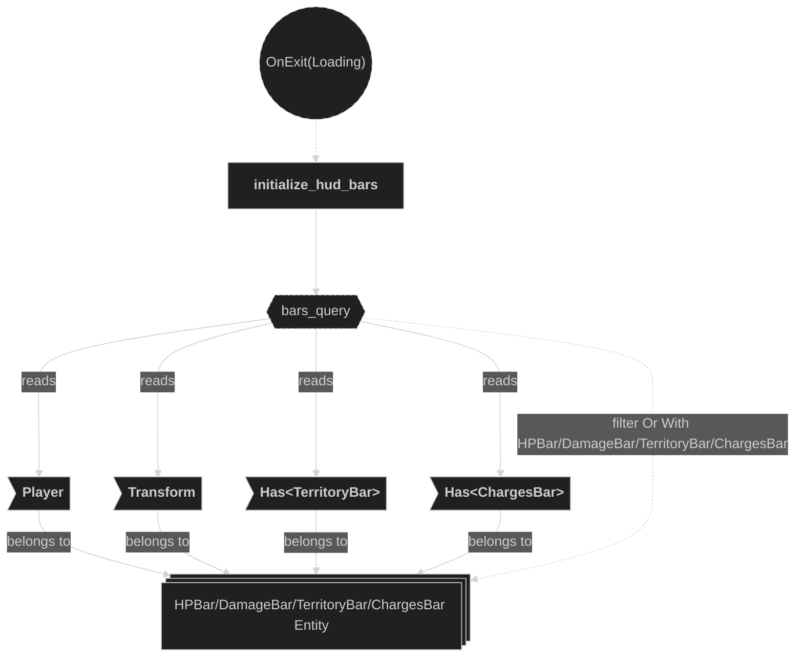
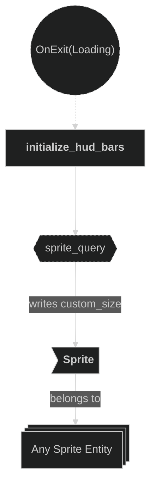
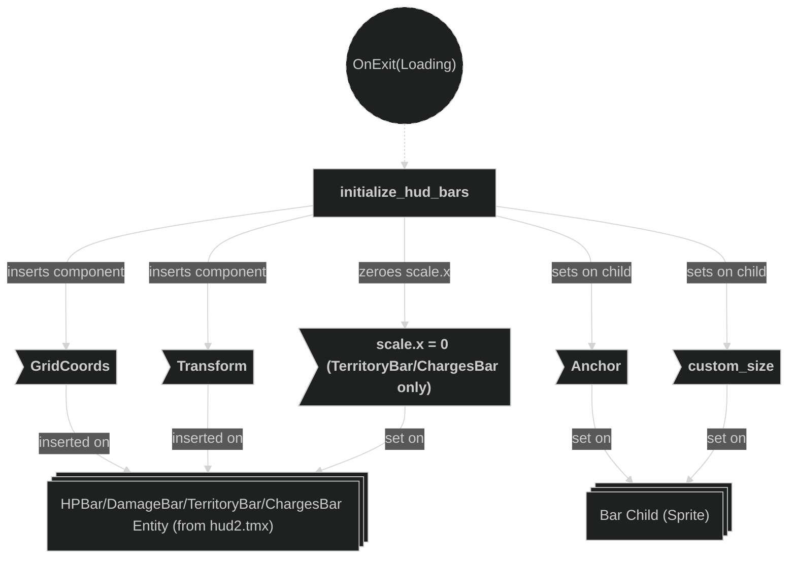

# Maps Plugin

This plugin loads the level map and the HUD map when a round begins. After loading, it fills the shared map lookup and sets up the players, the claimable tiles and the HUD bars.

The setup reads no message. When it runs, the maps and all their entities already exist, so it reads the world directly.

## Plugin Systems

### Load Maps

- Runs on `OnEnter(AppState::InRound)`, after the matchup is confirmed in the menu.
- Spawns `level2.tmx` (tagged `CurrentLevel`) and `hud2.tmx` (tagged `HudMap`).

### Setup chain

- The four systems below run on `OnExit(RoundPhase::Loading)`. This happens only once: no round goes back to `Loading`.
- `initialize_map_info` runs first. The other three run after it, in any order.

### Initialize Map Info

- Fills `MapInfo`: ground tiles, forbidden tiles, an empty claimed-tile map, and the map geometry.
- Both maps have a tilemap named `"ground"`. It reads only the one of the level map.

### Initialize Players

- Sets up each player with its grid position, facing, health, charges, abilities and counters.
- `SpawnPoint` and `SpawnLookDirection` keep the start position and facing for the round reset.
- `PreviousGridCoords` starts on the spawn tile, so tile-entry damage works from the first move.
- `RestingTranslation` starts at the spawn position. The Effects plugin keeps it up to date.
- Health is `starting_health`. Charges are the ground-tile count divided by `beam_charges_divisor`.
- Abilities come from `PlayerLoadouts`. The tile and beam counters start at zero.

### Initialize Claimed Tiles

- Spawns one `ClaimedTile` with no owner for each ground tile, and stores it in `MapInfo`.
- The Effects plugin adds the lit overlay to each tile later. This plugin does not.

### Initialize HUD Bars

- Places the HP, damage, territory and charges bars from `hud2.tmx`. Player 1's bars move 16px to the right.
- Territory and charges bars start empty and grow in. HP and damage bars start at their real value.
- Player 1's bars grow from the left, player 2's from the right.
- HP and damage bars are 176x32. Territory and charges bars are 432x32 and grow toward each other.

## Components, Resources and Messages CRUD

### Query Tilemap metadata

Used in the following systems:
- **initialize_map_info**: reads the map geometry (size, tile size, etc.).

### Query TilePos of Ground tiles

Used in the following systems:
- **initialize_map_info**: all ground tiles.

### Query TilePos of ForbiddenArea tiles

Used in the following systems:
- **initialize_map_info**: all forbidden tiles.

### Query Character entities (initialize_players)

Used in the following systems:
- **initialize_players**: all player characters.

### Write MapInfo resource

Used in systems:
- **initialize_map_info**: fills every field of `MapInfo`.

### Write commands — initialize_players

Used in systems:
- **initialize_players**: the player setup listed above. The diagram does not show `SpawnPoint`, `SpawnLookDirection` and `PreviousGridCoords`.

### Write commands — initialize_claimed_tiles

Used in systems:
- **initialize_claimed_tiles**: one tile entity for each ground tile.

### Query HPBar/DamageBar/TerritoryBar/ChargesBar entities (initialize_hud_bars)

Used in the following systems:
- **initialize_hud_bars**: all four bar kinds. Only territory and charges bars are handled differently.

### Query Sprite entities (initialize_hud_bars)

Used in the following systems:
- **initialize_hud_bars**: sets the size of each bar's child sprite. Matches any sprite.

### Write commands — initialize_hud_bars

Used in systems:
- **initialize_hud_bars**: places the bars spawned from `hud2.tmx`.

