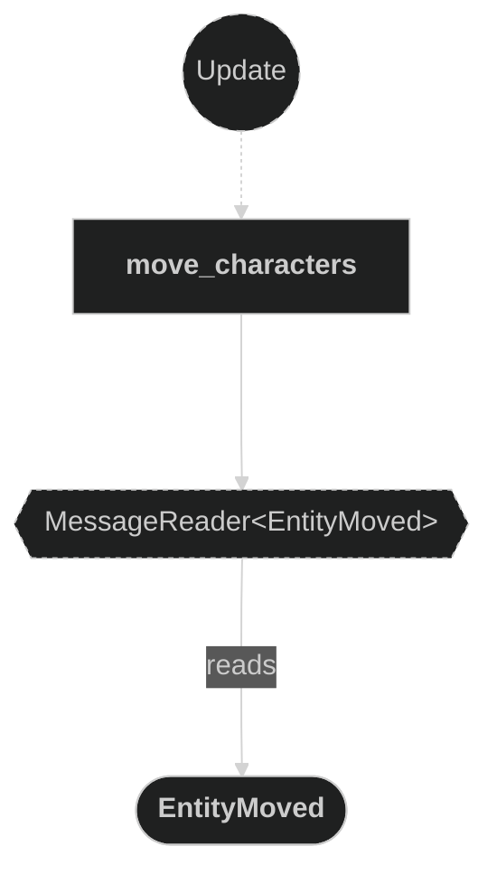
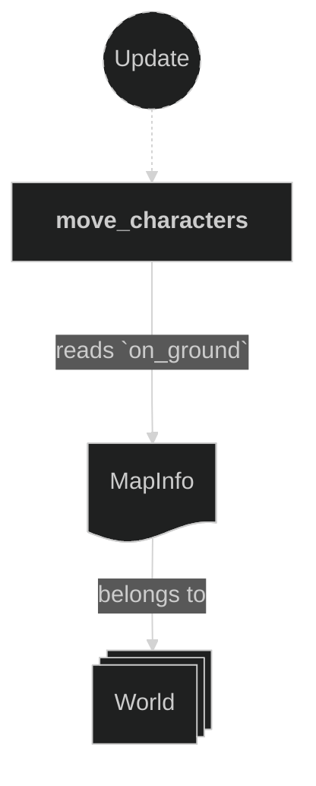
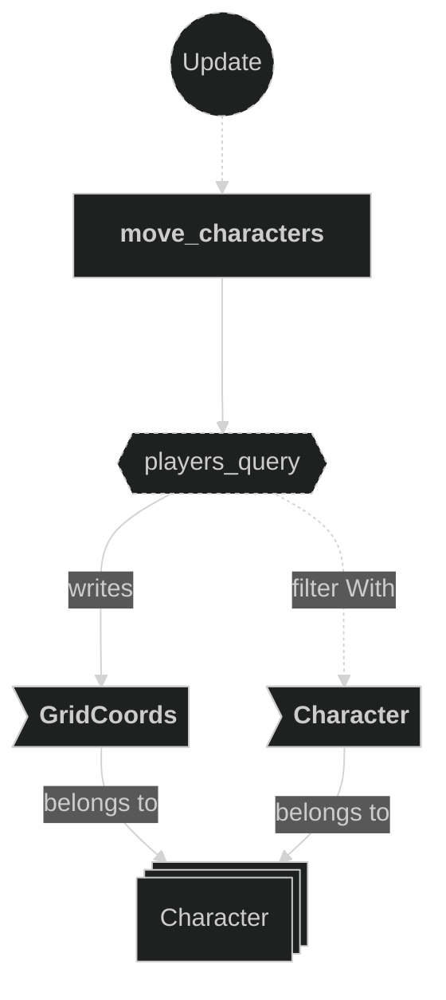

# Controller Plugin

This plugin moves a character to the tile it asked for, if the move is legal. A move into an enemy beam or into another character asks for a knockback, and the Damage plugin applies it.

## Plugin Systems

### Move Characters

- Runs in `GameplaySet::Movement`, only during `Playing`. It handles each move request in this order:
- **Enemy beam on the target tile**: knockback for the mover, in the beam direction. Nothing else happens.
- **Target is not ground**: the move is ignored.
- **Target is free**: the character's `GridCoords` becomes the target. The old value is never read.
- **Another character is on the target**: a collision (see below).

### Collisions

- Each side's distance is how far its sprite still is from its destination tile.
- **Tie**: both sides are knocked back one tile, away from their destination.
- **No tie**: the side with the larger distance wins. It is knocked back one tile, away from its destination.
- The loser is pushed in the winner's move direction, and a `CharacterCollision` is written for it.
- Both characters are then done for this frame.

### Knockback order

- The Damage plugin moves knocked-back characters, later in the frame.
- If one entity gets several knockbacks in a frame, only the last one applies.
- Beam damage writes its knockback after this plugin, so a beam hit wins over a walk-in or a bump.

## Components, Resources and Messages CRUD

### Read EntityMoved messages

Used in the following systems:
- **move_characters**: one move request for each message.

### Read MapInfo resource

Used in the following systems:
- **move_characters**: checks that the target is ground.

### Write KnockbackRequested and CharacterCollision messages

Used in the following systems:
- **move_characters**: finds enemy beams, then writes the knockback and collision messages.

### Write GridCoords

Used in the following systems:
- **move_characters**: sets the new position of the character.

