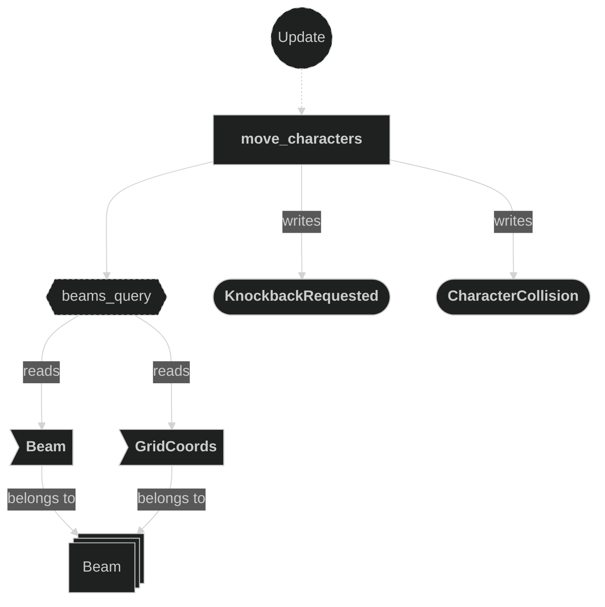

# Controller Plugin

Contains the system responsible for reacting to movement messages and updating player grid positions. When an `EntityMoved` message is received, the controller validates the target position against walkable ground tiles and overwrites the player's `GridCoords` if the move is legal. A move into an enemy beam, or into another character, does not move the character. It writes `KnockbackRequested` messages instead. The damage plugin applies them.

## Plugin workflow

- Update phase (`GameplaySet::Movement`, `in_state(RoundPhase::Playing)`)
    - Move Characters:
        - Reacts to `EntityMoved` message
            - Reads:
                - `MapInfo` resource (for ground validation via `on_ground()`)
                - `EntityMoved` message fields (`entity`, target `position`)
                - `Beam` and `GridCoords` on beam entities, and a snapshot of every `Character` position and translation
            - Writes:
                - Updates `GridCoords` on the `Character` entity if the target tile is walkable ground and free
                - Writes `KnockbackRequested { entity, direction }` when the target tile holds an enemy beam (direction = the beam direction), and for both sides of a character collision
                - Writes `CharacterCollision { loser }` when a collision has a loser

## Plugin Systems

### Move Characters

Reads `EntityMoved` messages written by the input system. For each message, in order:
- If a beam of another owner is on the target tile, writes `KnockbackRequested` for the mover with the beam direction and stops.
- If the target is not ground (`MapInfo::on_ground()`), ignores the move.
- If no other character is on the target tile, overwrites the `Character` entity's `GridCoords` with the new position.
- Otherwise it resolves a collision (`resolve_collision`) between the mover and the occupant. Each side's distance is how far its `Transform` still is from its destination. On a tie, both sides get a `KnockbackRequested` one tile back, away from their destination. Otherwise the side with the larger distance wins. The winner gets a `KnockbackRequested` one tile back, away from its destination. The loser gets one in the winner's move direction, and a `CharacterCollision { loser }` message is written. Both characters are then marked resolved for this frame.

The controller never moves an entity because of a knockback. `apply_knockback` in the damage plugin does that in `GameplaySet::Displacement`. When one entity gets several `KnockbackRequested` messages in a frame, the damage plugin applies only the last one. The controller writes in `Movement`, which runs before the damage plugin's `apply_beam_damage` in `Damage`, so a beam hit on the same frame beats a walk-in or a collision bump.

## Components, Resources and Messages CRUD

### Read EntityMoved messages

Used in the following systems:
- **move_characters**: used to trigger a character grid position update

### Read MapInfo resource

Used in the following systems:
- **move_characters**: used to validate that the target position is walkable ground via `on_ground()`

### Write KnockbackRequested and CharacterCollision messages

Used in the following systems:
- **move_characters**: writes `KnockbackRequested` when a mover steps into an enemy beam (direction = beam direction) and for both sides of a character collision. Writes `CharacterCollision` for the loser of an uneven collision. Reads `Beam` and `GridCoords` on beam entities to find the enemy beam.

### Write GridCoords

Used in the following systems:
- **move_characters**: overwrites the player's `GridCoords` with the validated target position (the new value comes entirely from `EntityMoved::position`, the existing component value is never read)

