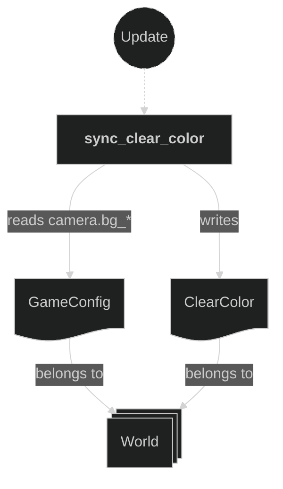
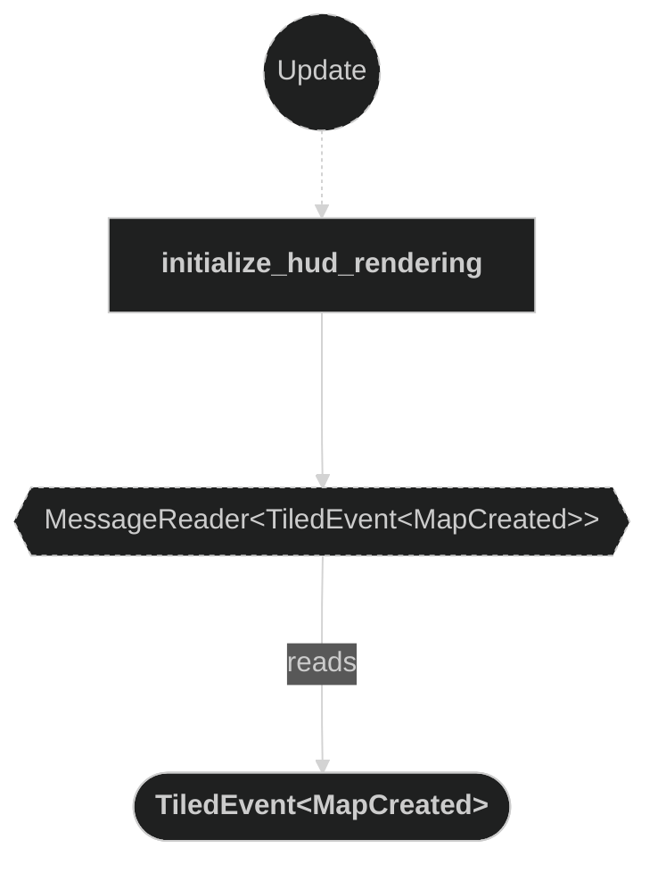
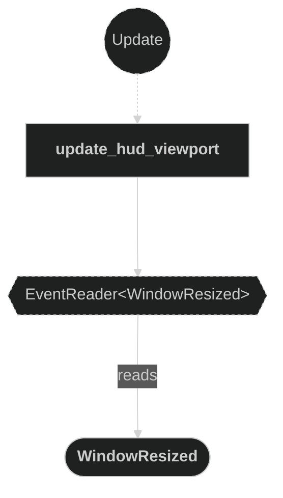
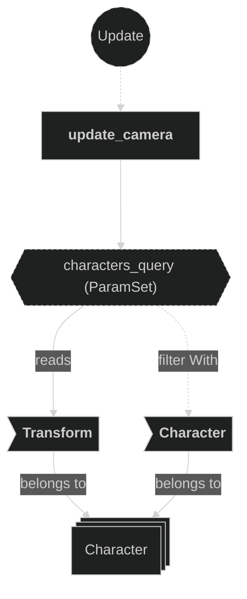
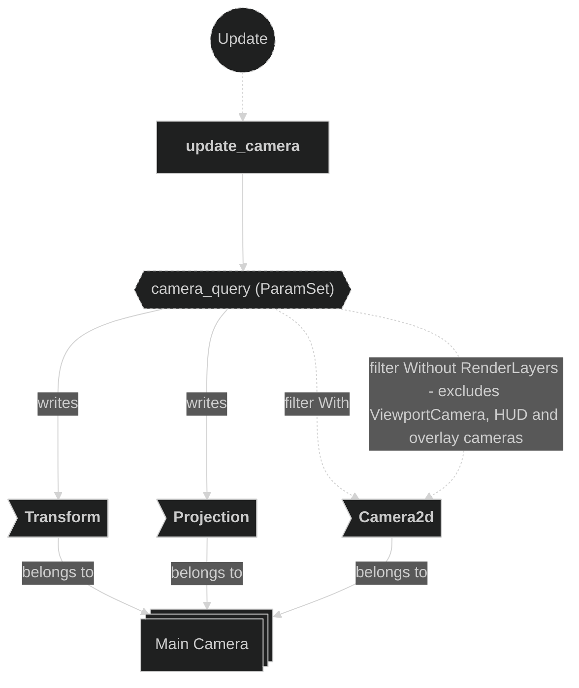
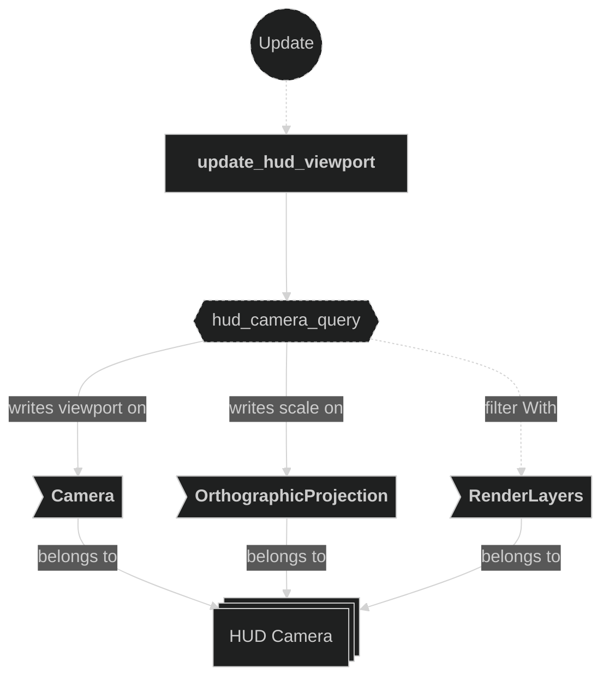
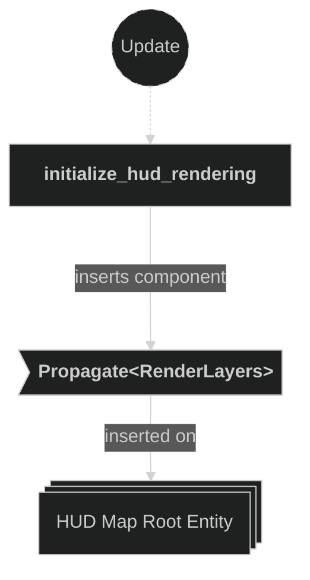

# Camera Plugin

This plugin spawns all the cameras and moves the main camera each frame. The main camera follows the players and zooms only to pixel-perfect levels. The HUD keeps a fixed size at the top of the window.

Four cameras are active at runtime:

| Camera | Render layer | Order | Purpose |
|--------|-------------|-------|---------|
| Main (`PixelCamera`) | default (no `RenderLayers`) | 0 | Renders the game world to an off-screen texture |
| ViewportCamera | layer 2 | 2 | Spawned automatically by `PixelCamera`; composites the off-screen texture onto the window |
| HUD camera | layer 1 | 3 | Renders the HUD map in a fixed viewport strip at the top of the window |
| Overlay camera | layer 3 | 4 | Renders screen-space round-phase banners (intro countdown, etc.) full-window, on top of everything; content is drawn by the round `intro` submodule |

`PixelCamera` (from `bevy_smooth_pixel_camera`) snaps the main camera to whole world units. It moves the viewport image by the rest, so motion is smooth with no pixel crawl.

## Plugin Systems

### Initialize Cameras

- Runs at `Startup`. Spawns the main, HUD and overlay cameras. `PixelCamera` spawns the fourth one.
- The main camera starts at `zoom_levels[0]` (the most zoomed out).
- The main camera is the only one with no `RenderLayers`. `update_camera` finds it this way.
- **Trap:** every other camera must have a `RenderLayers`, or that lookup matches two cameras and breaks.
- The HUD camera gets its scale at spawn, so the HUD is right from the first frame.
- The overlay camera does not clear the screen, and uses `Msaa::Off` like the HUD camera.
- MSAA (multisample anti-aliasing) makes the edges of shapes softer, so they do not look like small steps. Cameras drawn on top of each other must use the same setting, or wgpu reports an error.
- The overlay uses a fixed vertical size, so its banners keep their size on resize with no extra code.

### Sync Clear Color

- Sets the background color from `bg_hue`, `bg_saturation` and `bg_lightness`.
- It reads the color from the config, so the color hot-reloads in dev.

### Initialize HUD Rendering

- Runs when the HUD map is loaded. Puts the whole HUD map on layer 1.
- So only the HUD camera draws the HUD.

### Update Camera

- Runs every frame. The target is the center of the box around all players.
- The camera moves toward it smoothly, at `decay_rate`.
- The target is moved up by half the HUD height, so players near the top stay below the HUD.
- The HUD height is converted to logical pixels, because the orthographic scale is in logical pixels.
- This offset is safe at any zoom: only the scale matters for pixel-perfect drawing.
- Zoom uses only `zoom_levels` (`1/4`, `1/3`, `1/2`, `1`). Only these give whole pixels per world unit.
- The player distance, divided by `base_zoom_distance` and clamped to `zoom_min`..`zoom_max`, gives the wanted zoom.
- The zoom is the smallest level that is at least the wanted zoom and also fits all players, plus one tile on each side, in the area below the HUD.
- If no level fits, the largest level is used.
- The zoom moves toward it at `zoom_decay_rate`, then snaps to the exact value when it is very close.

### Update HUD Viewport

- Runs when the window is resized. The HUD viewport is a full-width strip at the top.
- The HUD scale is a fixed 2x at any DPI. Each 16px HUD tile is always `16 * HUD_SCALE` screen pixels.
- So the HUD is a fixed-size band in the middle. The game world shows on both sides.

## Components, Resources and Messages CRUD

### Write ClearColor resource

Used in the following systems:
- **sync_clear_color**: sets the background color.

### Read TiledEvent MapCreated messages (HUD)

Used in the following systems:
- **initialize_hud_rendering**: waits for the HUD map to finish loading.

### Read WindowResized events

Used in the following systems:
- **update_hud_viewport**: one update for each window resize.

### Query Character transforms

Used in the following systems:
- **update_camera**: the positions of all characters.

### Write Camera components (main)

Used in the following systems:
- **update_camera**: moves and zooms the main camera.

### Write HUD Camera components (viewport)

Used in the following systems:
- **update_hud_viewport**: sets the HUD viewport and scale.

### Write commands — initialize_hud_rendering

Used in the following systems:
- **initialize_hud_rendering**: puts the HUD map and all its children on layer 1.

### Write commands — initialize_cameras (Startup)

Used in the following systems:
- **initialize_cameras**: spawns three cameras. `PixelCamera` spawns the viewport camera and image.

```mermaid
---
config:
  theme: dark
---

flowchart TD
classDef system-group stroke-dasharray: 5 5

startup(("`Startup`")):::system-group
initialize_cameras["`**initialize_cameras**`"]

startup -.-> initialize_cameras

main_camera_entity@{ shape: st-rect, label: "Main Camera (spawned)" }
viewport_camera_entity@{ shape: st-rect, label: "ViewportCamera + ViewportImage (auto-spawned by PixelCamera)" }
hud_camera_entity@{ shape: st-rect, label: "HUD Camera (spawned)" }
overlay_camera_entity@{ shape: st-rect, label: "Overlay Camera (spawned)" }

mc_camera2d>"`**Camera2d**`"]
mc_pixel_camera>"`**PixelCamera (PixelSize 1.0, layer 2, order 2)**`"]
mc_projection>"`**Projection (Orthographic, scale config.camera.zoom_levels[0])**`"]

hc_camera2d>"`**Camera2d**`"]
hc_render_layers>"`**RenderLayers (layer 1)**`"]
hc_camera>"`**Camera (order 3, viewport top strip)**`"]

oc_camera2d>"`**Camera2d + Msaa::Off**`"]
oc_render_layers>"`**RenderLayers (layer 3)**`"]
oc_camera>"`**Camera (order 4, ClearColorConfig::None)**`"]
oc_projection>"`**Projection (Orthographic, FixedVertical)**`"]

mc_camera2d --> |spawned on| main_camera_entity
mc_pixel_camera --> |spawned on| main_camera_entity
mc_projection --> |spawned on| main_camera_entity
mc_pixel_camera -.-> |triggers on_add → spawns| viewport_camera_entity

hc_camera2d --> |spawned on| hud_camera_entity
hc_render_layers --> |spawned on| hud_camera_entity
hc_camera --> |spawned on| hud_camera_entity

initialize_cameras ---> |spawns entity with| mc_camera2d
initialize_cameras ---> |spawns entity with| mc_pixel_camera
initialize_cameras ---> |spawns entity with| mc_projection
initialize_cameras ---> |spawns entity with| hc_camera2d
initialize_cameras ---> |spawns entity with| hc_render_layers
initialize_cameras ---> |spawns entity with| hc_camera

oc_camera2d --> |spawned on| overlay_camera_entity
oc_render_layers --> |spawned on| overlay_camera_entity
oc_camera --> |spawned on| overlay_camera_entity
oc_projection --> |spawned on| overlay_camera_entity

initialize_cameras ---> |spawns entity with| oc_camera2d
initialize_cameras ---> |spawns entity with| oc_render_layers
initialize_cameras ---> |spawns entity with| oc_camera
initialize_cameras ---> |spawns entity with| oc_projection
```

