# Beam Plugin

This plugin spawns a beam when a player shoots, moves it one tile at a time, and ends it on the tile it claims. It also handles parries: a parried beam turns around, changes owner and gets faster. The Claim plugin then changes the tile owner.

## Key ideas

- A beam is an invisible logic object. The tiles bounce under it to show where it is.
- `caster` is the player who fired the beam. `owner` is the player it claims for. A parry changes only `owner`.
- A charge is spent when a beam spawns. A blocked shot and a parry cost nothing.
- `InFlightBeamCount` is the number of beams that a player has on the board right now (see the lifecycle below).

## Beam abilities

- `Lance`: the player can shoot from a claimed tile. The beam goes over claimed tiles and claims the first free one.
- `BorderGrinder`: a `Straight` beam that hits an enemy tile claims that enemy tile.

## Ordering

- `spawn_beam`, `resolve_parry` and `beam_step` run in this order, in `GameplaySet::Beam`, only during `Playing`.
- The Claim stage runs after this one, so a tile claimed in this frame is already visible later in the frame.

## Plugin Systems

### Spawn Beam

- Runs for each fire message. `resolve_fire` picks the beam type from the tile the player stands on:
- The player stands on a free tile: the beam is a `Straight` beam.
- The player stands on a claimed tile and has the `Lance` ability: the beam is a `Lance` beam.
- The player stands on a claimed tile without the `Lance` ability: no beam, and no charge is spent.
- A `Straight` beam goes forward until a claimed tile or the map edge. It claims the last free tile before it stops.
- A `Lance` beam goes over claimed tiles. It claims the first free tile it finds, or nothing if it reaches the edge.
- The Input plugin does the same check, but the tile can change before this system runs, so it checks again.
- When a beam spawns: one charge is spent, `InFlightBeamCount` goes up, and `ChargeSpent` is written.
- The beam starts with zero parries and its own step timer. It takes its first step on its spawn frame.
- It gets `WaveSource` and `BounceEffect` (the tile bounce), unless its caster already has a beam in the same lane.
- `WaveSource` makes each tile bounce when the beam steps on it. This bounce is the wave that players see.
- Same lane means the same row for horizontal beams, or the same column for vertical ones. The glow shows for every beam.

### Resolve Parry

- Reads `ParryTriggered`. The Input plugin writes it when a player shoots while facing a beam that is about to hit them.
- "About to hit" means: in the first `window_fraction` of the beam's step, and the beam can claim the player's tile.
- The beam turns around, its `owner` becomes the parrier, and its parry count goes up by one.
- Each parry divides the step time by `speed_multiplier`, but never below `min_step_secs`.
- Its timer restarts, ready to step. Then `BeamParried` is written for the Effects and Hitstop plugins.
- Only the first parry of a beam in a frame counts. A player cannot parry a beam they already own.

### Beam Step

- Ticks the timer of each beam. A beam moves one tile each time its timer ends.
- A beam always ends through `end_beam`: it lowers the caster's `InFlightBeamCount`, then despawns the beam.
- `end_beam` is a small helper function. Every case where a beam stops calls it, so the count always stays right.

**Straight**

- Next tile is off the map: step back out of forbidden tiles, then claim the current tile if it is free.
- Next tile is claimed: same as above. But if the caster has `BorderGrinder` and the tile is an enemy's, claim that tile.
- Otherwise: move one tile.

**Lance**

- Next tile is off the map (not ground, not forbidden): the beam ends and claims nothing.
- Next tile is free ground: claim it, then end.
- Otherwise (claimed or forbidden tile): move one tile.

### Resync Beam Step Timers (dev only)

- Only in dev builds. When the config reloads, it gives every live beam its new step time.
- Runs before `beam_step`, because both change `Beam`.

## Components, Resources and Messages CRUD

### Read BeamFired messages

Used in the following systems:
- **spawn_beam**: one shot for each message.

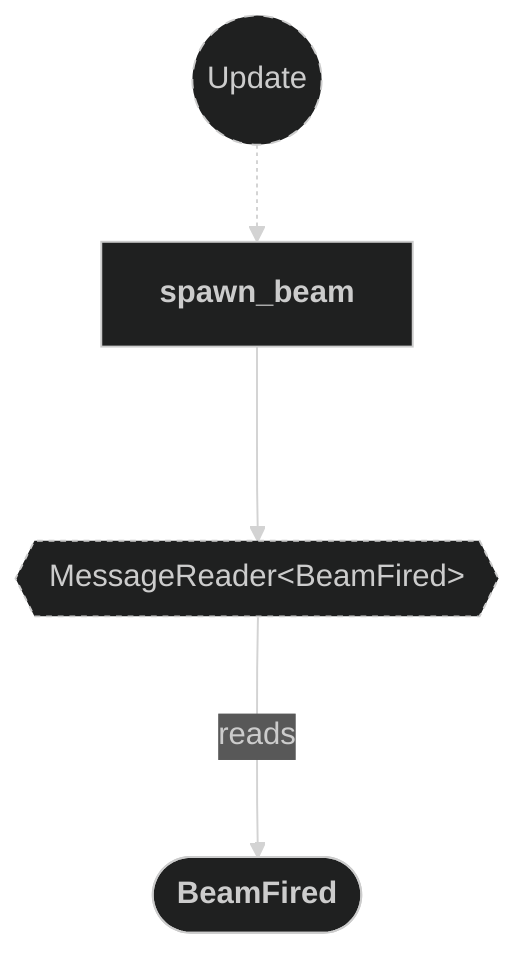

### Query Beam entities (spawn)

Used in the following systems:
- **spawn_beam**: checks the caster's live beams for one in the same lane.

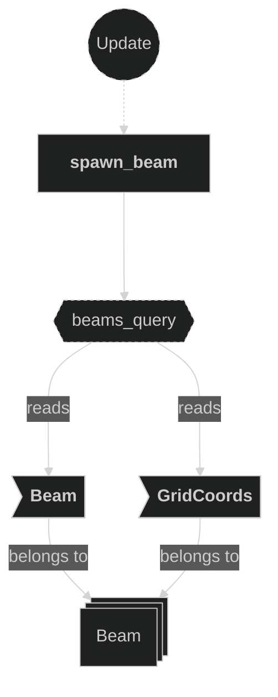

### Read behavior-selection inputs (spawn)

Used in the following systems:
- **spawn_beam**: checks the tile under the player and the `Lance` ability.

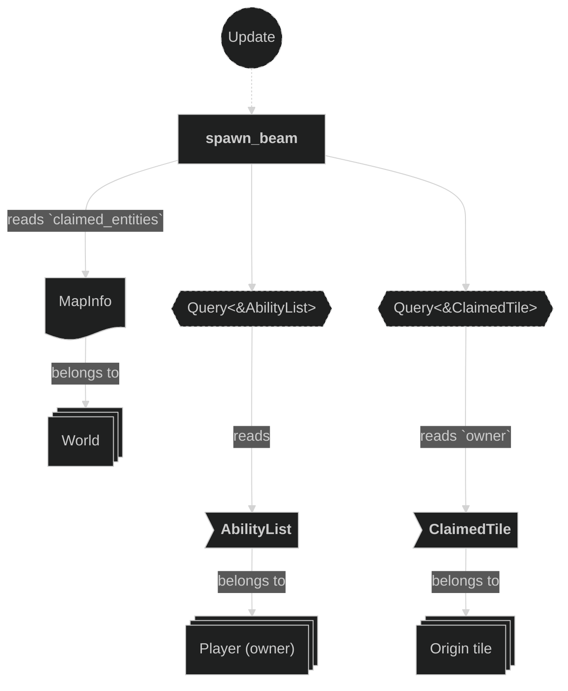

### Read MapInfo resource (beam step)

Used in the following systems:
- **beam_step**: checks the next tile: ground, forbidden or off the map.

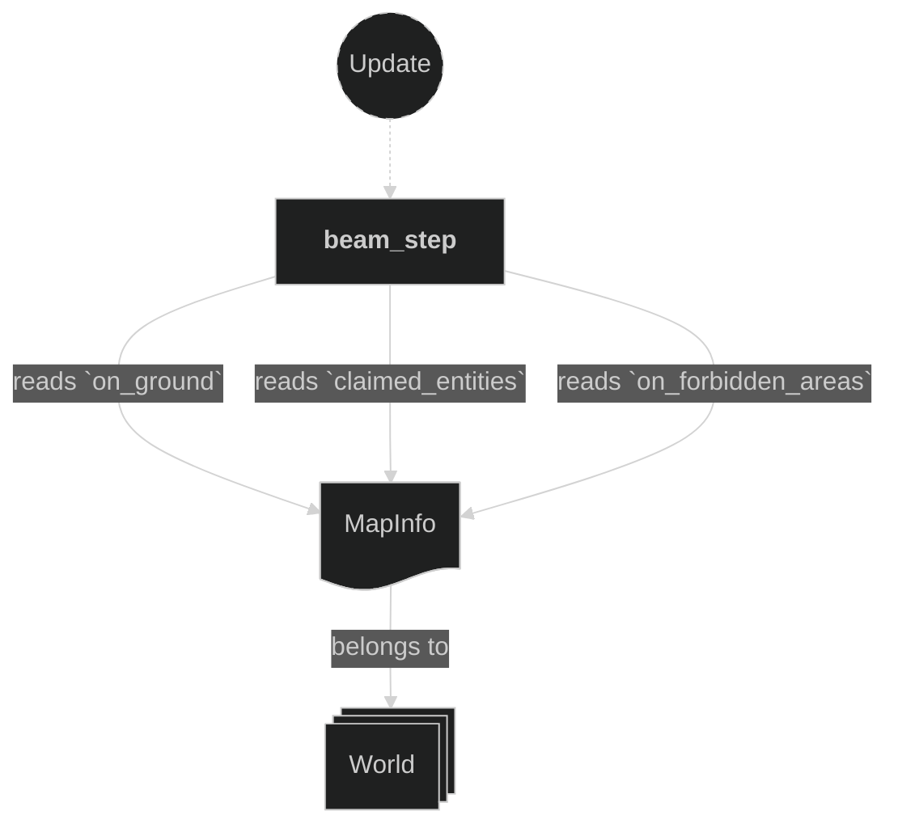

### Write commands: spawn Beam entity

Used in the following systems:
- **spawn_beam**: the bounce components are left out when the lane is already used.

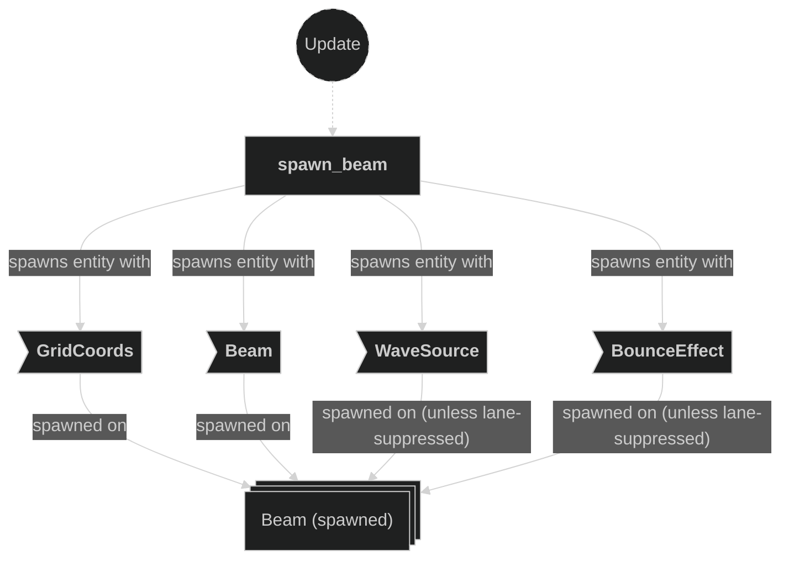

### Query Beam entities

Used in the following systems:
- **beam_step**: all live beams. It ticks their timers and moves them.

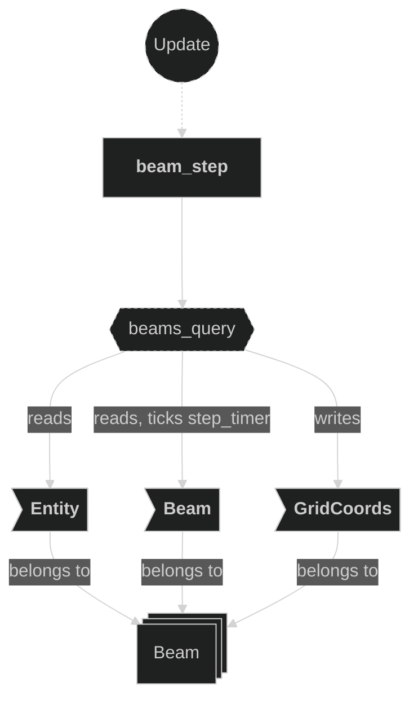

### Query ClaimedTile (beam step)

Used in the following systems:
- **beam_step**: checks if the next tile has an owner.

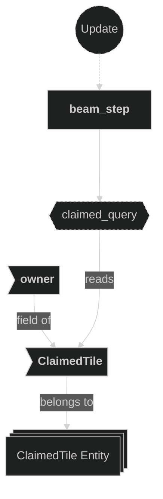

### Write BeamResolved messages

Used in the following systems:
- **beam_step**: one message for each claimed tile.

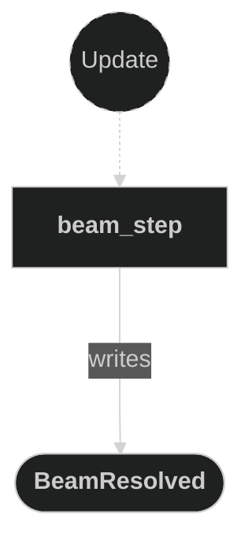

### Write commands: despawn Beam entity

Used in the following systems:
- **beam_step**: through `end_beam`, which also lowers the caster's in-flight count.

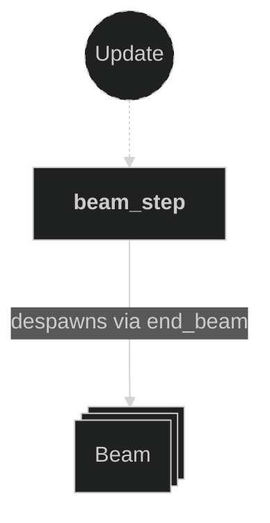

### Query BeamCharges and InFlightBeamCount (spawn_beam)

Used in the following systems:
- **spawn_beam**: one charge less and one in-flight beam more, for each beam spawned.

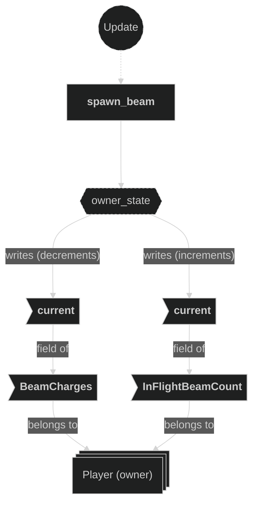

### Write ChargeSpent messages

Used in the following systems:
- **spawn_beam**: one message for each beam spawned. No plugin reads it yet.

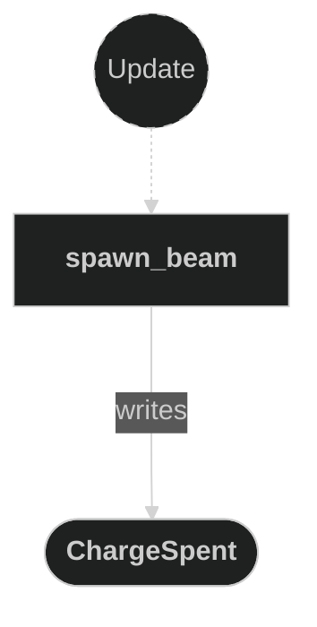

### Read AbilityList (beam step)

Used in the following systems:
- **beam_step**: checks if the caster has `BorderGrinder`.

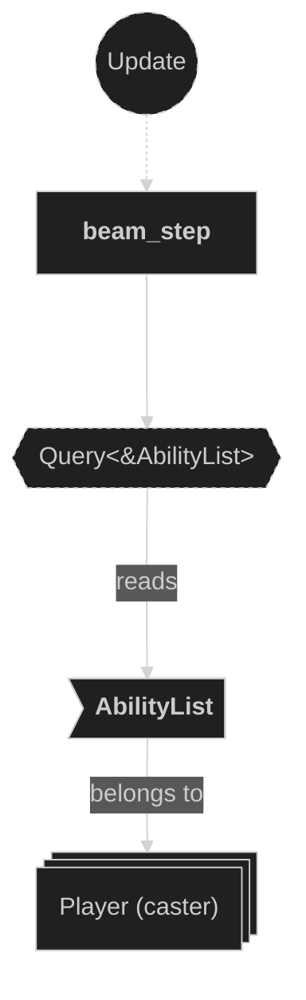

### Read ParryTriggered, write Beam and BeamParried (resolve_parry)

Used in the following systems:
- **resolve_parry**: turns the parried beam around, gives it to the parrier, and writes `BeamParried`.

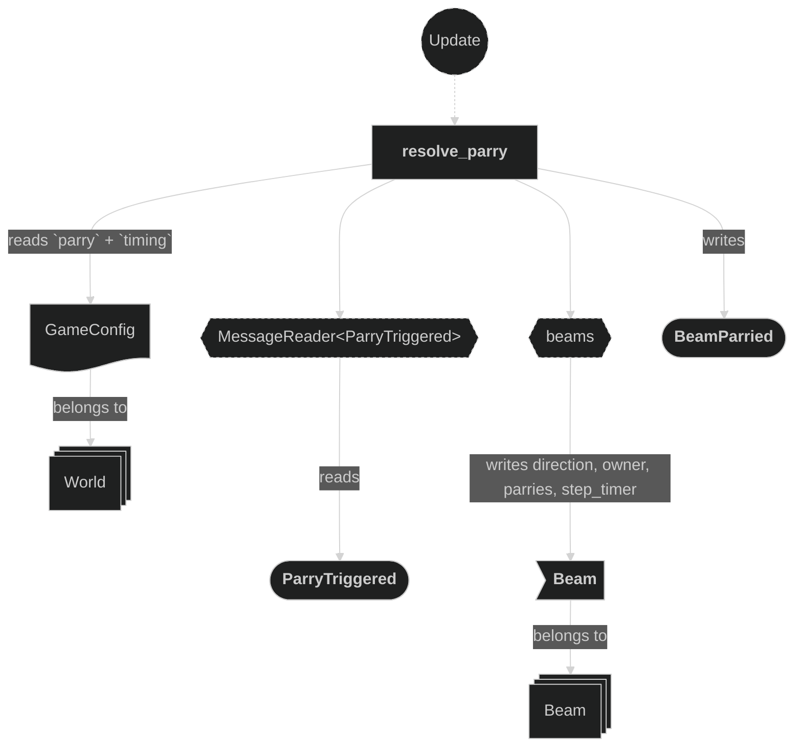

### Write Beam step timers (resync_beam_step_timers, dev only)

Used in the following systems:
- **resync_beam_step_timers**: sets the new step time on every live beam when the config changes.

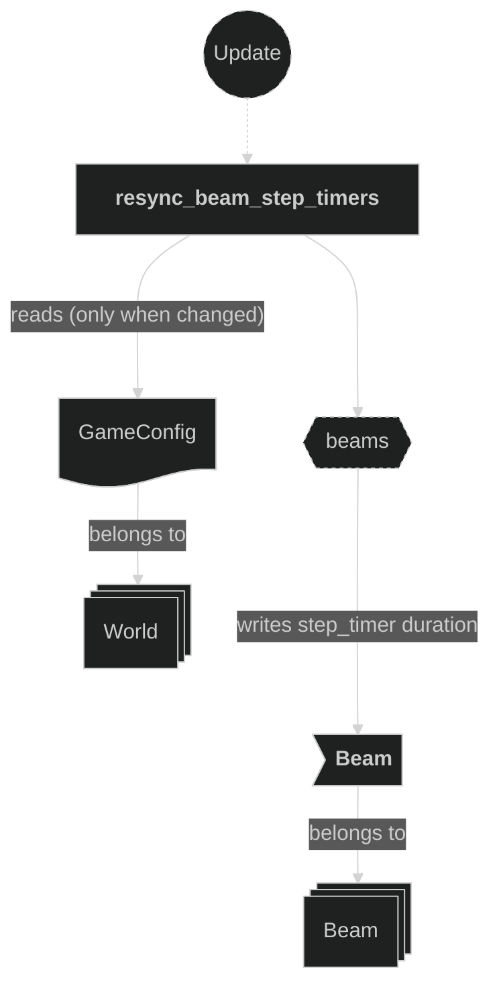

### InFlightBeamCount component lifecycle

- The number of beams that a player has on the board right now.
- Bevy applies the spawn or despawn of a `Beam` entity later. So counting `Beam` entities can give an old number.
- This counter changes in the same system that spawns or ends the beam. Every system that reads it after that gets the right number.
- **Inserted** at 0 by `initialize_players` (Maps plugin).
- **Increased** by `spawn_beam` when a beam spawns. **Decreased** by `beam_step` (through `end_beam`) on the caster.
- **Reset** to 0 by `reset_round` (Round plugin).
- **Read** by `animate_charges_bar` (HUD), so a beam still in flight counts in the charges bar.
- **Read** by `resolve_charge_exhaustion` (Round), to wait until no beam is in flight before ending the round.

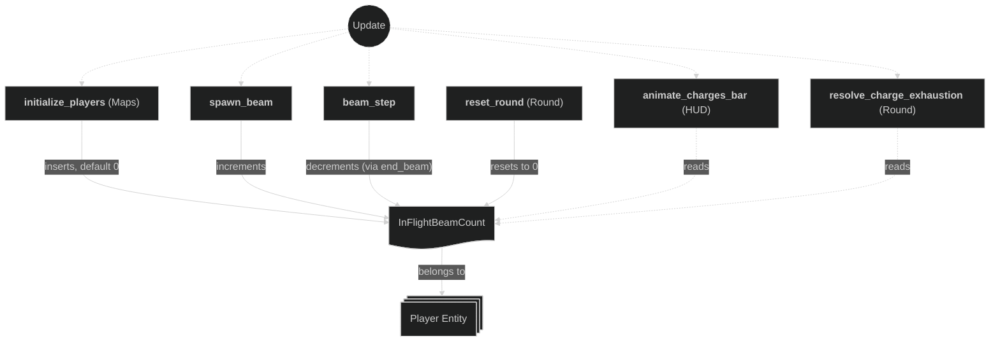
